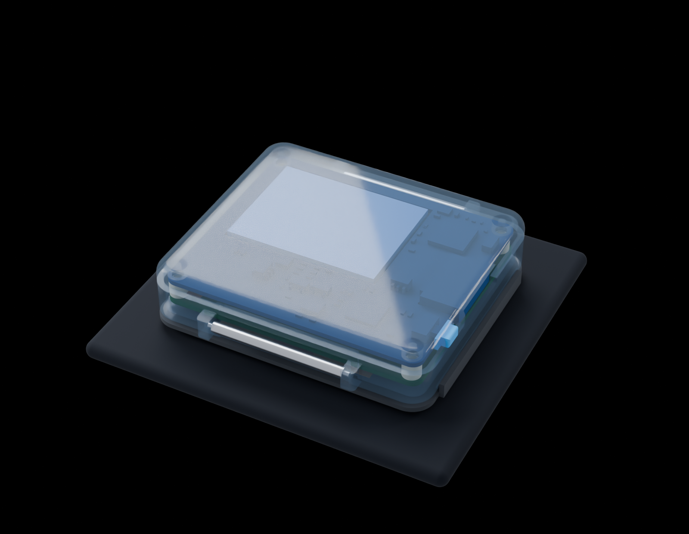
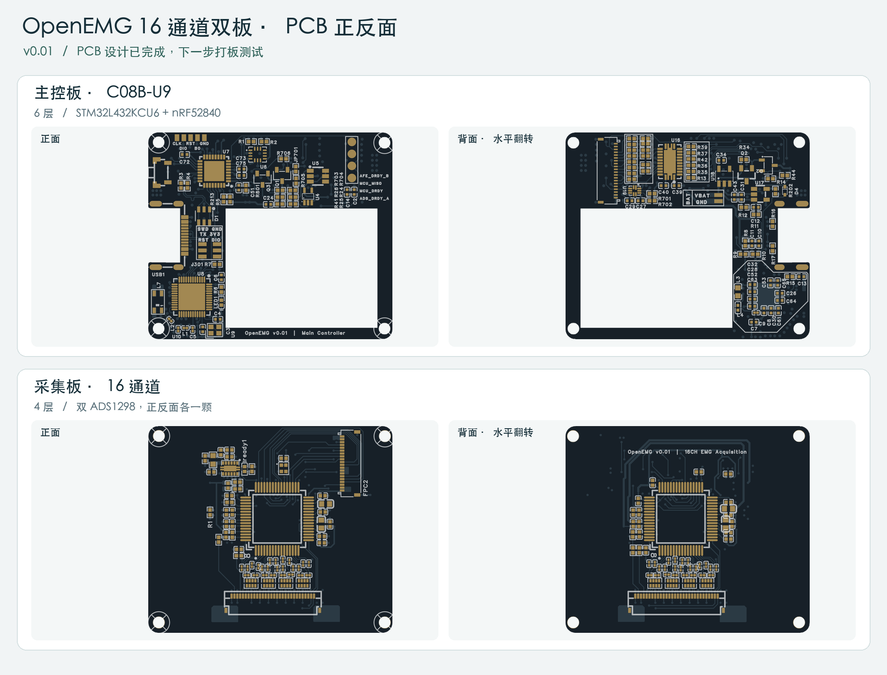
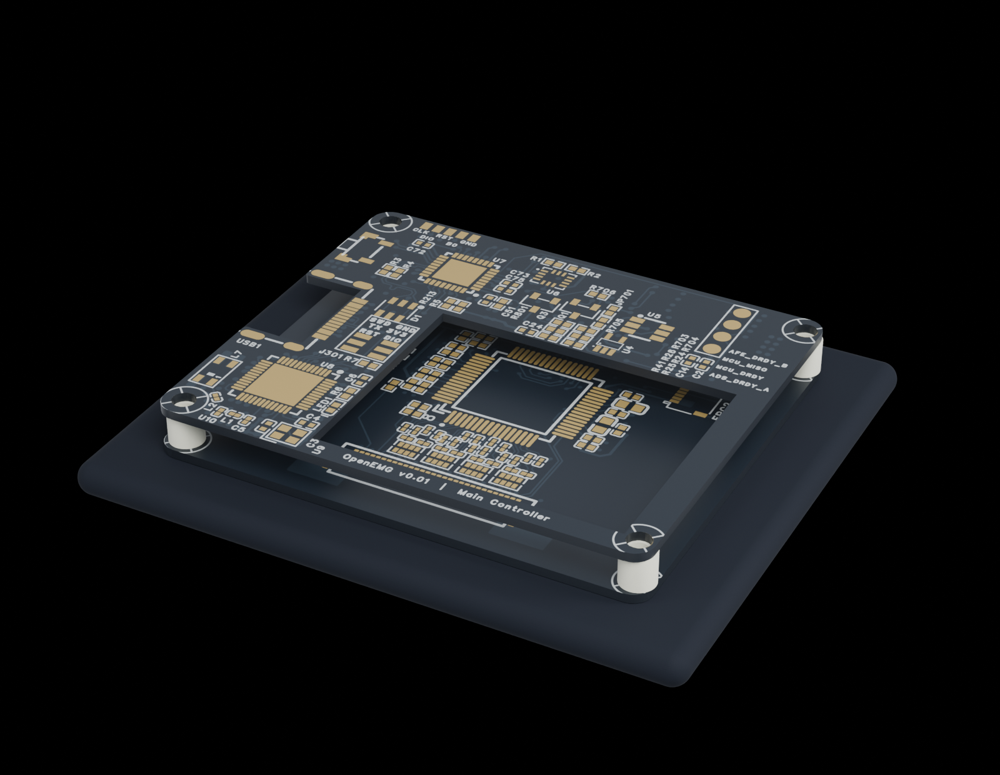
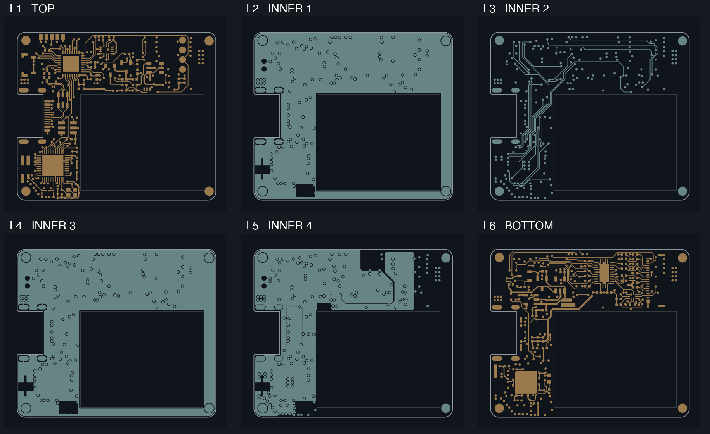
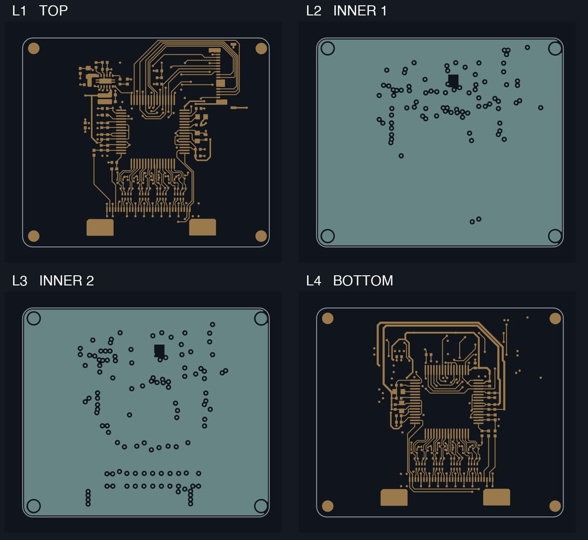
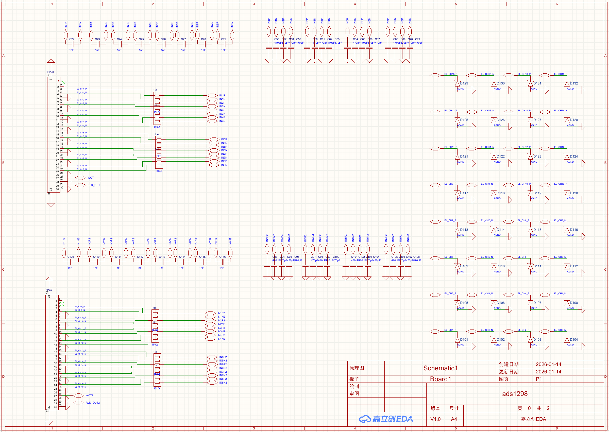

# OpenEMG

[简体中文](README.md) · **English**

OpenEMG is an open-source **16-channel surface EMG wristband**. Our goal is to recognize hand gestures from muscle activity measured at the wrist. The desktop app displays waveforms, records labeled movements, and trains gesture models.

We want to do for EMG what DeepSeek did for AI: share the circuit, mechanical design, firmware, and desktop software so others can build a board and train a model on their own data.

[Status and roadmap](#status-and-roadmap) · [Gallery](#gallery) · [How it works](#how-it-works) · [Desktop app](#desktop-app)

**v0.01 is an early prototype.** A 20-pin ribbon cable connects the six-layer controller board to the four-layer acquisition board. Two ADS1298 chips provide 16 differential inputs. [Design and fabrication files](hardware/16ch-afe-hirose-1mm-1nf/)

## Gallery

### Controller and acquisition PCBs

**PCB design is complete. Fabrication, assembly, and first power-on are next.** We have no bench measurements for this board pair yet.

The views come from the production Gerbers. The right column shows each board as seen from the back. [Board files](hardware/16ch-afe-hirose-1mm-1nf/) · [Controller with components](hardware/renders/v001-mcu-front.png) · [Acquisition board with components](hardware/renders/v001-afe-front.png)

### Mechanical assembly

| Controller above the acquisition board | Exploded view of the boards and U9 enclosure |
|---|---|
|  |  |

These renders show the 0.8 mm bare-board configuration. The exploded view omits components, cable, and battery. Physical fit still needs testing. [Enclosure CAD](hardware/16ch-u9-dual30/enclosure-u9-watch/) · [Earlier enclosure and strap designs](hardware/renders/)

### Copper layers and schematics

| Controller · six layers | Acquisition board · four layers |
|---|---|
|  |  |

Read left to right, then top to bottom. All copper layers are viewed from above so you can follow traces through vias. [Controller Gerbers and drill files](hardware/16ch-afe-hirose-1mm-1nf/Gerber_C08B-U9_v0.01.zip) · [Acquisition Gerbers and drill files](hardware/16ch-afe-hirose-1mm-1nf/Gerber_AFE-30P.zip)

Sheets 1–5 cover controller power, Bluetooth, USB, inter-board connections, and the sampling MCU. Sheets 6–7 cover analog power, acquisition, electrode connectors, and input filters. [Searchable schematic PDF](hardware/16ch-afe-hirose-1mm-1nf/views/schematic.pdf) · [Editable EasyEDA Pro project](hardware/16ch-afe-hirose-1mm-1nf/OpenEMG_v0.01_DualBoard.epro2)

| Assembly files | Controller | Acquisition board |
|---|---|---|
| Bill of materials | [Controller BOM](hardware/16ch-u9-dual30/fab-mcu-u9/jlc_smt_bom.csv) | [Acquisition BOM](hardware/16ch-afe-hirose-1mm-1nf/jlc_smt_bom.csv) |
| Pick-and-place coordinates | [Controller CPL](hardware/16ch-u9-dual30/fab-mcu-u9/jlc_smt_cpl.csv) | [Acquisition CPL](hardware/16ch-afe-hirose-1mm-1nf/jlc_smt_cpl.csv) |

This acquisition board is for off-body bench testing. Check board thickness, via-in-pad requirements, stencil details, and bottom-side orientation before ordering. [Fabrication notes](hardware/16ch-afe-hirose-1mm-1nf/) · [Safety before power-on or wear](SAFETY.md)

## How it works

A pinch produces small voltage changes at the skin. Each channel measures the voltage difference between two electrodes. Pairs at different positions see different waveforms from the same movement. The app saves waveforms alongside gesture labels so a model can learn to distinguish a pinch from rest.

Taking the band off and putting it back on changes electrode position and pressure. One four-channel study correctly classified 152 of 160 trials across four movements: making a fist, opening the hand, and flexing or extending the wrist. The paper does not say whether participants put the band on again before testing. We plan to train and test on separate wear sessions. [Research notes and paper](docs/research/wrist-semg.md)

## Status and roadmap

**November 15, 2026.** The v0.01 design and manufacturing files are public. Once the boards are fabricated and assembled, we will check power and communication before testing each input on the bench.

| Step | Test | What we will record |
|---|---|---|
| 1. Bring up both boards | Verify cable orientation, power, and communication. Apply a known signal to each input. | Channel mapping, waveform, shorted-input noise, and dropped frames. |
| 2. Check desktop playback | Replay bench recordings in the 2-, 8-, and 16-channel configurations. | Channel count and labels match the input, and saved files reopen correctly. |
| 3. Test after refitting the band | After wear safety checks, train on one wear session and test on another. | Results for rest, activation, and four swipe directions, plus false triggers at rest. |

### Desktop app

View waveforms, record movements, and train gesture models. [App source](app/)

### Hardware variants

| Channels | Design and firmware | Mechanics | Status |
|---|---|---|---|
| **16** | [Dual Hirose 30-pin](hardware/16ch-u9-dual30/), [v0.01 Hirose 1 nF](hardware/16ch-afe-hirose-1mm-1nf/), [dual XUNPU 30-pin](hardware/16ch-afe-xunpu-2mm-1nf/), [dual 34-pin](hardware/16ch-c08b-round/). [Controller self-test](firmware/c08b-bringup/) · [Dual ADS1298 firmware](firmware/c08b-stream/) | [U9 enclosure](hardware/16ch-u9-dual30/enclosure-u9-watch/) | Priority build. Hirose assembly checked in CAD. Fabrication and 16-channel bench testing are next. The XUNPU variant has a separate [bias circuit review](hardware/16ch-afe-xunpu-2mm-1nf/#待工程师确认). |
| **8** | [D20 wristband](hardware/8ch-ads1298/afe-d20-8ch/), [R01 bench board](hardware/8ch-ads1298/r01-bench/). [Wristband firmware](firmware/c08b-stream/) · [R01 Bluetooth firmware](hardware/8ch-ads1298/r01-bench/firmware-f05-ble-dout/) | [R12 enclosure](hardware/enclosure-46x40/c08b-shell-r12/) · [D2 electrode flex](hardware/8ch-ads1298/strap-fpc-d2-8ch/) | R01 recorded 1,187,774 consecutive frames in 10 minutes with shorted inputs. The D20 wristband still needs an assembled test. |
| **2** | [ADS1292 six-contact board](hardware/2ch-ads1292/) · [XIAO Bluetooth firmware](firmware/xiao-ads1292-2ch/) | [R7 enclosure](hardware/enclosure-46x40/ads1292-shell-r7/) | Design checked. Fabrication and power-on pending. |

## Getting started

[Desktop app](app/) · [Development environment](firmware/software.md) · [Hardware index](hardware/README.md) · [Safety notes](SAFETY.md)

[Software license (MIT)](LICENSE) · [Hardware license (CERN-OHL-S-2.0)](LICENSE-HARDWARE) · [Third-party notices](THIRD_PARTY_NOTICES.md)
