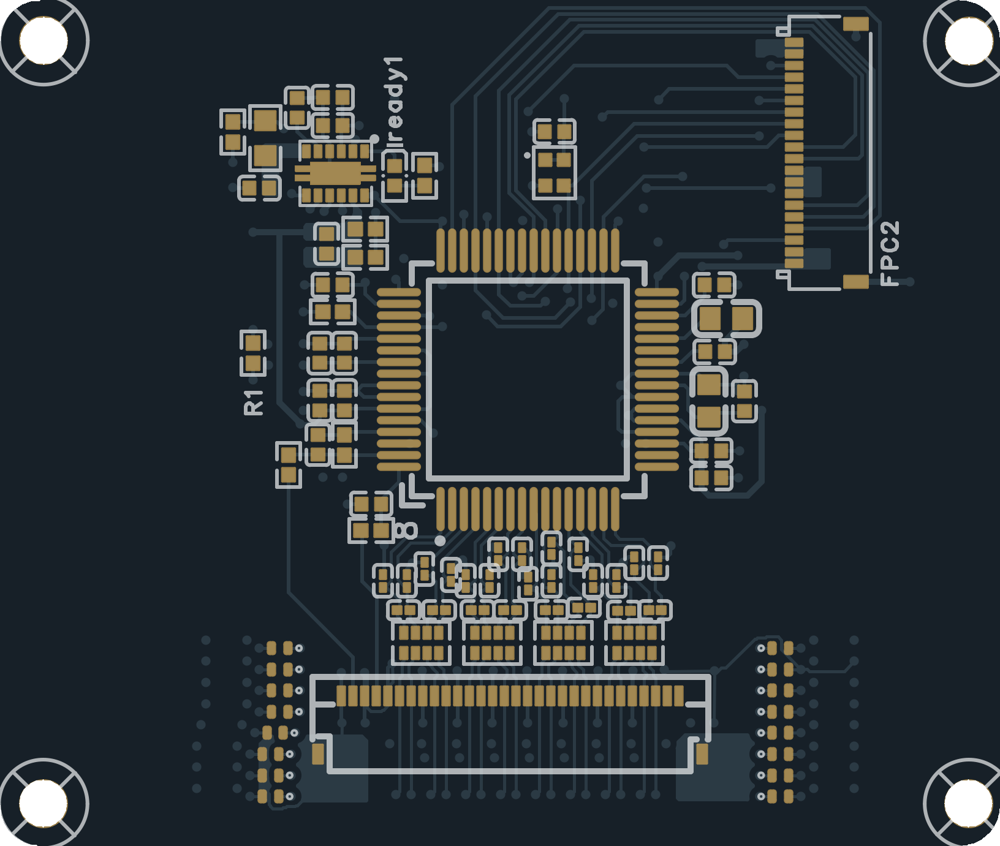
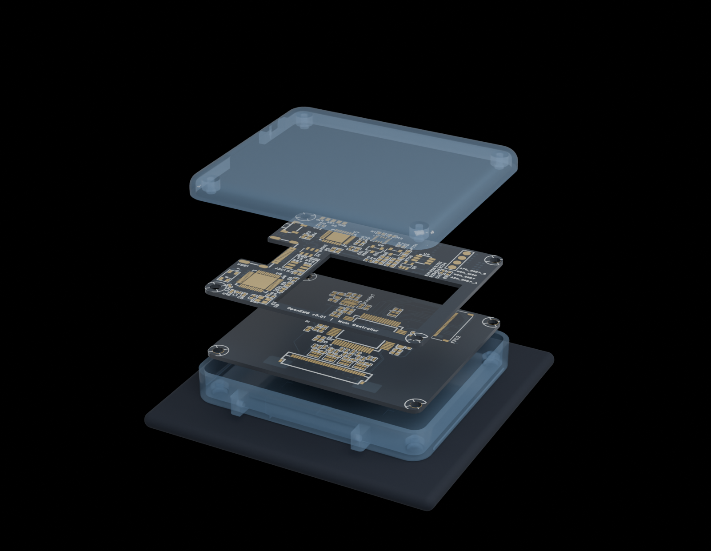
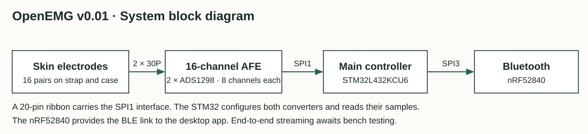
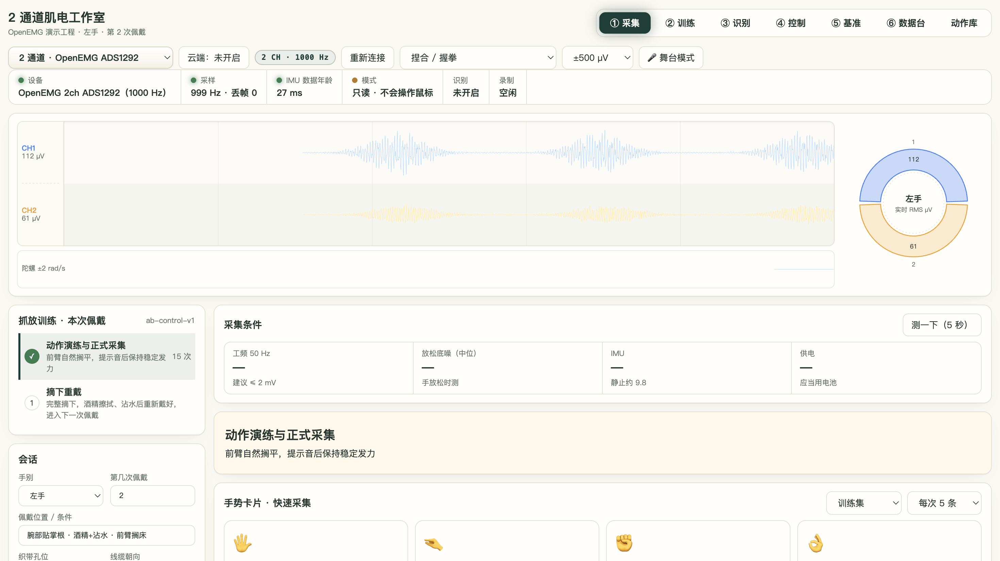

# OpenEMG

[简体中文](README.md) · **English**

OpenEMG is an open-source **16-channel surface EMG wristband**. Our goal is to recognize hand gestures from muscle activity measured at the wrist. The desktop app displays waveforms, records labeled movements, and trains gesture models.

We want to do for EMG what DeepSeek did for AI: share the circuit, mechanical design, firmware, and desktop software so others can build a board and train a model on their own data.

We develop OpenEMG together with AI. It’s still early, and the circuits, code, and documentation will have mistakes. If you spot one, please [open an issue](https://github.com/makoshan/OpenEMG/issues). If you have a code fix, a circuit change, or measurements that tell a different story, [send a pull request](https://github.com/makoshan/OpenEMG/pulls) so others can build on your work.

[Status and roadmap](#status-and-roadmap) · [Gallery](#gallery) · [How it works](#how-it-works) · [Desktop app](#desktop-app)

| Front · U9 case and PCBs | Skin side · metal contacts |
|---|---|
|  |  |

The outside follows the R13 strap design. The skin side shows the dual 30-pin flex layout. The 24 round contacts on the long strap, four on the short strap and four under the case form 16 differential pairs. Two square auxiliary contacts sit under the case. A physical fit test is still pending. [Strap models](hardware/enclosure-46x40/c08b-shell-r13-notch/) · [Dual 30-pin electrode flex circuits](hardware/16ch-u9-dual30/strap-fpc-30p/)

**OpenEMG is in early development.** The November 15, 2026 PCB revision is ready for prototyping. Firmware, desktop integration, and gesture recognition are still in development. The 16-channel system has yet to be tested on hardware.

> [!IMPORTANT]
> **Human-Reviewed Boards Ready to Order vs. AI-Generated Unordered Designs**
> - **16-channel `v0.01` dual-board set (Human-engineered & reviewed · Ready to order)**: The 6-layer `C08B-U9` controller and 4-layer `AFE-30P` acquisition board in [`hardware/16ch-afe-hirose-1mm-1nf/`](hardware/16ch-afe-hirose-1mm-1nf/) (with 32 `ESD401DPYR` input protection diodes and 146 SMT placements) were designed and laid out by a human hardware engineer, audited pin-by-pin against the TI `ADS1298` datasheet and `SBAU171D` EVM user's guide, and cleared for prototype fabrication.
> - **All other boards, electrode FPCs, and 3D enclosures (AI-generated · Unreviewed · Not yet ordered)**: The **2-channel `ADS1292` board**, **8-channel `D20-8CH` wristband board**, **16-channel dual 34-pin (`D20/R4U6`) and `22 pF` wearable (`16ch-u9-dual30`) variants**, **XUNPU `2.0 mm` variant**, **all flexible electrode FPCs**, and **all 3D-printed enclosure models** were generated by AI, have not been reviewed by a human engineer, and **have not been ordered** (only the earlier 8-channel [`V12-R01`](hardware/8ch-ads1298/r01-bench/) bench board has been physically built and tested with shorted inputs). Perform your own independent engineering review before fabricating any AI-generated variant.

A 20-pin ribbon cable connects the six-layer controller board to the four-layer acquisition board. Two ADS1298 chips provide 16 differential inputs. [Human-reviewed design and fabrication files](hardware/16ch-afe-hirose-1mm-1nf/)

## Gallery

### Controller and acquisition PCBs

**PCB design is complete. Fabrication, assembly, and first power-on are next.** The acquisition board has 32 ESD protection diodes (D101–D132), one per input lead. The BOM and placement file cover 146 components.

| Board | Front | Back |
|---|---|---|
| C08B-U9 controller |  |  |
| 16-channel acquisition board |  |  |

The views come from the production Gerbers. The right column shows each board as seen from the back. [Board files](hardware/16ch-afe-hirose-1mm-1nf/) · [Controller with components](hardware/renders/v001-mcu-front.png) · [Acquisition board with components](hardware/renders/v001-afe-front.png)

### Mechanical assembly

| Controller above the acquisition board | Exploded view of the boards and U9 enclosure |
|---|---|
|  |  |

These renders show the 0.8 mm bare-board configuration. The exploded view omits components, cable, and battery. Physical fit still needs testing. [Enclosure CAD](hardware/16ch-u9-dual30/enclosure-u9-watch/) · [Earlier enclosure and strap designs](hardware/renders/)

### Copper layers and schematics

| Controller · six layers | Acquisition board · four layers |
|---|---|
|  |  |

Read left to right, then top to bottom. All copper layers are viewed from above so you can follow traces through vias. [Controller Gerbers and drill files](hardware/16ch-afe-hirose-1mm-1nf/Gerber_C08B-U9_v0.01.zip) · [Acquisition Gerbers and drill files](hardware/16ch-afe-hirose-1mm-1nf/Gerber_AFE-30P.zip)

Sheet 1 shows the system block diagram and sheet 2 shows the power tree. Sheets 3–7 cover controller power, Bluetooth, USB, inter-board connections, and the sampling MCU. Sheets 8–9 cover analog power, acquisition, electrode connectors, and input filters. [Searchable schematic PDF](hardware/16ch-afe-hirose-1mm-1nf/views/schematic.pdf) · [Editable EasyEDA Pro project](hardware/16ch-afe-hirose-1mm-1nf/OpenEMG_v0.01_DualBoard.epro2) · [Native KiCad 8 project (dual-board PCBs & 9-page schematics)](hardware/16ch-afe-hirose-1mm-1nf/kicad/)

| Assembly files | Controller | Acquisition board |
|---|---|---|
| Bill of materials | [Controller BOM](hardware/16ch-u9-dual30/fab-mcu-u9/jlc_smt_bom.csv) | [Acquisition BOM](hardware/16ch-afe-hirose-1mm-1nf/jlc_smt_bom.csv) |
| Pick-and-place coordinates | [Controller CPL](hardware/16ch-u9-dual30/fab-mcu-u9/jlc_smt_cpl.csv) | [Acquisition CPL](hardware/16ch-afe-hirose-1mm-1nf/jlc_smt_cpl.csv) |

This acquisition board is for off-body bench testing. Check board thickness, via-in-pad requirements, stencil details, and bottom-side orientation before ordering. [Fabrication notes](hardware/16ch-afe-hirose-1mm-1nf/) · [Safety before power-on or wear](SAFETY.md)

## How it works

A pinch produces small voltage changes at the skin. Each channel measures the voltage difference between two electrodes. Pairs at different positions see different waveforms from the same movement. The app saves waveforms alongside gesture labels so a model can learn to distinguish a pinch from rest.

[View the nine schematic sheets](hardware/16ch-afe-hirose-1mm-1nf/views/schematic.pdf)

Taking the band off and putting it back on changes electrode position and pressure. One four-channel study correctly classified 152 of 160 trials (95%) across four movements: making a fist, opening the hand, and flexing or extending the wrist. The paper does not say whether participants put the band on again before testing. We plan to train and test on separate wear sessions. [Research notes and paper](research/wrist-semg.md)

Together with literature review and bench measurements on our earlier 8-channel [`V12-R01`](hardware/8ch-ads1298/r01-bench/) board, these findings shaped the `v0.01` hardware and software pipeline:

| Area | Evidence & prior finding | Design choice in OpenEMG `v0.01` & Studio |
|---|---|---|
| **Reference bias & noise floor** | `V12-R01` measured **`2.8 µV`** shorted-input noise and **`1,187,774` consecutive zero-drop frames** over 10 min; without a reference electrode on skin, 50 Hz common-mode saturated at `10 mV` | Dedicated `BIAS / REF` contacts driven solely by `U1` through `392 kΩ` (`U2` bias left open to avoid op-amp contention), paired with a **5-second rest signal check** (`p95 > 150 µV` blocks calibration; `> 40%` 50 Hz ratio flags poor reference contact) |
| **Dual-ADC sync & sample rate** | Informed by ETH Zurich BioGAP-Ultra dual-`ADS1298` architecture and the `20–450 Hz` sEMG band | Both `ADS1298` chips share a single `2.048 MHz` oscillator at **`1000 SPS`** (with desktop support for `2000 SPS` commercial wristbands) |
| **Cross-wear features & model** | Same-wear accuracy overstates real usability; per-channel z-score erases spatial amplitude ratios across refits | Per-channel z-score is avoided; **`250 ms` five-band log bandpower (`bands5`: `20–45`, `55–95`, `105–145`, `155–245`, `255–445 Hz`) + Shrinkage LDA** is evaluated strictly with **leave-one-wear-out** splits |
| **Off-mains safety interlock** | Direct USB connection introduces mains fault-current risk | Hardware `VBUS` detection pulls `AFE_OE_N` high to cut analog power (`JP701` DNP by default), and software keeps `record: false` locked on unverified `c08b-16ch / 8ch / 2ch` profiles |

## Status and roadmap

**November 15, 2026.** The 16-channel v0.01 board design is ready for prototyping. The editable project, schematics, Gerbers, and assembly files are public. The firmware has passed host-side tests, and the desktop app can display 16 demo traces. **We have no measurements from this assembled system yet. The next milestone is a continuous bench recording of known signals on all 16 inputs.**

#### Before the boards arrive

| Work | What remains |
|---|---|
| Fabrication and assembly | Build from the November 15 package. Check board thickness, via-in-pad treatment, and stencil openings. Review both assembly sides for the two ADS1298 chips, three ribbon connectors, and 32 protection diodes. |
| Firmware adaptation | [`c08b-bringup`](firmware/c08b-bringup/) and [`c08b-stream`](firmware/c08b-stream/) are aligned and verified against the `v0.01` dual-board netlist (`INT_TEST=1` on both chips for independent `TESTP/TESTN` pins, `RLD_MEAS=0` / no `MUX=010` for `RLDIN=+2.5 V`, `RLDREF_INT=0` for `RLDREF=AGND`, and online `500/1000/2000 SPS` + hardware-guarded `ADS1298` `RREG/WREG` tuning over BLE or USB receiver — see [transport & inter-board protocol](firmware/transport-protocol.md)), ready for first-board flashing. |
| Bench setup | Prepare the 20-pin cable, adapters, and an off-body signal source. Map the input pins to CH1–CH16 in the app and prepare shorted-input, known-signal, and stream-interruption tests. |

#### When the boards arrive: bench tests first

| Work | Evidence to collect |
|---|---|
| Inspection and power | Check component orientation, cable pin 1 at both ends, and continuity. Measure digital and analog rails, reference voltage, startup timing, and ripple. Test the acquisition power interlock with USB connected. |
| Board communication | Read the ID and registers of each ADS1298 separately. Observe both data-ready signals and verify the ordering of the two eight-channel groups. |
| Analog acquisition | Measure shorted-input noise on every channel, then inject a known signal into one input at a time. Record gain, polarity, mains interference, and adjacent-channel crosstalk. Test bias output with a simulated load. |
| Wireless link and desktop recording | Measure sample rate, dropped frames, and latency during a continuous hardware run. View, label, save, close, and replay a recording. Disconnect mid-run and check file integrity and whether the gap is visible. Run separate compatibility checks for 2 and 8 channels. |
| Enclosure, flex, and battery | Fit both boards and the cell. Insert the 20-pin cable and both 30-pin flex tails. Check latch access and cable clearance with the lid closed. Measure power draw, temperature rise, and runtime. |

#### After bench validation: wear and gesture tests

| Work | Evidence to collect |
|---|---|
| Before wear | Review electrode connections, current-limiting paths, battery power, and the charging interlock before scheduling wear tests. [Safety notes](SAFETY.md) |
| Electrode contact and data | Record band position and tightness. Compare each channel at rest, during movement, and after refitting. Keep gesture labels and wear-session IDs so intermittent contact can be traced. |
| Gesture recognition | Start with rest, activation, and four swipe directions. Train on one wear session and test on another. Report results per gesture, response time, and false triggers at rest. |
| Reproducing a build | Publish assembly photos, firmware versions, desktop connection instructions, and first-board measurements. Have another developer follow the public files through assembly and recording and document where they get stuck. |

### Desktop app (16 / 8 / 2 channels)

OpenEMG Studio supports **16-channel (`OpenEMG Dual ADS1298 · 1000 Hz`)**, **8-channel (`WL8 2000 Hz` / `OpenEMG Single ADS1298 1000 Hz`)**, and **2-channel (`OpenEMG ADS1292 · 1000 Hz`)** workflows from a single device switcher, automatically adapting waveform lanes, the radial electrode ring, isolated project folders, and feature extraction. Before recording, a 5-second rest check inspects unfiltered `50 Hz` mains pickup alongside `50 Hz` notched + `20–450 Hz` bandpass display traces, followed by leave-one-wear-out evaluation and the built-in 3D sEMG game *Palm Tribulation*. [App source and setup](app/)

| 16-channel studio (`Dual ADS1298 · 16 CH · 1000 Hz`) | 8-channel calibration capture (`8 CH · 2000 Hz`) |
|---|---|
|  |  |
| **2-channel entry studio (`ADS1292 · 2 CH · 1000 Hz`)** | **Cross-wear evaluation (`93%` leave-one-wear-out + learning curve)** |
|  |  |
| **Live recognition dashboard (`0.65` threshold + rest gate)** | **Built-in 3D sEMG game (*Palm Tribulation*)** |
|  |  |

The 16-channel and 2-channel views above run on synthetic bench streams; recording remains hardware-locked (`record: false`) on `c08b-*` profiles until physical board safety checks pass.

### Hardware variants

Our immediate priority is fabricating and bench-testing the **human-reviewed 16-channel `v0.01` dual-board set**; all other AI-generated 16-, 8-, and 2-channel variants, FPCs, and enclosures remain unreviewed and unordered.

| Channels | Design and firmware | Mechanics (AI-generated · Unordered) | Review & build status |
|---|---|---|---|
| **16** | **[v0.01 Hirose 1 nF dual-board (Human-reviewed)](hardware/16ch-afe-hirose-1mm-1nf/)**, [Hirose 22 pF wearable (AI)](hardware/16ch-u9-dual30/), [XUNPU 30-pin (AI)](hardware/16ch-afe-xunpu-2mm-1nf/), [dual 34-pin (AI)](hardware/16ch-c08b-round/). [Controller self-test](firmware/c08b-bringup/) · [Dual ADS1298 firmware](firmware/c08b-stream/) | [U9 enclosure](hardware/16ch-u9-dual30/enclosure-u9-watch/) · [Dual 30-pin FPC](hardware/16ch-u9-dual30/strap-fpc-30p/) | **`v0.01` dual-board set is human-reviewed and ready to order** for 16-channel bench validation. Other 16-ch variants, FPCs, and enclosures are AI-generated and not yet ordered (XUNPU has an open [bias circuit review](hardware/16ch-afe-xunpu-2mm-1nf/#待工程师确认)). |
| **8** | [D20-8CH wristband (AI)](hardware/8ch-ads1298/afe-d20-8ch/) · [11-page schematic PDF](hardware/8ch-ads1298/afe-d20-8ch/views/schematic.pdf) · [34P/20P pinout & review](hardware/8ch-ads1298/afe-d20-8ch/PINOUT-AND-REVIEW.md), [R01 bench board (Tested)](hardware/8ch-ads1298/r01-bench/). [Wristband firmware](firmware/c08b-stream/) · [R01 Bluetooth firmware](hardware/8ch-ads1298/r01-bench/firmware-f05-ble-dout/) | [R12 enclosure](hardware/enclosure-46x40/c08b-shell-r12/) · [D2-8CH electrode FPC](hardware/8ch-ads1298/strap-fpc-d2-8ch/) | Historical `R01` bench board recorded `1,187,774` consecutive frames in 10 min (`2.8 µV` shorted noise). `D20-8CH` 11-page schematics, 34P/20P pinout table, and orientation diagrams are prepared; **awaiting independent human engineering review**, not yet ordered. |
| **2** | [ADS1292 six-contact board (AI)](hardware/2ch-ads1292/) · [3-page schematic PDF](hardware/2ch-ads1292/views/schematic.pdf) · [6-contact polarity & review](hardware/2ch-ads1292/PINOUT-AND-REVIEW.md) · [XIAO Bluetooth firmware](firmware/xiao-ads1292-2ch/) | [R7 enclosure](hardware/enclosure-46x40/ads1292-shell-r7/) | 3-page schematics, 6-contact skin-side vs. top-view polarity table, and 8-test-point checklist prepared (automated DRC passed); **awaiting independent human engineering review**, not yet ordered. |

## Getting started

[Desktop app](app/) · [Development environment](firmware/software.md) · [Transport protocol](firmware/transport-protocol.md) · [Hardware index](hardware/README.md) · [Safety notes](SAFETY.md)

[Software license (MIT)](LICENSE) · [Hardware license (CERN-OHL-S-2.0)](LICENSE-HARDWARE) · [Third-party notices](THIRD_PARTY_NOTICES.md)
