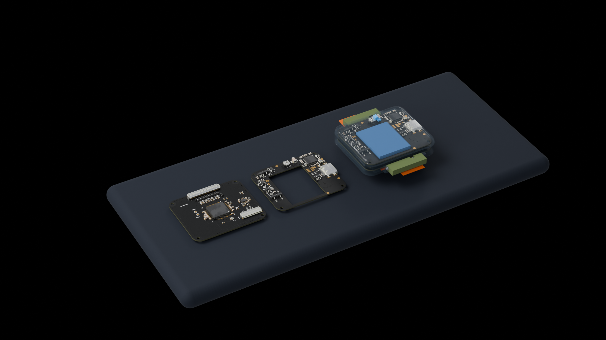
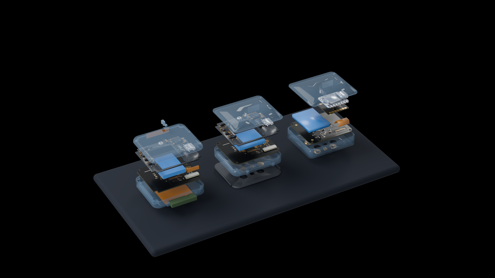
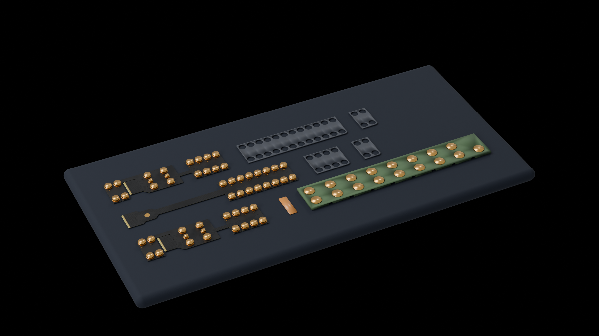
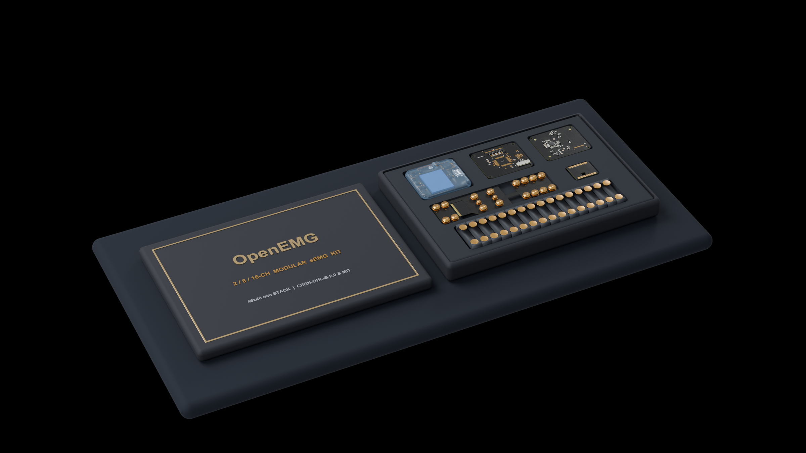
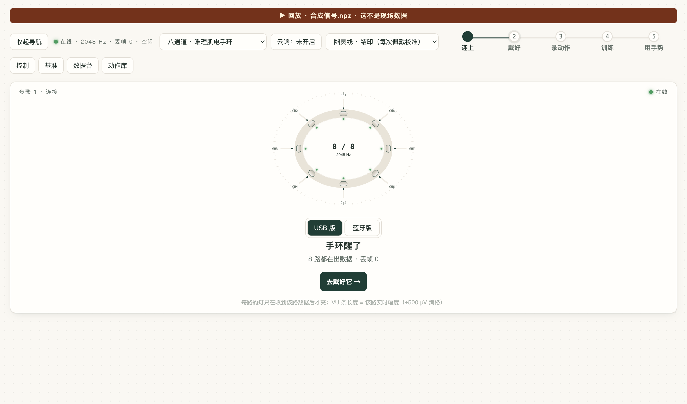

# OpenEMG

OpenEMG 是一个硬件和软件完全开源的表面肌电（sEMG）项目。我们从一只手环开始，研究一个具体的问题：手指轻轻一捏，能不能只凭手腕上的肌电信号把这个动作认出来？

**我们的愿景是做肌电界的 DeepSeek。** 希望学生、研究者和独立开发者都能从一套公开的设计开始做肌电实验。你可以照着原理图做一块采集板，打开固件看每个采样点怎么传到电脑，再用桌面工作台给自己的动作打标签，训练自己的手势分类器。下一位开发者可以换一种电极布局、试一种识别算法，和原方案比较，把改进留给后来的人。

**最新板稿 · OpenEMG v0.01**　6 层 C08B-U9 主控板通过 20 针排线连接 4 层采集板，两颗 ADS1298 共提供 16 路差分采集。嘉立创专业版工程包含两块 PCB 和 7 页原理图，目录内附主控板与采集板各自的 Gerber。这一版用于离体台架，整机采集待实测。[打开双板工程与制造文件](hardware/16ch-afe-hirose-1mm-1nf/)

## 三种通道配置

查看单张大图　[2 通道](hardware/renders/2ch-iso-dark.png) · [8 通道](hardware/renders/8ch-iso-dark.png) · [16 通道](hardware/renders/16ch-iso-dark.png)

| 通道 | 硬件工程 | 固件 | 3D 外观 | 实板测试进展 |
|---|---|---|---|---|
| **2 通道** | [ADS1292 六触点板](hardware/2ch-ads1292/) | [XIAO 蓝牙采集](firmware/xiao-ads1292-2ch/) | [R7 六触点外壳](hardware/enclosure-46x40/ads1292-shell-r7/) | 已完成设计检查，待打样、上电。 |
| **8 通道** | [D20-8CH 腕带板](hardware/8ch-ads1298/afe-d20-8ch/) · [R01 台架板](hardware/8ch-ads1298/r01-bench/) | [腕带采集](firmware/c08b-stream/) · [R01 蓝牙采集](hardware/8ch-ads1298/r01-bench/firmware-f05-ble-dout/) | [R12 外壳](hardware/enclosure-46x40/c08b-shell-r12/) · [D2-8CH 电极软板](hardware/8ch-ads1298/strap-fpc-d2-8ch/) | R01 实板短接输入采集 10 分钟，1,187,774 帧序号连续。D20-8CH 腕带待装机实测。 |
| **16 通道** | [广濑双 30 针](hardware/16ch-u9-dual30/) · [v0.01 双板与广濑 1 nF](hardware/16ch-afe-hirose-1mm-1nf/) · [讯普双 30 针](hardware/16ch-afe-xunpu-2mm-1nf/) · [双 34 针](hardware/16ch-c08b-round/) | [主控自检](firmware/c08b-bringup/) · [双 ADS1298 采集](firmware/c08b-stream/) | [U9 广濑版手表壳](hardware/16ch-u9-dual30/enclosure-u9-watch/) | 广濑版已核对数字装配，待整机采集实测。讯普版有 3 个位号待工程师确认。 |

## 结构与装配

下面的设计渲染展示不同代际的结构。左图是 D20 采集板与 R4U6 主控的叠装方式，右图展示 2、8、16 通道方案的装配层次。复刻 v0.01 时请使用上方双板工程核对板形和接口。

| D20 与 R4U6 叠装 | 三档方案的爆炸图 |
|---|---|
|  |  |
| **柔性电极与表带** | **干电极与底盖** |
|  |  |

查看套件收纳设计

[全部渲染图、俯视图与生成脚本](hardware/renders/)

## 桌面工作台

八通道连接页用圆环显示每个通道是否收到数据。顶部可依次进入佩戴检查、动作录制、训练和手势识别。截图使用合成信号回放。

## 开始使用

[桌面工作台](app/) · [软件与开发环境](firmware/software.md) · [硬件与制造文件索引](hardware/README.md) · [通电与佩戴安全须知](SAFETY.md)

[软件许可 MIT](LICENSE) · [硬件许可 CERN-OHL-S-2.0](LICENSE-HARDWARE) · [第三方声明](THIRD_PARTY_NOTICES.md)
