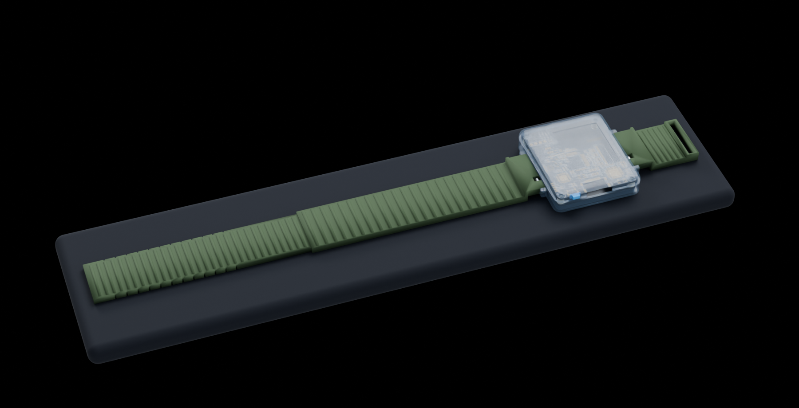
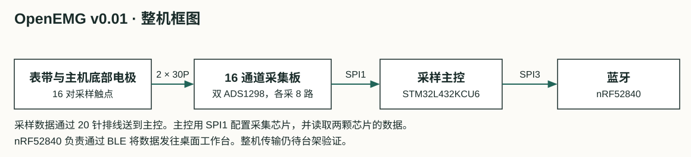
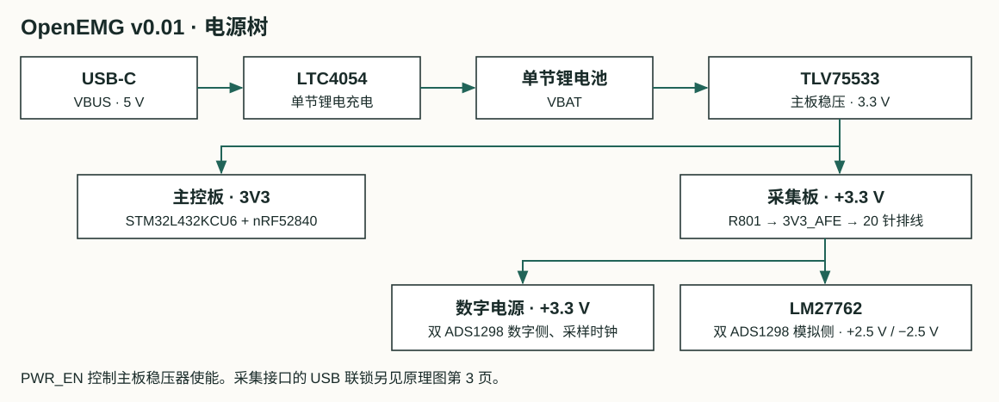

# OpenEMG

**简体中文** · [English](README.en.md)

OpenEMG 是一个 **16 通道开源肌电手环**项目。我们想用腕部的表面肌电信号识别手势。桌面软件可以查看各通道波形、录制动作和训练模型。

我们想做肌电界的 DeepSeek。电路、结构、固件和桌面软件全部开源，谁都可以照着做一块板，用自己的数据训练模型。

OpenEMG 由人和 AI 共同研发。项目还在早期，电路、代码和文档里难免有错。如果你发现问题，欢迎[提 issue](https://github.com/makoshan/OpenEMG/issues)。如果你改好了代码、电路，或测出了不同的结果，也欢迎[提交 PR](https://github.com/makoshan/OpenEMG/pulls)，让其他人能复用你的工作。

[当前状态与进展计划](#当前状态与进展计划) · [Gallery](#gallery) · [工作原理与调研](#工作原理) · [桌面工作台](#桌面工作台)

| 正面 · U9 外壳与双板 | 贴肤面 · 金属电极触点 |
|---|---|
|  |  |

外观沿用 R13 表带，贴肤面按双 30 针电极软板布局绘制。长带 24 个、短带 4 个、主机底部 4 个圆形采样触点，共组成 16 对差分输入。底部另有 2 个方形辅助触点。这套组合尚待实物试装。 [表带模型](hardware/enclosure-46x40/c08b-shell-r13-notch/) · [双 30 针电极软板](hardware/16ch-u9-dual30/strap-fpc-30p/)

**OpenEMG 还在早期研制阶段。** 2026 年 11 月 15 日定下的是打样用的 PCB。固件、桌面软件与板子的联调、手势识别都还在开发，16 通道整机尚未上机验证。

6 层主控板通过 20 针排线连接 4 层采集板。采集板用两颗 ADS1298，设计为 16 路差分输入。[打开双板工程与制造文件](hardware/16ch-afe-hirose-1mm-1nf/)

## Gallery

### PCB · 主控与采集板

**v0.01 的 PCB 设计已完成，下一步是打板、贴片和上电测试。** 采集板新增 32 颗输入保护管（D101–D132），贴片 BOM 和坐标表共 146 个位号。

| 板卡 | 正面 | 背面 |
|---|---|---|
| C08B-U9 主控板 |  |  |
| 16 通道采集板 |  |  |

图由同版 Gerber 生成。右列按翻到板背后的方向显示。[双板工程与制造文件](hardware/16ch-afe-hirose-1mm-1nf/) · [主控板元件正视图](hardware/renders/v001-mcu-front.png) · [采集板元件正视图](hardware/renders/v001-afe-front.png)

### 结构与装配

| v0.01 双板叠放 · 主控在上、采集在下 | U9 壳体与 v0.01 双板 · 分层视图 |
|---|---|
|  |  |

装配图按 v0.01 制造文件绘制，采用 0.8 mm 裸板。右图拉开了层间距，省略了元件、排线和电池。实物还没试装。[U9 外壳模型](hardware/16ch-u9-dual30/enclosure-u9-watch/) · [历代结构与表带图集](hardware/renders/)

### 走线与原理图

| C08B-U9 主控板 · 6 层铜箔 | 16 通道采集板 · 4 层铜箔 |
|---|---|
|  |  |

从左到右、从上到下依次是顶层、内层和底层。各层都从板顶看，方便对照走线和过孔。[主控 Gerber 与钻孔](hardware/16ch-afe-hirose-1mm-1nf/Gerber_C08B-U9_v0.01.zip) · [采集板 Gerber 与钻孔](hardware/16ch-afe-hirose-1mm-1nf/Gerber_AFE-30P.zip)

**[下载七页矢量原理图](hardware/16ch-afe-hirose-1mm-1nf/views/schematic.pdf)**。第 1–5 页是主控板的供电、蓝牙、USB、板间接口与采样主控，第 6–7 页是采集板的模拟电源、采集芯片、电极接口与输入滤波。PDF 可放大和搜索位号；修改电路请打开[嘉立创 EDA 专业版双板源工程](hardware/16ch-afe-hirose-1mm-1nf/OpenEMG_v0.01_DualBoard.epro2)。

| 复刻资料 | 主控板 | 采集板 |
|---|---|---|
| 物料清单（BOM） | [主控 BOM](hardware/16ch-u9-dual30/fab-mcu-u9/jlc_smt_bom.csv) | [采集 BOM](hardware/16ch-afe-hirose-1mm-1nf/jlc_smt_bom.csv) |
| 贴片坐标（CPL） | [主控坐标](hardware/16ch-u9-dual30/fab-mcu-u9/jlc_smt_cpl.csv) | [采集坐标](hardware/16ch-afe-hirose-1mm-1nf/jlc_smt_cpl.csv) |

板厚、盘中孔工艺、钢网和底面贴装方向见[同版制造说明](hardware/16ch-afe-hirose-1mm-1nf/)。本版采集板用于离体台架，通电前请阅读[测试与佩戴边界](SAFETY.md)。

## 工作原理

捏指时，肌肉活动会让皮肤表面产生微小的电压变化。手环的每个通道测一对电极之间的电压差。电极位置不同，同一次捏指在各通道上录到的波形也不同。桌面软件把波形和动作标签一起保存，供模型学习区分放松、捏指等动作。

[查看同版七页原理图](hardware/16ch-afe-hirose-1mm-1nf/views/schematic.pdf)

摘下再戴，电极位置和松紧都会变。我们读过的一项四通道实验，在握拳、张手、屈腕和伸腕测试中判对了 152/160 次。论文没说明测试前是否重新佩戴。OpenEMG 计划把训练和测试分在两次佩戴中，单独记录重戴后的识别结果。[阅读项目调研节选与论文出处](research/wrist-semg.md)

## 当前状态与进展计划

**2026-11-15 · 现在做到哪了**　16 通道 v0.01 的双板设计已定，工程、原理图、Gerber 和贴片文件已公开。固件通过了主机端测试，桌面工作台能演示 16 路波形。**这版整机还没有实测数据。最近的目标是让首板在台架上连续采到 16 路已知信号。**

#### 首板回来前

| 工作 | 还要做什么 |
|---|---|
| 打板与贴片 | 用 11 月 15 日定版包打样。核对板厚、盘中孔和钢网，在贴装预览里逐面检查两颗 ADS1298、三只排线座和 32 颗保护管。 |
| 固件适配 | 对照定版原理图检查片选、复位、时钟和偏置配置。新版 RLDIN 接 +2.5 V，两颗芯片的测试脚各自独立，旧版自检配置需要逐项复核。 |
| 测试准备 | 准备 20 针排线、转接线和离体信号源。把每个输入脚对应到桌面的 CH1–CH16，列好短接、已知信号和断流三组测试。 |

#### 样板到手后：先在台架测

| 工作 | 要拿到的结果 |
|---|---|
| 来板与供电 | 核对贴片方向、排线两端的 1 脚和通断。记录数字电源、正负模拟电源、基准电压、启动时序和纹波；验证 USB 插入时采集供电互锁。 |
| 双板通信 | 分别读回两颗 ADS1298 的 ID 和寄存器，观察各自的数据就绪信号，核对两组八路数据的顺序。 |
| 16 路模拟采集 | 先短接输入测各路底噪，再逐路注入已知信号。记录增益、极性、工频干扰和相邻通道串扰；用模拟负载检查偏置输出。 |
| 无线传输与桌面录制 | 真机连续传输，统计采样率、丢帧和延迟。用桌面端看波形、打标签、保存、关闭再回放；断连后检查文件是否完整、间断是否可见。2、8 通道另做兼容回归。 |
| 外壳、软板与电池 | 试装双板和电芯，实插 20 针板间排线和两条 30 针软尾。检查锁扣能否操作、合盖是否夹线，再测采集功耗、温升和续航。 |

#### 台架通过后：再做佩戴与手势验证

| 工作 | 怎样判断进展 |
|---|---|
| 佩戴前检查 | 核对贴肤触点、限流路径、电池供电与充电互锁，完成佩戴安全复核，再安排佩戴采集。[安全说明](SAFETY.md) |
| 电极接触与数据 | 记录佩戴位置和松紧，比较静息、动作、摘下重戴后的各路信号。保留动作标签和佩戴编号，找出容易失去接触的通道。 |
| 手势识别 | 先做放松、唤起和四向滑动六类。用一次佩戴训练，另一次佩戴测试；分别记录各类识别结果、响应时间和静息误触发。 |
| 开源复现 | 补齐装配照片、固件版本、桌面连接步骤和首板测试记录。让另一位开发者按公开文件从装配走到录制，记录卡在哪一步。 |

### 桌面工作台

左侧逐行显示 CH1–CH16 的波形，右侧圆环显示各通道的均方根幅值（RMS，单位 µV）。图中数据来自演示工程。

桌面工作台用于查看波形、录制动作和训练手势模型。[打开软件目录](app/)

### 各版本工程与实测记录

目前优先验证 16 通道双板。8 通道和 2 通道的设计与测试进度列在下表。

| 通道 | 硬件工程 | 固件 | 3D 外观 | 实板测试进展 |
|---|---|---|---|---|
| **16 通道** | [广濑双 30 针](hardware/16ch-u9-dual30/) · [v0.01 双板与广濑 1 nF](hardware/16ch-afe-hirose-1mm-1nf/) · [讯普双 30 针](hardware/16ch-afe-xunpu-2mm-1nf/) · [双 34 针](hardware/16ch-c08b-round/) | [主控自检](firmware/c08b-bringup/) · [双 ADS1298 采集](firmware/c08b-stream/) | [U9 广濑版手表壳](hardware/16ch-u9-dual30/enclosure-u9-watch/) | 广濑版已核对 CAD 装配。v0.01 下一步打板，验证 16 路采集。另一个讯普版的偏置电路仍待定值。[三处改值与接线](hardware/16ch-afe-xunpu-2mm-1nf/#待工程师确认) |
| **8 通道** | [D20-8CH 腕带板](hardware/8ch-ads1298/afe-d20-8ch/) · [R01 台架板](hardware/8ch-ads1298/r01-bench/) | [腕带采集](firmware/c08b-stream/) · [R01 蓝牙采集](hardware/8ch-ads1298/r01-bench/firmware-f05-ble-dout/) | [R12 外壳](hardware/enclosure-46x40/c08b-shell-r12/) · [D2-8CH 电极软板](hardware/8ch-ads1298/strap-fpc-d2-8ch/) | R01 实板短接输入采集 10 分钟，1,187,774 帧序号连续。D20-8CH 腕带待装机实测。 |
| **2 通道** | [ADS1292 六触点板](hardware/2ch-ads1292/) | [XIAO 蓝牙采集](firmware/xiao-ads1292-2ch/) | [R7 六触点外壳](hardware/enclosure-46x40/ads1292-shell-r7/) | 已完成设计检查，待打样、上电。 |

## 开始使用

[桌面工作台](app/) · [软件与开发环境](firmware/software.md) · [硬件与制造文件索引](hardware/README.md) · [通电与佩戴安全须知](SAFETY.md)

[软件许可 MIT](LICENSE) · [硬件许可 CERN-OHL-S-2.0](LICENSE-HARDWARE) · [第三方声明](THIRD_PARTY_NOTICES.md)
