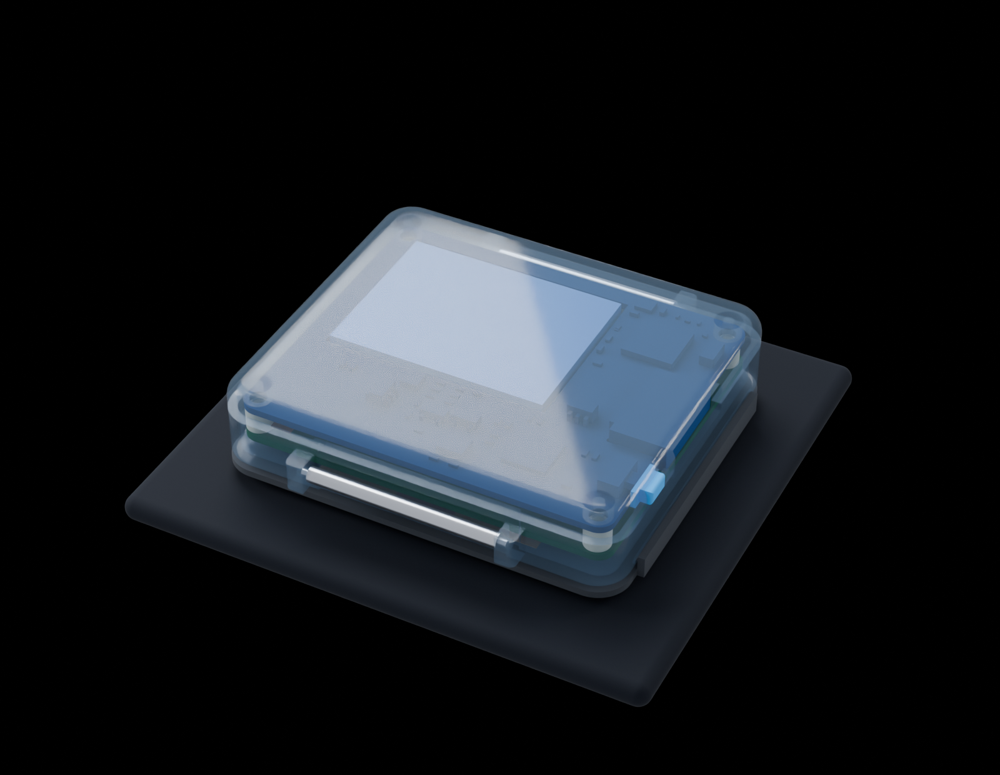
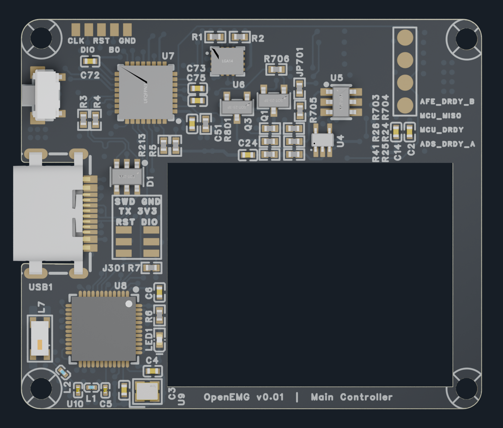
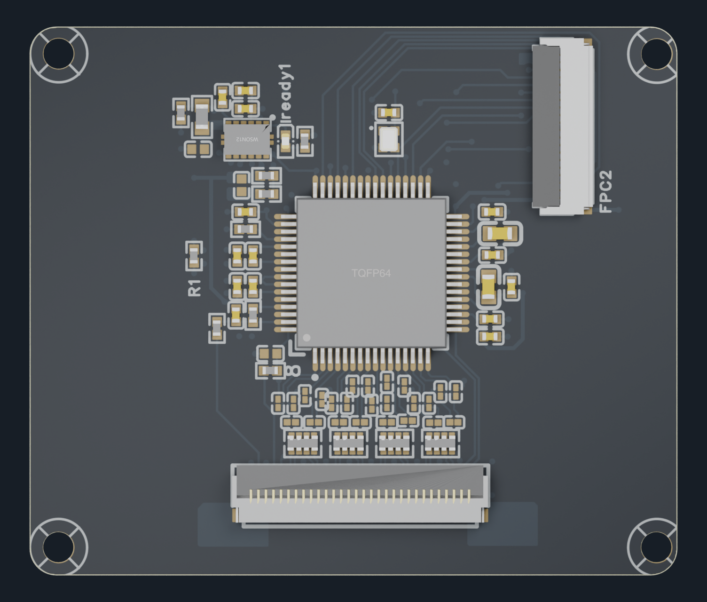
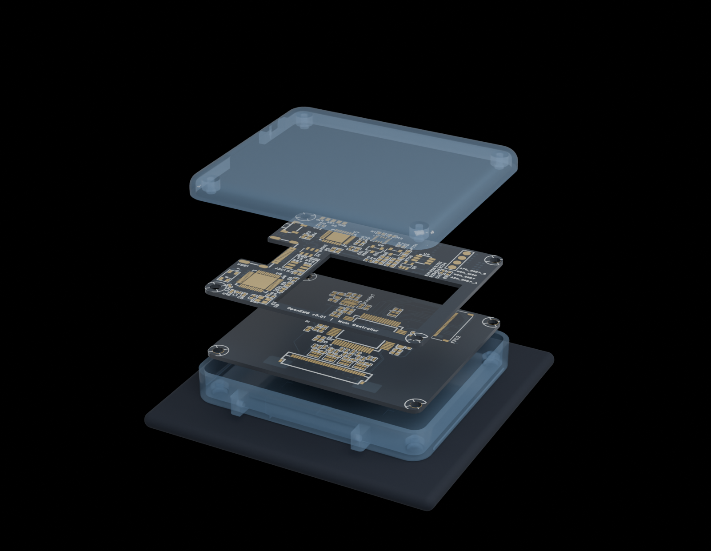
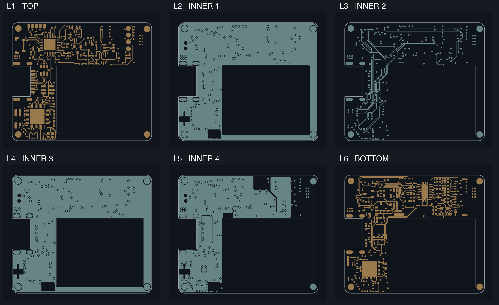
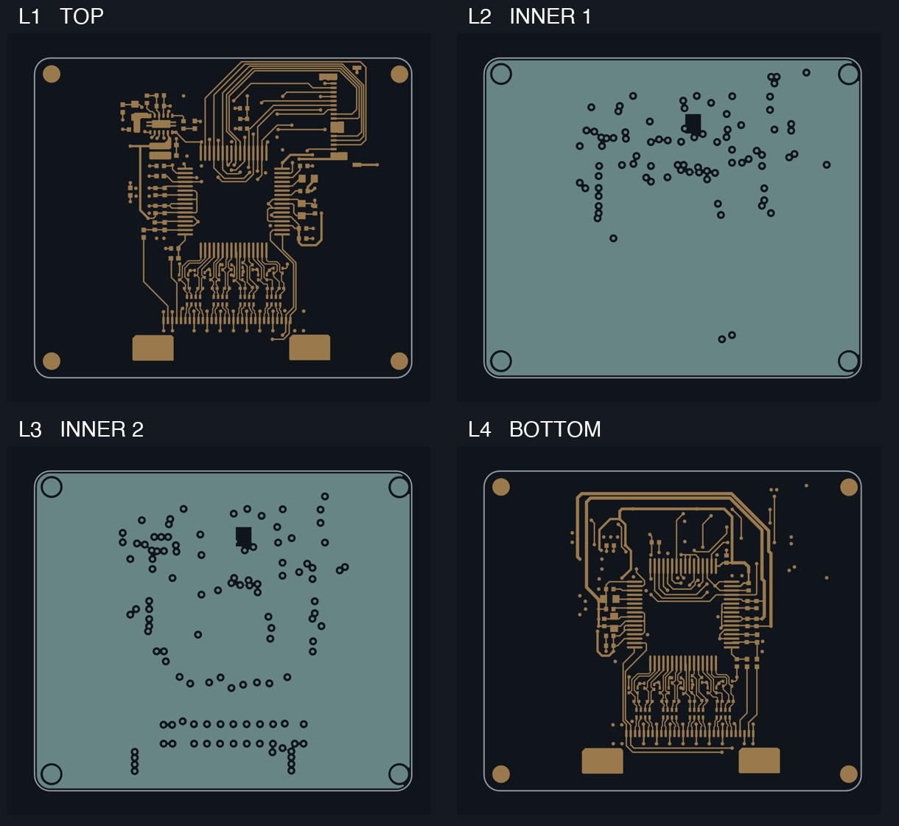
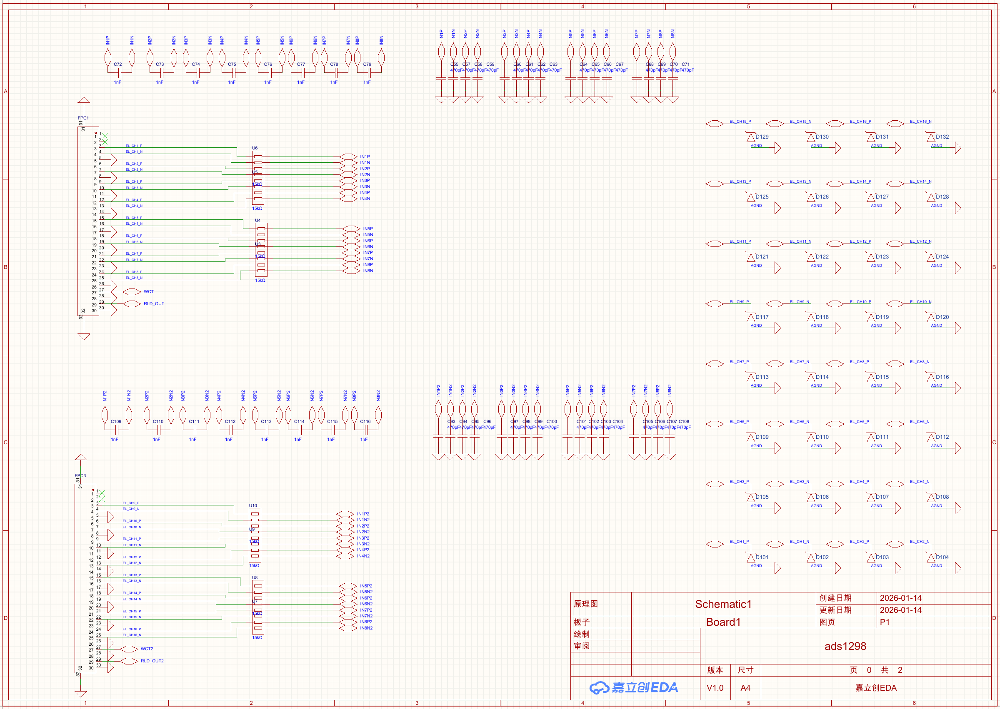

# OpenEMG

OpenEMG 是一个 **16 通道开源肌电手环**项目。我们想用腕部的表面肌电信号识别手势。桌面软件可以查看各通道波形、录制动作和训练模型。

我们想做肌电界的 DeepSeek。电路、结构、固件和桌面软件全部开源，谁都可以照着做一块板，用自己的数据训练模型。

[当前状态与进展计划](#当前状态与进展计划) · [Gallery](#gallery) · [工作原理与调研](#工作原理) · [桌面工作台](#桌面工作台)

**当前版本 v0.01** 用 20 针排线连接 6 层主控板和 4 层采集板。采集板用两颗 ADS1298 采集 16 路差分信号，整机待台架实测。[打开双板工程与制造文件](hardware/16ch-afe-hirose-1mm-1nf/)

## Gallery

### PCB · 主控与采集板

| v0.01 主控板 · C08B-U9 | v0.01 采集板 · 16 通道 |
|---|---|
|  |  |

两图按同一比例从元件面垂直观察。采集板正反面各有一颗 ADS1298。[查看同版原理图、PCB 与制造文件](hardware/16ch-afe-hirose-1mm-1nf/)

### 结构与装配

| v0.01 双板叠放 · 主控在上、采集在下 | U9 壳体与 v0.01 双板 · 分层视图 |
|---|---|
|  |  |

装配图按 v0.01 制造文件绘制，采用 0.8 mm 裸板。右图拉开了层间距，省略了元件、排线和电池。实物还没试装。[U9 外壳模型](hardware/16ch-u9-dual30/enclosure-u9-watch/) · [历代结构与表带图集](hardware/renders/)

### 走线与原理图

| C08B-U9 主控板 · 6 层铜箔 | 16 通道采集板 · 4 层铜箔 |
|---|---|
|  |  |

从左到右、从上到下依次是顶层、内层和底层。各层都从板顶看，方便对照走线和过孔。[主控 Gerber 与钻孔](hardware/16ch-afe-hirose-1mm-1nf/Gerber_C08B-U9_v0.01.zip) · [采集板 Gerber 与钻孔](hardware/16ch-afe-hirose-1mm-1nf/Gerber_AFE-30P.zip)

**[下载七页矢量原理图](hardware/16ch-afe-hirose-1mm-1nf/views/schematic.pdf)**。第 1–5 页是主控板的供电、蓝牙、USB、板间接口与采样主控，第 6–7 页是采集板的模拟电源、采集芯片、电极接口与输入滤波。PDF 可放大和搜索位号；修改电路请打开[嘉立创 EDA 专业版双板源工程](hardware/16ch-afe-hirose-1mm-1nf/OpenEMG_v0.01_DualBoard.epro2)。

| 复刻资料 | 主控板 | 采集板 |
|---|---|---|
| 物料清单（BOM） | [主控 BOM](hardware/16ch-u9-dual30/fab-mcu-u9/jlc_smt_bom.csv) | [采集 BOM](hardware/16ch-afe-hirose-1mm-1nf/jlc_smt_bom.csv) |
| 贴片坐标（CPL） | [主控坐标](hardware/16ch-u9-dual30/fab-mcu-u9/jlc_smt_cpl.csv) | [采集坐标](hardware/16ch-afe-hirose-1mm-1nf/jlc_smt_cpl.csv) |

板厚、盘中孔工艺、钢网和底面贴装方向见[同版制造说明](hardware/16ch-afe-hirose-1mm-1nf/)。本版采集板用于离体台架，通电前请阅读[测试与佩戴边界](SAFETY.md)。

## 工作原理

捏指时，肌肉活动会让皮肤表面产生微小的电压变化。手环的每个通道测一对电极之间的电压差。电极位置不同，同一次捏指在各通道上录到的波形也不同。桌面软件把波形和动作标签一起保存，供模型学习区分放松、捏指等动作。

摘下再戴，电极位置和松紧都会变。我们读过的一项四通道实验，在握拳、张手、屈腕和伸腕测试中判对了 152/160 次。论文没说明测试前是否重新佩戴。OpenEMG 计划把训练和测试分在两次佩戴中，单独记录重戴后的识别结果。[阅读项目调研节选与论文出处](docs/research/wrist-semg.md)

## 当前状态与进展计划

**2026-11-15**　16 通道 v0.01 的双板工程和制造文件已公开。下一步在离体台架上逐路验证 16 个输入，记录底噪和丢帧数。

| 步骤 | 怎么测 | 看什么结果 |
|---|---|---|
| 1 · 16 通道双板采集 | 核对主控与采集板的排线方向，在台架上检查供电、通信，再逐路接入已知信号 | 记录每一路对应的输入、波形、短接底噪和连续采集时的丢帧数 |
| 2 · 工作台接入 | 将台架实录回放到桌面端，逐项核对 2、8、16 通道配置 | 各配置的通道数、编号和录制文件与输入一致，重新打开仍能回放 |
| 3 · 重戴后识别 | 完成佩戴安全检查后，用一次佩戴录制训练样本，再用另一次佩戴单独测试 | 分别报告放松、唤起和四个方向滑动的识别结果，以及放松时的误触发次数 |

### 桌面工作台

下图用合成信号回放，圆环显示 8 个通道的收数状态。连接设备后，可以检查佩戴、录制动作和训练模型。

### 各版本工程与实测记录

目前优先验证 16 通道双板。8 通道和 2 通道的设计与测试进度列在下表。

| 通道 | 硬件工程 | 固件 | 3D 外观 | 实板测试进展 |
|---|---|---|---|---|
| **16 通道** | [广濑双 30 针](hardware/16ch-u9-dual30/) · [v0.01 双板与广濑 1 nF](hardware/16ch-afe-hirose-1mm-1nf/) · [讯普双 30 针](hardware/16ch-afe-xunpu-2mm-1nf/) · [双 34 针](hardware/16ch-c08b-round/) | [主控自检](firmware/c08b-bringup/) · [双 ADS1298 采集](firmware/c08b-stream/) | [U9 广濑版手表壳](hardware/16ch-u9-dual30/enclosure-u9-watch/) | 广濑版已核对数字装配，待整机采集实测。讯普版有 3 个位号待工程师确认。 |
| **8 通道** | [D20-8CH 腕带板](hardware/8ch-ads1298/afe-d20-8ch/) · [R01 台架板](hardware/8ch-ads1298/r01-bench/) | [腕带采集](firmware/c08b-stream/) · [R01 蓝牙采集](hardware/8ch-ads1298/r01-bench/firmware-f05-ble-dout/) | [R12 外壳](hardware/enclosure-46x40/c08b-shell-r12/) · [D2-8CH 电极软板](hardware/8ch-ads1298/strap-fpc-d2-8ch/) | R01 实板短接输入采集 10 分钟，1,187,774 帧序号连续。D20-8CH 腕带待装机实测。 |
| **2 通道** | [ADS1292 六触点板](hardware/2ch-ads1292/) | [XIAO 蓝牙采集](firmware/xiao-ads1292-2ch/) | [R7 六触点外壳](hardware/enclosure-46x40/ads1292-shell-r7/) | 已完成设计检查，待打样、上电。 |

## 开始使用

[桌面工作台](app/) · [软件与开发环境](firmware/software.md) · [硬件与制造文件索引](hardware/README.md) · [通电与佩戴安全须知](SAFETY.md)

[软件许可 MIT](LICENSE) · [硬件许可 CERN-OHL-S-2.0](LICENSE-HARDWARE) · [第三方声明](THIRD_PARTY_NOTICES.md)
