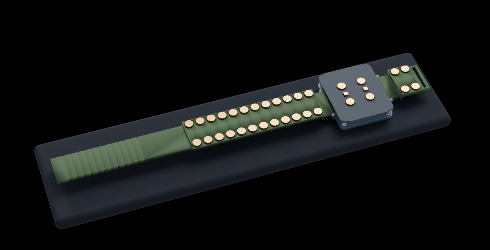
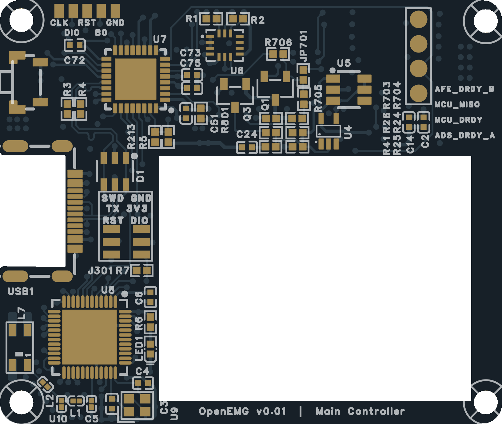
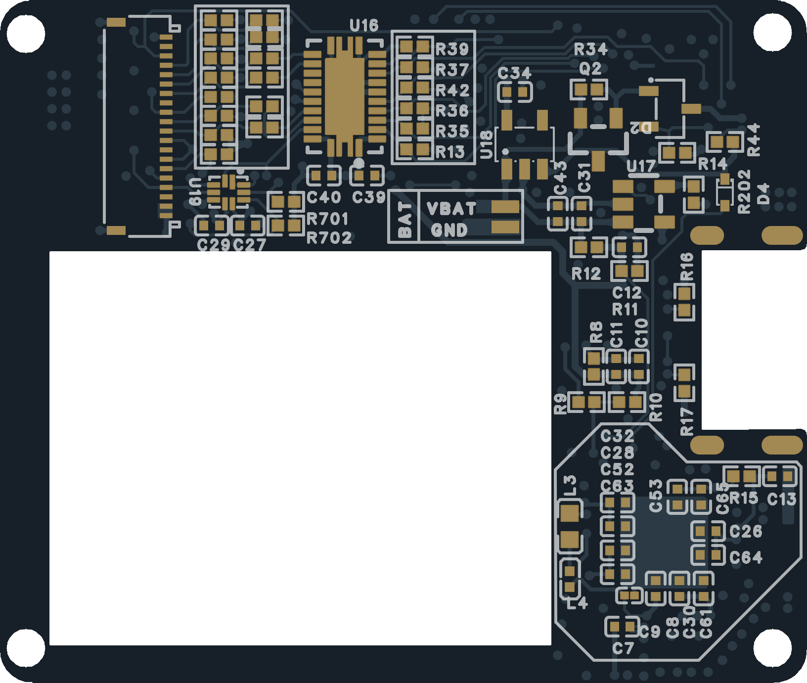
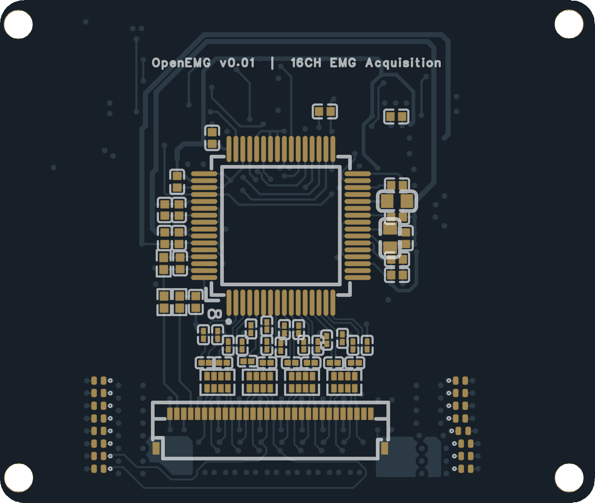
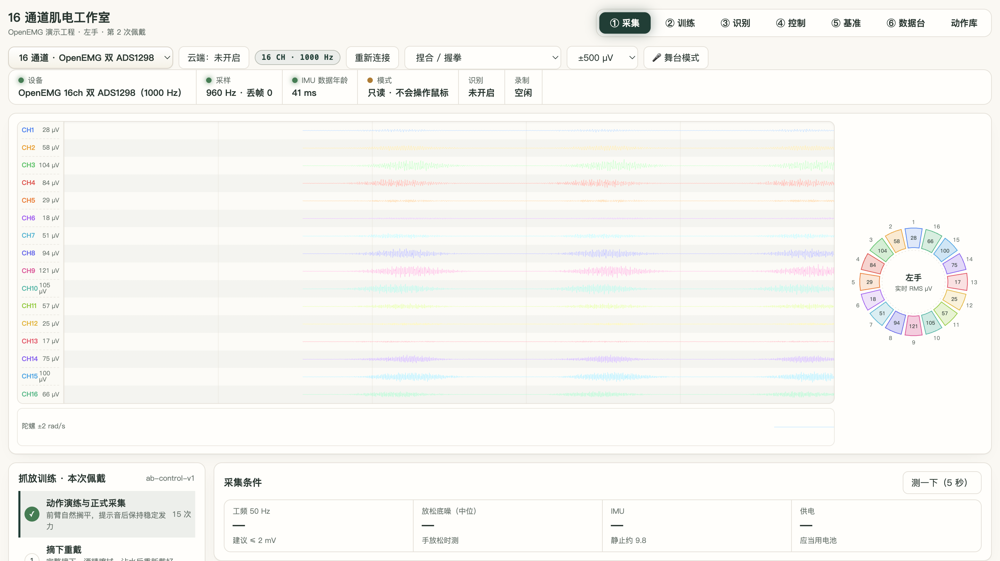
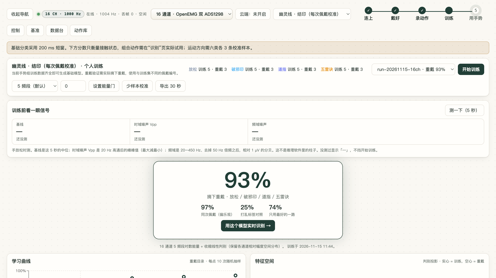

# OpenEMG

**简体中文** · [English](README.en.md) · **[官网 openemg.org](https://openemg.org/)**

OpenEMG 是一个 **16 通道开源肌电手环**项目。我们想用腕部的表面肌电信号识别手势。桌面软件可以查看各通道波形、录制动作和训练模型。

我们想做肌电界的 DeepSeek。电路、结构、固件和桌面软件全部开源，谁都可以照着做一块板，用自己的数据训练模型。

OpenEMG 由人和 AI 共同研发。项目还在早期，电路、代码和文档里难免有错。如果你发现问题，欢迎[提 issue](https://github.com/makoshan/OpenEMG/issues)。如果你改好了代码、电路，或测出了不同的结果，也欢迎[提交 PR](https://github.com/makoshan/OpenEMG/pulls)，让其他人能复用你的工作。

**本次下单的最终主板为 OpenEMG MAIN V1.0B（2026-11-24）。** 首件已下单，实物待验。下载主板 PCB、五页原理图、Gerber 和实际贴片 BOM，见[主板定版资料](hardware/main-v1.0b/)。

[当前状态与进展计划](#当前状态与进展计划) · [Gallery](#gallery) · [工作原理与调研](#工作原理) · [桌面工作台](#桌面工作台)

| 正面 · U9 外壳与双板 | 贴肤面 · 金属电极触点 |
|---|---|
|  |  |

外观沿用 R13 表带，贴肤面按双 30 针电极软板布局绘制。长带 24 个、短带 4 个、主机底部 4 个圆形采样触点，共组成 16 对差分输入。底部另有 2 个方形辅助触点。这套组合尚待实物试装。 [表带模型](hardware/enclosure-46x40/c08b-shell-r13-notch/) · [双 30 针电极软板](hardware/16ch-u9-dual30/strap-fpc-30p/)

**OpenEMG 还在早期研制阶段。** 2026 年 11 月 15 日定下的是打样用的 PCB。固件、桌面软件与板子的联调、手势识别都还在开发，16 通道整机尚未上机验证。

> [!IMPORTANT]
> **人工审核准备下单 vs AI 生成未下单（硬件状态声明）**
> - **16 通道 `v0.01` 双板（人工工程师设计并逐脚审核通过 · 准备下单打样）**：[`hardware/16ch-afe-hirose-1mm-1nf/`](hardware/16ch-afe-hirose-1mm-1nf/) 中的 6 层主控板 `C08B-U9` 与 4 层采集板 `AFE-30P`（含 32 颗 `ESD401DPYR` 输入保护管、146 个贴片位号）由人工硬件工程师完成原理图与 PCB 布局布线，并对照 TI `ADS1298` 数据手册与 `SBAU171D` 评估板指南完成逐脚复核、DRC 与贴片极性核对，准备下单打样。
> - **其余衍生板卡、柔性软板与外壳（AI 生成设计 · 尚未人工审核 · 尚未下单）**：仓库内的 **2 通道 `ADS1292` 六触点板**、**8 通道 `D20-8CH` 腕带板**、**16 通道双 34 针（`D20/R4U6`）与广濑 `22 pF` 穿戴派生版（`16ch-u9-dual30`）**、**讯普 `2.0 mm` 对照版**、**全系柔性电极软板（FPC）** 以及 **全系 3D 打印外壳模型** 均由 AI 生成，尚未经过人工工程师逐板审核，也**尚未下单打样**（仅历史 8 路台架开发板 [`V12-R01`](hardware/8ch-ads1298/r01-bench/) 做过离体短接实板测试）。如需复刻 AI 生成的板卡，请务必在投产前自行人工复核原理图、封装手性与安全间距。

6 层主控板通过 20 针排线连接 4 层采集板。采集板用两颗 ADS1298，设计为 16 路差分输入。[打开人工审核双板工程与制造文件](hardware/16ch-afe-hirose-1mm-1nf/)

## Gallery

### PCB · 主控与采集板

**v0.01 的 PCB 设计已完成，下一步是打板、贴片和上电测试。** 采集板新增 32 颗输入保护管（D101–D132），贴片 BOM 和坐标表共 146 个位号。

| 板卡 | 正面 | 背面 |
|---|---|---|
| C08B-U9 主控板 |  |  |
| 16 通道采集板 |  |  |

图由同版 Gerber 生成。右列按翻到板背后的方向显示。[双板工程与制造文件](hardware/16ch-afe-hirose-1mm-1nf/) · [主控板元件正视图](hardware/renders/v001-mcu-front.png) · [采集板元件正视图](hardware/renders/v001-afe-front.png)

### 结构与装配

| v0.01 双板叠放 · 主控在上、采集在下 | U9 壳体与 v0.01 双板 · 分层视图 |
|---|---|
|  |  |

装配图按 v0.01 制造文件绘制，采用 0.8 mm 裸板。右图拉开了层间距，省略了元件、排线和电池。实物还没试装。[U9 外壳模型](hardware/16ch-u9-dual30/enclosure-u9-watch/) · [历代结构与表带图集](hardware/renders/)

### 走线与原理图

| C08B-U9 主控板 · 6 层铜箔 | 16 通道采集板 · 4 层铜箔 |
|---|---|
|  |  |

从左到右、从上到下依次是顶层、内层和底层。各层都从板顶看，方便对照走线和过孔。[主控 Gerber 与钻孔](hardware/16ch-afe-hirose-1mm-1nf/Gerber_C08B-U9_v0.01.zip) · [采集板 Gerber 与钻孔](hardware/16ch-afe-hirose-1mm-1nf/Gerber_AFE-30P.zip)

**[下载九页矢量原理图](hardware/16ch-afe-hirose-1mm-1nf/views/schematic.pdf)**。第 1 页是整机框图，第 2 页是电源树。第 3–7 页是主控板的供电、蓝牙、USB、板间接口与采样主控，第 8–9 页是采集板的模拟电源、采集芯片、电极接口与输入滤波。PDF 可放大和搜索位号；修改或联调电路请打开[嘉立创 EDA 专业版双板源工程](hardware/16ch-afe-hirose-1mm-1nf/OpenEMG_v0.01_DualBoard.epro2)或 [KiCad 8 原生双板与九页原理图工程](hardware/16ch-afe-hirose-1mm-1nf/kicad/)。

| 复刻资料 | 主控板 | 采集板 |
|---|---|---|
| 物料清单（BOM） | [主控 BOM](hardware/16ch-u9-dual30/fab-mcu-u9/jlc_smt_bom.csv) | [采集 BOM](hardware/16ch-afe-hirose-1mm-1nf/jlc_smt_bom.csv) |
| 贴片坐标（CPL） | [主控坐标](hardware/16ch-u9-dual30/fab-mcu-u9/jlc_smt_cpl.csv) | [采集坐标](hardware/16ch-afe-hirose-1mm-1nf/jlc_smt_cpl.csv) |

板厚、盘中孔工艺、钢网和底面贴装方向见[同版制造说明](hardware/16ch-afe-hirose-1mm-1nf/)。本版采集板用于离体台架，通电前请阅读[测试与佩戴边界](SAFETY.md)。

## 工作原理

捏指时，肌肉活动会让皮肤表面产生微小的电压变化。手环的每个通道测一对电极之间的电压差。电极位置不同，同一次捏指在各通道上录到的波形也不同。桌面软件把波形和动作标签一起保存，供模型学习区分放松、捏指等动作。

[查看同版九页原理图](hardware/16ch-afe-hirose-1mm-1nf/views/schematic.pdf)

摘下再戴，电极位置和松紧都会变。我们读过的一项四通道实验，在握拳、张手、屈腕和伸腕测试中判对了 152/160 次（95%），但论文没说明测试前是否重新佩戴，现有材料也不足以原样复现。[阅读项目调研节选与论文出处](research/wrist-semg.md)

结合文献复核与前期 8 路台架板（[`V12-R01`](hardware/8ch-ads1298/r01-bench/)）实测，定版电路与软件采用以下设计约束：

| 调研与实测维度 | 关键数据与来源 | 在 OpenEMG v0.01 与工作台中的落地 |
|---|---|---|
| **参考偏置与底噪** | `V12-R01` 实板短接输入底噪 **`2.8 µV`**，连续 10 分钟 **`1,187,774` 帧零丢包**；悬空不接参考电极上臂时 50 Hz 共模飙至 `10 mV` 饱和 | 盒底设独立 `BIAS / REF` 辅助触点，由 `U1` 单源经 `392 kΩ` 驱动偏置（`U2` 偏置输出悬空防双运放互顶），录制前先过 **5 秒静息信号体检**（`p95 > 150 µV` 阻断、`50 Hz` 能量占比 `> 40%` 提示重贴参考电极） |
| **双芯片同步与采样率** | 对照 ETH Zurich BioGAP-Ultra 双 `ADS1298` 架构与腕部 sEMG 有效频带（`20–450 Hz`） | 两颗 `ADS1298` 共用同一颗 `2.048 MHz` 有源晶振消除帧间漂移，硬件采样率定为 **`1000 SPS`**（兼容 `2000 SPS` 商用腕带回放与对比） |
| **跨佩戴特征与分类器** | 单次佩戴内准确率极易虚高；逐通道 z-score 标准化会抹掉空间幅值比，换位置重戴后性能骤降 | 禁用单通道标准化；提取 **`250 ms` 窗五频带对数功率（`bands5`：`20–45`、`55–95`、`105–145`、`155–245`、`255–445 Hz`）+ 收缩线性判别（Shrinkage LDA）**，桌面端强制按独立佩戴编号做**跨佩戴留一验证** |
| **人体供电互锁** | 市电 USB 直连存在故障漏电风险 | 主控板内建硬件互锁（检测 `VBUS` 自动拉高 `AFE_OE_N` 切断采集模拟电），`JP701` 默认空贴；桌面软件对未完成实物安全验收的 `c08b-16ch / 8ch / 2ch` 保持默认录制锁关闭（`record: false`） |

## 当前状态与进展计划

**2026-11-15 · 现在做到哪了**　16 通道 v0.01 的双板设计已定，工程、原理图、Gerber 和贴片文件已公开。固件通过了主机端测试，桌面工作台能演示 16 路波形。**这版整机还没有实测数据。最近的目标是让首板在台架上连续采到 16 路已知信号。**

#### 首板回来前

| 工作 | 还要做什么 |
|---|---|
| 打板与贴片 | 用 11 月 15 日定版包打样。核对板厚、盘中孔和钢网，在贴装预览里逐面检查两颗 ADS1298、三只排线座和 32 颗保护管。 |
| 固件适配 | [`c08b-bringup`](firmware/c08b-bringup/) 与 [`c08b-stream`](firmware/c08b-stream/) 已对照 `v0.01` 双板网表完成适配（双片独立 `INT_TEST=1` 测试源、`Pin 62 RLDIN=+2.5 V` 禁置 `RLD_MEAS/MUX=010`、`Pin 60 RLDREF=AGND` 禁置 `RLDREF_INT`，支持经蓝牙或 USB 接收器在线切换 `500/1000/2000 SPS` 及安全读写校验 `ADS1298` 寄存器，见[板间与传输协议说明](firmware/transport-protocol.md)），待回板后实机烧录验证。 |
| 测试准备 | 准备 20 针排线、转接线和离体信号源。把每个输入脚对应到桌面的 CH1–CH16，列好短接、已知信号和断流三组测试。 |

#### 样板到手后：先在台架测

| 工作 | 要拿到的结果 |
|---|---|
| 来板与供电 | 核对贴片方向、排线两端的 1 脚和通断。记录数字电源、正负模拟电源、基准电压、启动时序和纹波；验证 USB 插入时采集供电互锁。 |
| 双板通信 | 分别读回两颗 ADS1298 的 ID 和寄存器，观察各自的数据就绪信号，核对两组八路数据的顺序。 |
| 16 路模拟采集 | 先短接输入测各路底噪，再逐路注入已知信号。记录增益、极性、工频干扰和相邻通道串扰；用模拟负载检查偏置输出。 |
| 无线传输与桌面录制 | 真机连续传输，统计采样率、丢帧和延迟。用桌面端看波形、打标签、保存、关闭再回放；断连后检查文件是否完整、间断是否可见。2、8 通道另做兼容回归。 |
| 外壳、软板与电池 | 试装双板和电芯，实插 20 针板间排线和两条 30 针软尾。检查锁扣能否操作、合盖是否夹线，再测采集功耗、温升和续航。 |

#### 台架通过后：再做佩戴与手势验证

| 工作 | 怎样判断进展 |
|---|---|
| 佩戴前检查 | 核对贴肤触点、限流路径、电池供电与充电互锁，完成佩戴安全复核，再安排佩戴采集。[安全说明](SAFETY.md) |
| 电极接触与数据 | 记录佩戴位置和松紧，比较静息、动作、摘下重戴后的各路信号。保留动作标签和佩戴编号，找出容易失去接触的通道。 |
| 手势识别 | 先做放松、唤起和四向滑动六类。用一次佩戴训练，另一次佩戴测试；分别记录各类识别结果、响应时间和静息误触发。 |
| 开源复现 | 补齐装配照片、固件版本、桌面连接步骤和首板测试记录。让另一位开发者按公开文件从装配走到录制，记录卡在哪一步。 |

### 桌面工作台（支持 16 / 8 / 2 通道）

桌面工作台现已统一支持 **16 通道（OpenEMG 双 `ADS1298` · `1000 Hz`）**、**8 通道（唯理腕带 `2000 Hz` / OpenEMG 单 `ADS1298` `1000 Hz`）** 与 **2 通道（OpenEMG `ADS1292` · `1000 Hz`）**，顶部设备栏一键切换后自动匹配通道数、采样率、环形电极图、工程隔离目录与特征训练流水线。界面采用暖米色手帐实验台配色，录制前先过 5 秒静息信号体检（检查链全频段查 `50 Hz` 工频，显示链 `50 Hz` 陷波 + `20–450 Hz` 带通），内置跨佩戴留一评估与 3D 手势游戏《掌中天劫》。[打开软件目录与运行说明](app/)

| 16 通道肌电工作室（双 `ADS1298` · `16 CH · 1000 Hz`） | 8 通道校准采集中（满高八路滚动波形 · `8 CH · 2000 Hz`） |
|---|---|
|  |  |
| **2 通道入门工作台（`ADS1292` · `2 CH · 1000 Hz`）** | **跨佩戴评估剧场（重戴留一验证 `93%` + 学习曲线 + 聚类散点）** |
|  |  |
| **实时识别仪表盘（`0.65` 置信红线 + 放松底噪门控）** | **内置 3D 肌电实战游戏《掌中天劫》** |
|  |  |

图中 16 通道与 2 通道界面使用合成台架信号演示；在对应实板通过台架与佩戴安全验收前，软件默认保持硬件录制锁关闭（`record: false`）。

### 各版本工程与实测记录

目前优先打样并验证**人工审核通过的 16 通道 `v0.01` 双板**；其余 AI 生成的 16 / 8 / 2 通道衍生板、软板与外壳均尚未下单，进度与状态列在下表。

| 通道 | 硬件工程 | 固件 | 3D 外观（AI 生成 · 未下单） | 审核与下单实测状态 |
|---|---|---|---|---|
| **16 通道** | **[v0.01 双板与广濑 1 nF（人工审核）](hardware/16ch-afe-hirose-1mm-1nf/)** · **[A5＋B1 双层表带软板（已下单待试装）](hardware/16ch-afe-hirose-1mm-1nf/strap-fpc-a5b1/)** · [广濑 22 pF 穿戴版（AI）](hardware/16ch-u9-dual30/) · [讯普双 30 针（AI）](hardware/16ch-afe-xunpu-2mm-1nf/) · [双 34 针（AI）](hardware/16ch-c08b-round/) | [主控自检](firmware/c08b-bringup/) · [双 ADS1298 采集](firmware/c08b-stream/) | **[25 mm R3 外壳与 TPU 表带（含六孔修订底盖，已下单待试装）](hardware/16ch-afe-hirose-1mm-1nf/enclosure-25mm-r3/)** · [U9 广濑版手表壳](hardware/16ch-u9-dual30/enclosure-u9-watch/) · [双 30 针四层软板](hardware/16ch-u9-dual30/strap-fpc-30p/) | **`v0.01` 双板已由人工工程师逐脚审核通过；配套 `strap-fpc-a5b1` 双层软板与 `25 mm R3` 外壳/表带已投单打样**，待回件验证 16 路采集与断电试装。其余派生版尚未下单（讯普版另有[偏置待确认项](hardware/16ch-afe-xunpu-2mm-1nf/#待工程师确认)）。 |
| **8 通道** | [D20-8CH 腕带板（AI）](hardware/8ch-ads1298/afe-d20-8ch/) · [11 页原理图 PDF](hardware/8ch-ads1298/afe-d20-8ch/views/schematic.pdf) · [34P/20P 逐针核对表](hardware/8ch-ads1298/afe-d20-8ch/PINOUT-AND-REVIEW.md) · [R01 台架板（已实测）](hardware/8ch-ads1298/r01-bench/) | [腕带采集](firmware/c08b-stream/) · [R01 蓝牙采集](hardware/8ch-ads1298/r01-bench/firmware-f05-ble-dout/) | [R12 外壳](hardware/enclosure-46x40/c08b-shell-r12/) · [D2-8CH 电极软板](hardware/8ch-ads1298/strap-fpc-d2-8ch/) | `R01` 历史台架实板短接输入采集 10 分钟，`1,187,774` 帧序号连续、底噪 `2.8 µV`。`D20-8CH` 腕带板已整理 11 页全套原理图、34P/20P 逐针表与排线朝向图，**待人工工程师独立审板**，尚未下单。 |
| **2 通道** | [ADS1292 六触点板（AI）](hardware/2ch-ads1292/) · [双肩外接线 S1 与整板 STEP](hardware/2ch-shoulder-s1/) · [3 页原理图 PDF](hardware/2ch-ads1292/views/schematic.pdf) · [六触点极性核对表](hardware/2ch-ads1292/PINOUT-AND-REVIEW.md) | [XIAO 蓝牙采集](firmware/xiao-ads1292-2ch/) | [R7 六触点外壳](hardware/enclosure-46x40/ads1292-shell-r7/) | 已整理 3 页原理图、六触点贴肤翻面/元件面极性对照与 8 测点表（自动 DRC 与逐脚对板已过），**待人工工程师独立审板**，尚未下单。 |

## 开始使用

[官网 openemg.org](https://openemg.org/) · [桌面工作台](app/) · [软件与开发环境](firmware/software.md) · [板间与传输协议](firmware/transport-protocol.md) · [硬件与制造文件索引](hardware/README.md) · [通电与佩戴安全须知](SAFETY.md)

[软件许可 MIT](LICENSE) · [硬件许可 CERN-OHL-S-2.0](LICENSE-HARDWARE) · [第三方声明](THIRD_PARTY_NOTICES.md)
