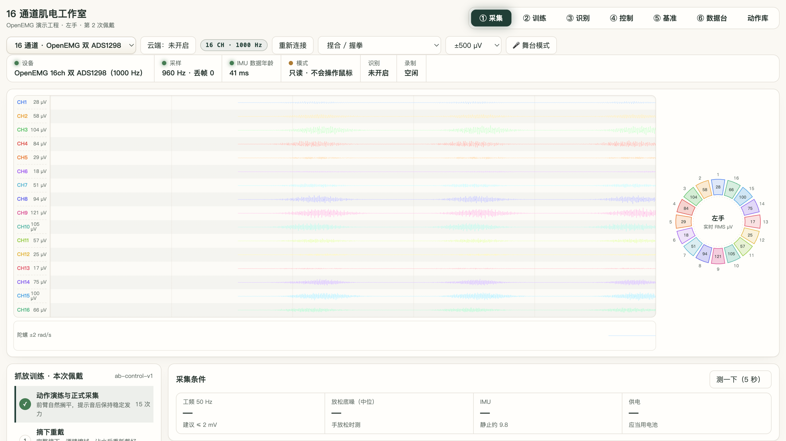
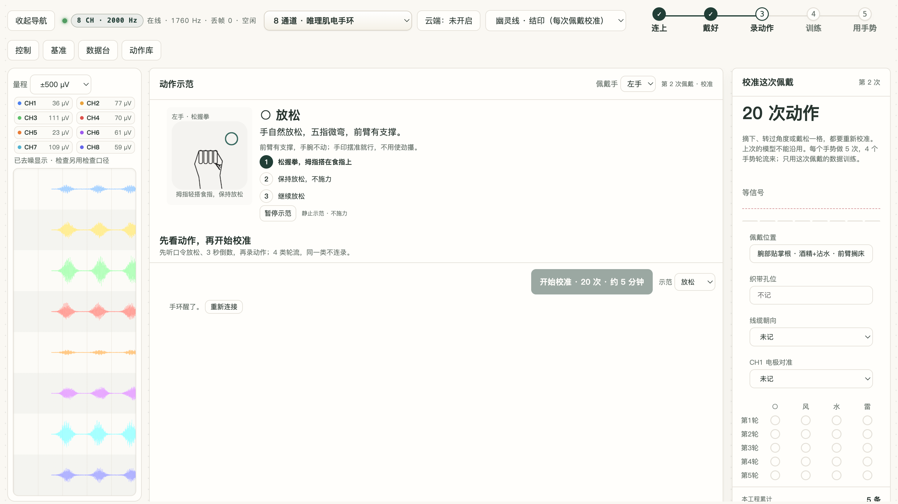
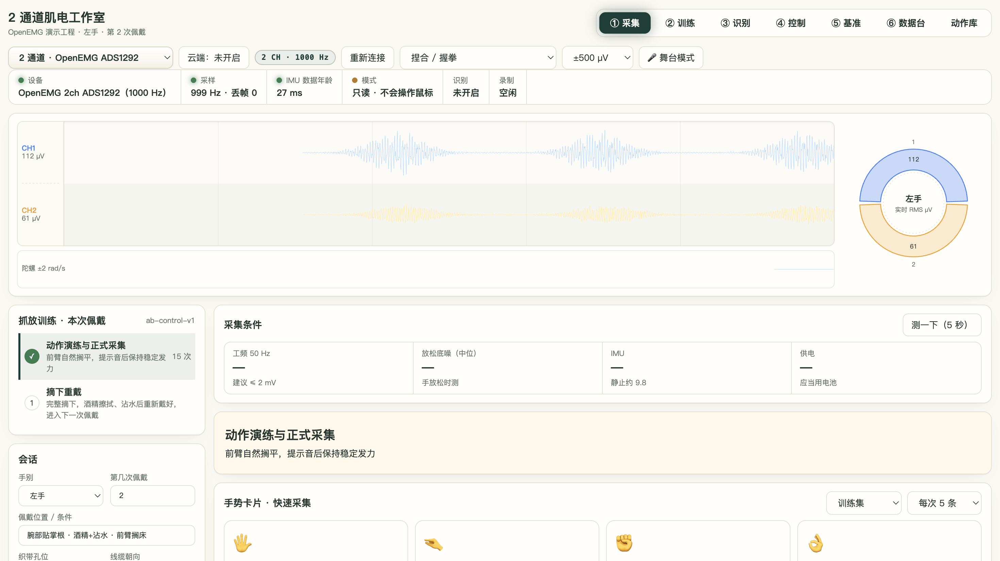
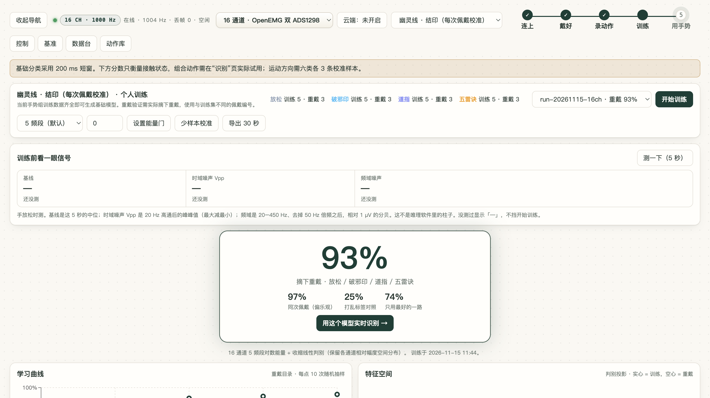
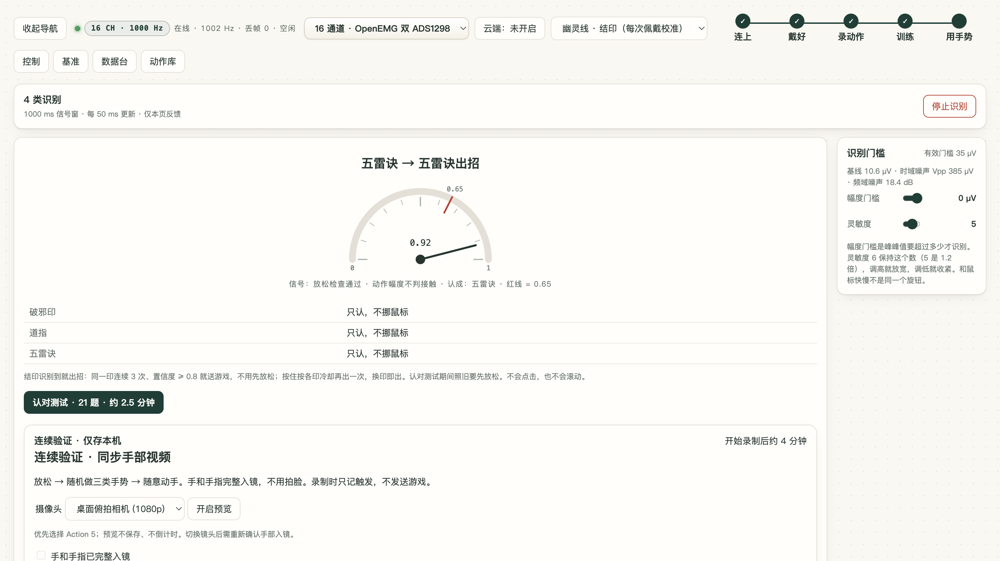
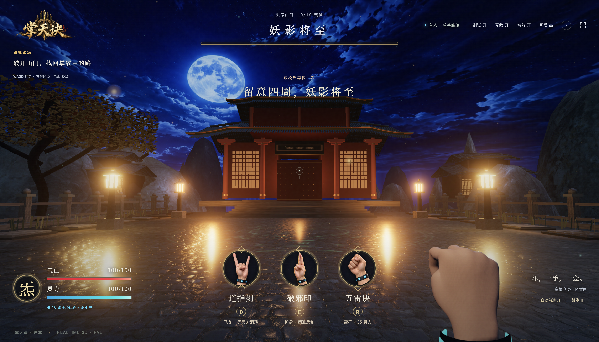

# OpenEMG App


支持 **16 通道 / 8 通道 / 2 通道 / 单通道** 的肌电采集、信号体检、跨佩戴模型训练与实时手势识别单机桌面工作台。
肌电页面的**唯一码源在这里**：`app/src/emg8/` 和 `app/electron/emg8-*`。

```
页面（src/，Vite + React） ──window.pt.emg8──▶ electron/emg8-ipc.cjs ──HTTP──▶ emg8-server.py → ../host/emg_web.py --channel-mode <16ch|8ch|2ch|wl8>
```

## 多通道桌面界面（16 / 8 / 2 通道）

| 16 通道肌电工作室（双 `ADS1298` · `1000 Hz`） | 8 通道校准采集中（`2000 Hz` 满高滚动波形） |
|---|---|
|  |  |
| **2 通道入门工作台（`ADS1292` · `1000 Hz`）** | **跨佩戴评估剧场（重戴留一验证 `93%` + 学习曲线）** |
|  |  |
| **实时识别仪表盘（`0.65` 置信红线 + 放松门控）** | **内置 3D 肌电实战游戏《掌中天劫》** |
|  |  |

顶部设备栏可一键切换五档工作流，同一套工作室自动适配通道数、采样率、环形电极图与训练流水线（旧版八通道连接页基线图仍保留在 [`screenshots/desktop-connection.png`](screenshots/desktop-connection.png)）：

| 顶部设备选项 | 通道与采样率 | 工程目录隔离 | 当前录制门禁 |
|---|---|---|---|
| `16 通道 · OpenEMG 双 ADS1298` | `16 CH · 1000 Hz` | `emg-c08b-16ch-data/` | 硬件锁默认关闭（`record: false`，可预览波形与跑 5 秒信号体检，待首板安全验收后解锁录制） |
| `8 通道 · 唯理肌电手环` | `8 CH · 2000 Hz` | `project/`（兼容既有数据） | 已支持真机连接、校准录制、跨佩戴评估与实时推理 |
| `8 通道 · OpenEMG 单 ADS1298` | `8 CH · 1000 Hz` | `emg-c08b-8ch-data/` | 硬件锁默认关闭（`record: false`） |
| `2 通道 · OpenEMG ADS1292` | `2 CH · 1000 Hz` | `emg-c08b-2ch-data/` | 硬件锁默认关闭（`record: false`） |
| `单通道 · Cheez + ESP32-S3` | `1 CH` 入门向导 | `emg-data/` | 引导录制页 `/guide` |

## 跑起来

```bash
npm install
npm start                      # 构建页面并开 App；支持顶部切换 16 / 8 / 2 / 1 通道
npm run dev                    # 网页版：Chrome / Edge 打开，用 Web Serial 直连接收器
npm run check                  # JS 解码与 host/wl8.py 逐帧对拍；后面加 <录音.npz> 再拿真实录音对一遍
npm run check:multichannel     # 16 / 8 / 2 通道切换、采样率适配、工程隔离与硬件锁关闭契约自检
npm run check:filter-stream    # 检查链（全频段找工频）与显示链（50 Hz 陷波 + 20–450 Hz 带通）逐块滤波一致性自检
npm run check:wear-hint        # 放松信号体检（>150 µV 阻断、>40% 工频提示、电极环定位）逻辑自检
npm run check:seal-game        # 结印映射与放松门单测，再开 Electron 用合成信号跑真识别页（要图形界面；CI 只跑前半）
npm run check:cloud            # 可选云端同步协议契约检查（需设 VIBE_HW=<测试服务端目录>）
npm run check:gesture-library  # 动作库 16 个动作左右手 jpg/mp4 都在 public/，地址是相对路径；pack 时对 dist/ 再查一次
npm run check:missing-label    # 训练页「还缺…」用中文类别名（抓握组没有 gestures 也要显示放松 / 捏合 / 握拳）
npm run check:rewear-hint      # 跨佩戴用旧模型的提醒：模型 created 早于手环最近一次重新出数据（link_since）才提醒
npm run pack                   # 打成 out/OpenEMG-darwin-arm64/OpenEMG.app，自带 Python，别的 Mac 装上就能用
```

打包（`scripts/bundle-python.sh` + `scripts/pack.mjs`）：独立 CPython 3.12.12 + numpy/scipy/scikit-learn/pyserial/bleak/h5py（版本对齐本机训练环境）+ `host/` 运行时代码 + 手势算法里实际用到的 features/rolling_buffer，都放进 `Contents/Resources`。软链全部换成实体文件（打包门会拦外部软链），标准库必须来自包内（脚本自检 sys.base_prefix）。不带 torch、matplotlib、pandas（WL8 路径只在函数里延迟导入）。整包约 610 MB，其中 Electron 300 MB、Python 270 MB。

App 顶部「设备」切换：16 / 8 / 2 通道共用完整的肌电工作室（`emg8-server.py` 传入对应 `--channel-mode` 与独立数据目录，切换时自动重启后端并释放串口/BLE）；单通道（Cheez + ESP32-S3）嵌 `host/emg_web.py` 的 `/guide` 引导录制页（`emg1-server.py`），同一时间只起一个采集服务。图标源图 `icon/icon.svg`；透明底 Logo `icon/logo.svg`，网页 favicon `public/favicon.svg`（都按 2026-10-16 幻灯片 v9 原图描成矢量）。普通浏览器里是网页版（`src/web.tsx`）：连接、八路波形、采样率/丢帧/每路 RMS，解码在 `src/wl8.ts`。

| 环境变量 | 作用 |
|---|---|
| `YUANLI_REPLAY=<录音.npz>` | 按原速回放推流：能连、能看，不能录 |
| `YUANLI_FAKE=1` | 合成台架；emg_web 不允许假台架写工程，页面会停在连接步 |
| `YUANLI_PLATFORM=<地址>` | 云端平台地址，默认留空（仅本地运行） |
| `YUANLI_USERDATA=<目录>` | 自检用临时数据目录，不碰正式数据 |
| `YUANLI_PY` / `YUANLI_HOST` | 换 Python / host 目录；打包后默认用 Resources 里自带的，开发时默认使用仓库 `.venv` 与 `host/` |

数据（工程目录 `project/`）在 `~/Library/Application Support/原力手环/`：2026-10-16 改名 OpenEMG 后仍用旧目录名（main.cjs 钉住），已录数据和设置不用搬家。

## 现状

- 已实现：外壳、单工程、采集服务起停（App 被强杀时服务自己退出）、页面全部复用。
- 回放实测：连接 8/8、丢帧 0，录动作页八路波形正常；真腕带录制未测。
- 网页版：JS 解码与 Python 对拍逐帧一致（合成 + 卖家 XCOM 实拍 + 真实录音，随机切块 20 轮）；浏览器里用假串口验证读取、2 kHz、丢帧计数和波形。真接收器经 Web Serial 未测。
- 自带 Python：在禁读 ~/.local/share/uv、本机训练环境和 ~/go 的 sandbox-exec 里，包内 Python 起采集服务正常，sys.base_prefix 在 .app 内（同一沙箱拦住了本机 Python，阴性对照成立）；.app 复制到仓库外运行回放连接 8/8、1994 Hz；首次打开 32 秒、第二次 10 秒就绪；强杀无残留。同一份六类数据，包内 Python 与本机训练环境训练结果逐项一致。没签名公证，别的 Mac 要右键打开；没在另一台 Mac 上试。
- 未做：网页录制与上传、平台训练（第 4、5 步）。
