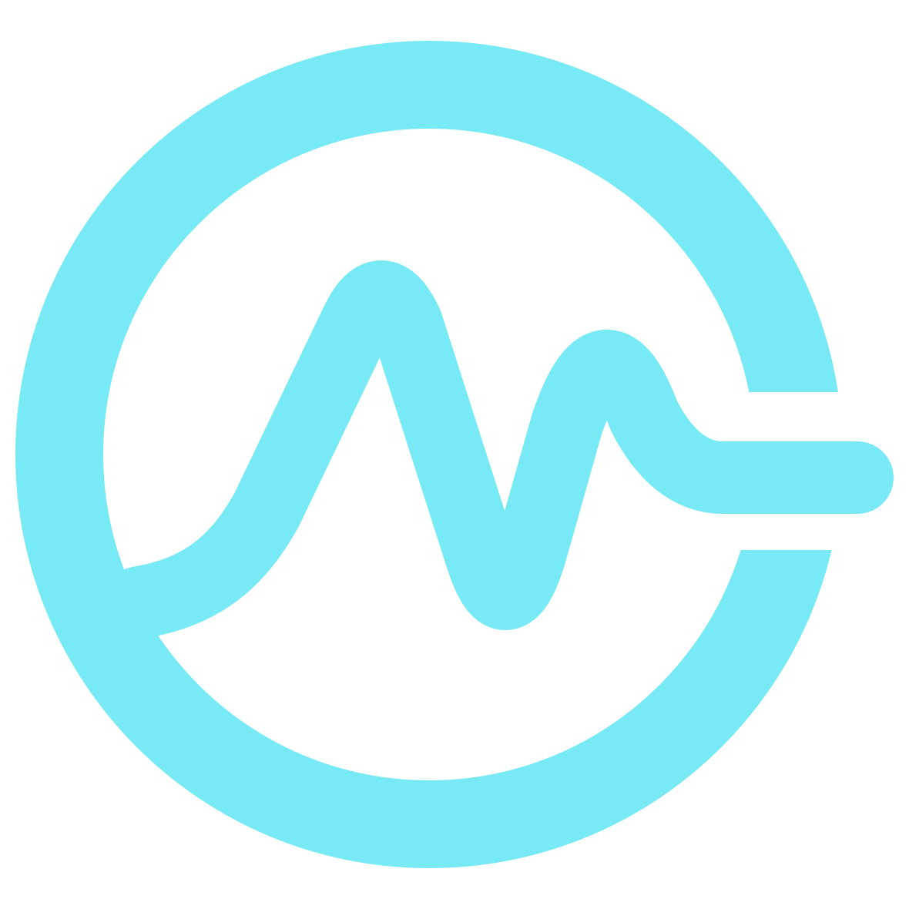

# OpenEMG App



肌电采集、训练和使用的单机 App。
肌电页面的**唯一码源在这里**：`app/src/emg8/` 和 `app/electron/emg8-*`。包含统一的多通道肌电工作室与入门采集向导。

```
页面（src/，Vite + React） ──window.pt.emg8──▶ electron/emg8-ipc.cjs ──HTTP──▶ emg8-server.py → ../host/emg_web.py --wl8
```

## 跑起来

```bash
npm install
npm start                      # 构建页面并开 App；连真腕带
npm run dev                    # 网页版：Chrome / Edge 打开，用 Web Serial 直连接收器
npm run check                  # JS 解码与 host/wl8.py 逐帧对拍；后面加 <录音.npz> 再拿真实录音对一遍
npm run check:seal-game        # 结印映射与放松门单测，再开 Electron 用合成信号跑真识别页（要图形界面；CI 只跑前半）
npm run check:cloud            # 可选云端同步协议契约检查（需设 VIBE_HW=<测试服务端目录>）
npm run check:gesture-library  # 动作库 16 个动作左右手 jpg/mp4 都在 public/，地址是相对路径；pack 时对 dist/ 再查一次
npm run check:missing-label    # 训练页「还缺…」用中文类别名（抓握组没有 gestures 也要显示放松 / 捏合 / 握拳）
npm run check:rewear-hint      # 跨佩戴用旧模型的提醒：模型 created 早于手环最近一次重新出数据（link_since）才提醒
npm run pack                   # 打成 out/OpenEMG-darwin-arm64/OpenEMG.app，自带 Python，别的 Mac 装上就能用
```

打包（`scripts/bundle-python.sh` + `scripts/pack.mjs`）：独立 CPython 3.12.12 + numpy/scipy/scikit-learn/pyserial/bleak/h5py（版本对齐本机训练环境）+ `host/` 运行时代码 + 手势算法里实际用到的 features/rolling_buffer，都放进 `Contents/Resources`。软链全部换成实体文件（打包门会拦外部软链），标准库必须来自包内（脚本自检 sys.base_prefix）。不带 torch、matplotlib、pandas（WL8 路径只在函数里延迟导入）。整包约 610 MB，其中 Electron 300 MB、Python 270 MB。

App 顶部「设备」切换：八通道用完整的肌电工作室（emg8-server.py）；单通道（Cheez + ESP32-S3）嵌 host/emg_web.py 的 /guide 引导录制页（emg1-server.py，和 PrintThings「单通道」同一个后端），两种服务同一时间只起一个（串口独占）。图标源图 `icon/icon.svg`；透明底 Logo `icon/logo.svg`，网页 favicon `public/favicon.svg`（都按 2026-10-16 幻灯片 v9 原图描成矢量）。普通浏览器里是网页版（`src/web.tsx`）：连接、八路波形、采样率/丢帧/每路 RMS，解码在 `src/wl8.ts`。

| 环境变量 | 作用 |
|---|---|
| `YUANLI_REPLAY=<录音.npz>` | 按原速回放推流：能连、能看，不能录 |
| `YUANLI_FAKE=1` | 合成台架；emg_web 不允许假台架写工程，页面会停在连接步 |
| `YUANLI_PLATFORM=<地址>` | 云端平台地址，默认留空（仅本地运行） |
| `YUANLI_USERDATA=<目录>` | 自检用临时数据目录，不碰正式数据 |
| `YUANLI_PY` / `YUANLI_HOST` | 换 Python / host 目录；打包后默认用 Resources 里自带的，开发时默认使用仓库 `.venv` 与 `host/` |

数据（工程目录 `project/`）在 `~/Library/Application Support/原力手环/`：2026-10-16 改名 OpenEMG 后仍用旧目录名（main.cjs 钉住），已录数据和设置不用搬家。

## 现状

- 已实现：外壳、单工程、采集服务起停（App 被强杀时服务自己退出）、页面全部复用。
- 回放实测：连接 8/8、丢帧 0，录动作页八路波形正常；真腕带录制未测。
- 网页版：JS 解码与 Python 对拍逐帧一致（合成 + 卖家 XCOM 实拍 + 真实录音，随机切块 20 轮）；浏览器里用假串口验证读取、2 kHz、丢帧计数和波形。真接收器经 Web Serial 未测。
- 自带 Python：在禁读 ~/.local/share/uv、本机训练环境和 ~/go 的 sandbox-exec 里，包内 Python 起采集服务正常，sys.base_prefix 在 .app 内（同一沙箱拦住了本机 Python，阴性对照成立）；.app 复制到仓库外运行回放连接 8/8、1994 Hz；首次打开 32 秒、第二次 10 秒就绪；强杀无残留。同一份六类数据，包内 Python 与本机训练环境训练结果逐项一致。没签名公证，别的 Mac 要右键打开；没在另一台 Mac 上试。
- 未做：网页录制与上传、平台训练（第 4、5 步）。
