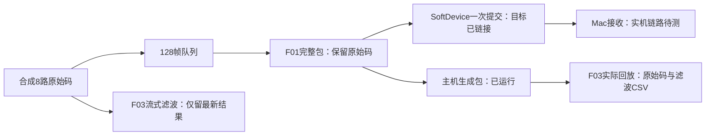

# F04：XIAO Sense 合成诊断固件

2026-10-03。状态：**已实现未验收**。2/4kHz目标已链接，主机检查和独立代码复核通过；未刷机、未测真实BLE/ADC或佩戴。代码把D0模拟电源使能固定低，未实现真实AFE启动。

## 已跑通的范围



2/4kHz为候选。滤波结果目前不随BLE发送；数据特征发送27字节原始ADS格式帧，状态字为合成的0xC00000。时间戳来自合成调度时刻，不能当作真实DRDY采样时刻。

两环境Flash各126,052字节，静态RAM各20,896字节。未测运行时间、动态堆/栈峰值及吞吐；链接器保留的.heap空间不能当成实测空闲内存。

## 复现（仓库根目录，不访问设备）

```sh
python3 firmware/xiao-f04/check.py
python3 firmware/xiao-f04/main-check/run.py
uv run --no-project --with numpy python firmware/xiao-f04/end_to_end.py
pio run -d firmware/xiao-f04 -e synthetic_2k -e synthetic_4k
python3 firmware/xiao-f04/collect.py
```

PlatformIO Core 6.1.19；使用本机已有Seeed框架、GCC 7.2.1。platform与framework的完整提交号固定在platformio.ini。构建前核实际SDK的D0–D10和4个IMU内部针脚。实物修订、Bootloader和连接器未确认，未提供自动刷机步骤。

`collect.py`检查输入哈希、ELF模块及镜像内构建ID，核HEX/DFU字节一致、CRC与SoftDevice需求版本。源码改动后拒绝旧构建。镜像留在忽略的artifacts目录，清单为build-manifest.json。检查不等于设备可升级或已运行。

## 蓝牙契约

设备名MAKO-V12-SYN-2K/4K。服务UUID为`7b24c101-3948-4f03-9d11-12bb9d000001`，末尾002/003/004分别是数据通知、元信息读取、计数读取。沿用[F01](../offline-f01/README.md)协议，仅SYNTHETIC来源；未定义IMU包或真实ADC配置。

- 元信息含profile、build_id、fs_Hz、channels、afe_enabled、protocol、notch；build_id用于核实设备运行版本，不能只认设备名。
- 计数为40字节：5个小端uint64，依次是生成帧、队列丢新帧、调度跳过帧、提交帧、通知失败次数。缓存约每秒更新，按连接重置。提交帧只表示SoftDevice接受，不能当作Mac收到。
- MTU至少46才容纳一帧；46/185/247分别容纳1/6/8帧。MTU23时不发送半包。包头16字节，最多8帧、232字节；按实际协商MTU分包。
- 128帧队列满时丢新样本，仍推进序号。发送失败保留同一字节串，成功完整提交才出队。包内不能跨序号或时间缺口；Mac须按序号计丢帧。断连后新会话从序号0开始。
- 2/4kHz原始数据为54/108kB/s；每8帧一个包时，含F01包头为58/116kB/s，尚未含BLE开销。MTU和连接参数请求不保证电脑接受，也不证明实际吞吐。

## 本轮修复与证据

1. `skip(0)`保留滤波状态；正缺样重置恢复标记。
2. 避开Bluefruit库notify的自动分片与阻塞信号量；使用非阻塞`sd_ble_gatts_hvx`一次提交，拥塞时重试。
3. 同步BLE事件记录代次与MTU，短暂停任务切换保护快照/提交，不把连接指针带回loop；同句柄重连不得发送旧代次数据。
4. 已固定的旧SDK在断连删除连接后仍用局部conn分发角色。sdk_patch.py按精确SHA核源、只在本项目构建副本清空该指针。共享SDK缓存未修改；源变则停止构建。构建方式依据[PlatformIO官方middleware文档](https://docs.platformio.org/en/latest/scripting/middlewares.html)。

results.json记录普通/UBSan共12,936次队列状态差分及6个必失败反例。main-check读取真实main并替换SDK外壳，核GPIO置低顺序、资源重试、100ms停顿计数和同句柄重连；不能替代真实RTOS/无线测试。两环境各1,200帧实际回放、缺16帧均检出，见e2e-results.json。独立复核见REVIEW.md。

## 下一段工作

[电气P0关闭并同步图纸/J1/BOM] → [核XIAO实物、Bootloader与电池] → [离体电源波形与真实DRDY/SPI驱动] → [Mac采集＋2/4kHz无线丢包/功耗] → [真实线束扫频与噪声] → [机械首件测力及安全复核后佩戴]

现有PWDN/PG上电窗口、电极故障路径、连接器和制造文件仍开放。固件D0低电平不证明复位前电源状态，也不构成USB隔离。IMU尚未接入。保留胶囊、连续软贴肤面和17路电极方案，打印、装配与舒适性须实物验收。
