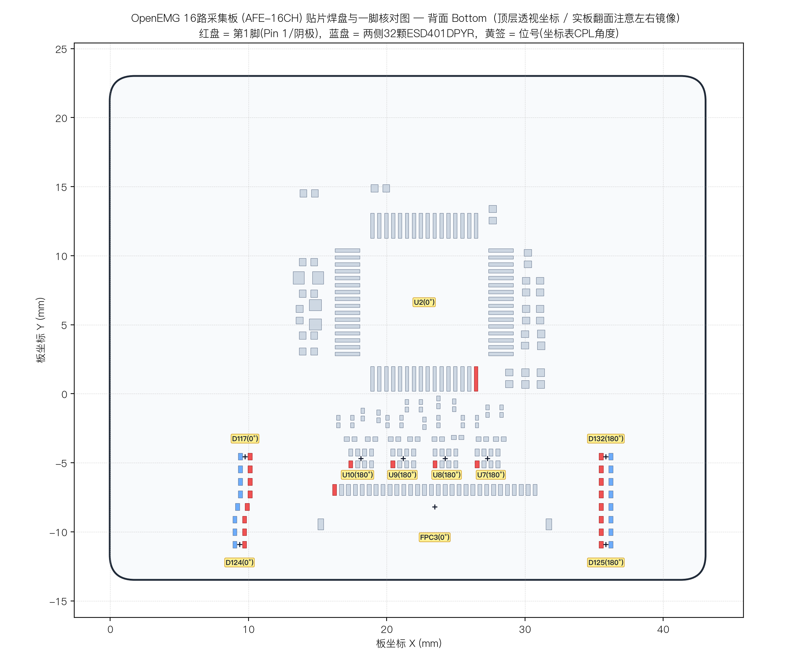

# 16 通道双板汇总工程与 1.0 mm 广濑双 30 针 1 nF 采集板（`v0.01`）

本目录归档 `OpenEMG v0.01` 双板合并嘉立创 EDA 专业版工程（含 6 层主控板与 4 层 16 通道采集板，共 7 页原理图 + 2 块圆角 `43.10 × 36.50 mm`、`R1.80` PCB），以及与该工程采集板逐位号同步导出的四层单板生产制造包。

| 识别项 | 本目录广濑 `1 nF` 版（`v0.01`） | [讯普 `2.0 mm` `1 nF` 版](../16ch-afe-xunpu-2mm-1nf/) | [广濑 `22 pF` 穿戴版](../16ch-u9-dual30/) |
|---|---|---|---|
| 工程形态 | 双板合并 `.epro2`（`01 主控板` + `02 采集板`） | 采集板独立 `.epro` / `.epro2` | 主控与采集板分立 `.epro2` + 软板 + 外壳 |
| 板框包络 | `43.10 × 36.50 mm`，四角 `R1.80` 圆角 | `43.10 × 36.67 mm`，直角 | `43.10 × 36.50 mm`，四角 `R1.80` 圆角 |
| `FPC1`、`FPC3` 表带座 | 广濑 `FH34SRJ-30S-0.5SH(50)`，`1.0 mm` 超薄上下双触点，`C324727` | 讯普 `FPC-05F-30PH20`，`2.0 mm`，`C2856808` | 广濑 `FH34SRJ-30S-0.5SH(50)`，`1.0 mm`，`C324727` |
| 输入 RC 网络 | `32 × 15 kΩ` + `32 × 470 pF` 对地 + `16 × 1 nF` 跨通道 | `32 × 15 kΩ` + `32 × 470 pF` 对地 + `16 × 1 nF` 跨通道 | `32 × 15 kΩ` + 32 颗共模空贴 DNP + `16 × 22 pF` 跨通道 |
| 负电源反馈 `R4` | `104 kΩ ±0.1%`（0603，`RT0603BRD07104KL`，`C861070`，现货） | `105 kΩ`（0402，`C2984407`） | `105 kΩ ±0.1%`（0402，`C2984407`） |
| 偏置串阻 `R34`、`R36` | `10 kΩ`（0402，`C25744`，离体台架直通软尾配置） | `392 kΩ`（暂选待回签） | `392 kΩ`（0402，`C99199`，配 `100 kΩ/200 kΩ` 保护软板） |

### 在线看图

[七页原理图（矢量 PDF）](views/schematic.pdf) · [主控六层走线](views/mcu-copper.png) · [采集四层走线](views/afe-copper.png) · [双板叠放](views/v001-stack-iso-dark.png) · [结构爆炸图](views/v001-exploded-iso-dark.png)

原理图由嘉立创 EDA 专业版 4.1.93 从本目录双板工程导出。走线图使用本目录两个 Gerber 包，按顶层、内层、底层排列，底层保持板顶视角。装配图使用相同 Gerber 的板框、阻焊和丝印，搭配 U9 壳体 CAD，按 0.8 mm 裸板展示。

### 工程与制造文件

[双板合并嘉立创工程 `.epro2`](OpenEMG_v0.01_DualBoard.epro2) · [采集板单板 Gerber（含钻孔与 `LM1` 双窗钢网）](Gerber_AFE-30P.zip) · [采集板贴片 BOM](jlc_smt_bom.csv) · [采集板贴片坐标 CPL](jlc_smt_cpl.csv)

- **采集板贴片清单**：整板共 **23 种料、114 个贴片位号**（顶面 64 个、底面 50 个，已剔除 4 个非贴片定位孔 `SCREW1–SCREW4`）；上传 `jlc_smt_cpl.csv` 时保持嘉立创平台默认的 **「AD,99SE,Allegro,PADS(宏)等其他」** 选项（切勿改选「嘉立创EDA」），并在贴片预览页核对 `U1/U2/FPC1–FPC3` 第 1 脚朝向。Gerber、BOM、CPL 与底面装配图成套同步，不可与直角框或 `0402 R4` 的历史文件混用。
- **配套主控板制造包**：双板工程内的 `01 主控板` 与 [`../16ch-u9-dual30/fab-mcu-u9/`](../16ch-u9-dual30/fab-mcu-u9/) 铜皮走线及 110 颗贴片位号一致（主控贴片需排除测试点、焊盘电池座 `J401` 及默认禁贴跨接件 `JP701 / R7 / R213`，贴片 BOM 与坐标沿用 `fab-mcu-u9/`，本次主控打样使用[评审后主控单板 Gerber](Gerber_C08B-U9_v0.01.zip)；注：`.epro2` 源内 `J401` 原理图符号保留第 3 空置 NTC 引脚且机械定位孔勾有加入 BOM，切勿从 `.epro2` 直接一键导出 BOM/钢网投产）。

### 采集板打样与安全边界须知

1. **必选盘中孔树脂塞孔 + 电镀盖帽（IPC-4761 Type VII）**：采集板存在 7 处同网络盘中孔/切焊盘过孔（`LM1.13` 散热焊盘 3 孔、`C63.1/C101.1`、`C65.1/C99.1`、`C7.1`、`C3.1`，均为同网连接无短路），嘉立创下单时过孔塞孔工艺须选 **树脂塞孔+电镀盖帽**，防止回流焊漏锡立碑。
2. **`LM1`（`WSON-12`）顶面钢网双窗裁切**：本目录 `Gerber_AFE-30P.zip` 的 `.GTP` 已按 TI `DSS0012B` 规范将 `LM1.13` 散热焊盘钢网拆分为左右双窗（覆盖率 `78.25%`，中央留 `0.20 mm` 防锡珠隔筋）；若从 `.epro2` 重新导出原生 Gerber，需重新执行双窗分切。
3. **板厚选择**：工程默认物理叠层记为 `1.6 mm`（适合离体台架）；若需装入 [`../16ch-u9-dual30/enclosure-u9-watch/`](../16ch-u9-dual30/enclosure-u9-watch/)（`9.60 mm` 超薄表壳），下单时板厚须选 **`0.8 mm`**。
4. **贴肤限流与共模滤波匹配**：本板装满 `32 × 470 pF` 对地电容且 `R34/R36 = 10 kΩ`，面向**低阻直通电极线离体台架测试**；若用于人体穿戴并配接串有 `100 kΩ`（采样）/ `200 kΩ`（偏置）保护电阻的 [`strap-fpc-30p`](../16ch-u9-dual30/strap-fpc-30p/)，请使用将 `R34/R36` 换为 `392 kΩ`、空贴 32 颗对地共模电容并将跨通道电容改为 `22 pF` 的 [`../16ch-u9-dual30/fab-afe-30p/`](../16ch-u9-dual30/fab-afe-30p/)，避免高源阻与 `470 pF` 容差劣化 50 Hz 共模抑制比，并确保单一故障贴肤限流达标（参见 [`../../SAFETY.md`](../../SAFETY.md)）。

### 底面装配方向

从板底正视（水平镜像 X），`FPC3` 所在南侧板边朝下。红圈对应 `U2`（`ADS1298`）第 1 脚焊盘；软排线从板外下方向上插入 `FPC3`。

