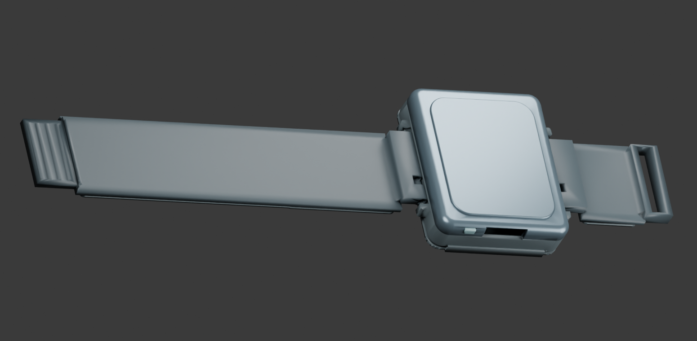
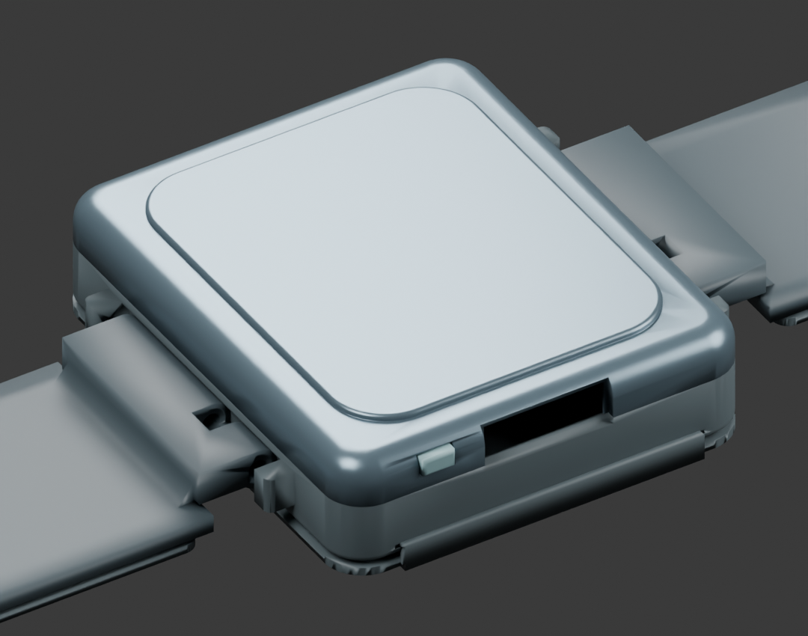

# OpenEMG v0.01 · 25 mm 表带与 R3 外壳套件（含修订六孔底盖与内衬裁切 DXF）

> [!IMPORTANT]
> **状态声明（已投单打样 · 待实物试装验收）**
> 本目录归档适配 [`OpenEMG v0.01` 双板](../README.md) 与 [`strap-fpc-a5b1` 双层表带软板](../strap-fpc-a5b1/README.md) 的 **25 mm 宽表带 R3 外壳结构件**、**孔距修订版贴肤六孔底盖（`15.90 × 15.00 mm`）** 以及 **`0.8 mm` 片材内衬裁切 DXF**。当前已提交首轮 3D 打印打样，尚待到件开展双板、电芯与 B 板 `U10` 折回穿孔的断电试装验证。

## 1. 外观预览

| 整机与保护表带全景 | 圆角上盖薄台细节 |
|---|---|
|  |  |

## 2. 零件清单与推荐打样工艺

整机装配模型 [`assembly.step`](assembly.step)（78 实体）已同步将第 6 个零件替换为修订六孔底盖 [`cap.step`](cap.step)（与 `tray`、`south_backing` 等相邻结构件三维布尔交叠体积为 `0.000 mm³`）：

| 加工方式 | 文件（STEP + STL / DXF） | 推荐材料与后处理 | 关键尺寸与装配说明 |
|---|---|---|---|
| **3D 打印 · 硬质壳体（4 件）** | [`cap.step`](cap.step) / [`cap.stl`](cap.stl) [`tray.step`](tray.step) / [`tray.stl`](tray.stl) [`cover.step`](cover.step) / [`cover.stl`](cover.stl) [`side_button.step`](side_button.step) / [`side_button.stl`](side_button.stl) | 光敏树脂（如 `9600` 哑光白，壳体粗磨，`side_button` 微小件免打磨） | `cap` 为贴肤六孔底盖（包络 `48.48 × 40.00 × 2.51 mm`），两排六孔中心距 **`15.90 × 15.00 mm`**，对齐 `strap-fpc-a5b1` 的 **A5＋B1** 柱位；`cover` 顶面融合 `39 × 32 mm` 圆角薄台 |
| **3D 打印 · 弹性表带背板（2 件）** | [`north_backing.step`](north_backing.step) / [`north_backing.stl`](north_backing.stl) [`south_backing.step`](south_backing.step) / [`south_backing.stl`](south_backing.stl) | `TPU` 弹性体（半透明或黑色） | `25.0 mm` 宽保护表带外层背板（北短带 `35.6 mm`，南长带 `118.7 mm`） |
| **片材裁切 · 电极定位内衬（不走 SLA）** | [`liner-0.8mm-cut.dxf`](liner-0.8mm-cut.dxf) （三维装配对位参考：[`north_liner.step`](north_liner.step) / [`north_liner.stl`](north_liner.stl)、[`south_liner.step`](south_liner.step) / [`south_liner.stl`](south_liner.stl)） | `0.8 mm` 柔性绝缘片材激光/模切裁切 | `0.8 mm` 薄壁内衬低于常规树脂 3D 打印 `1.2 mm` 壁厚规范，直接使用毫米单位 `liner-0.8mm-cut.dxf` 裁切成型，四角已做 `R1.5 mm` 倒圆防顶表带槽 |
