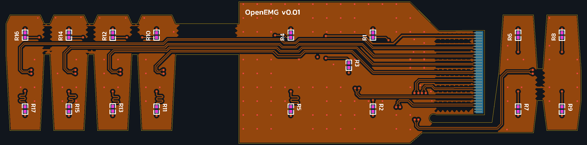
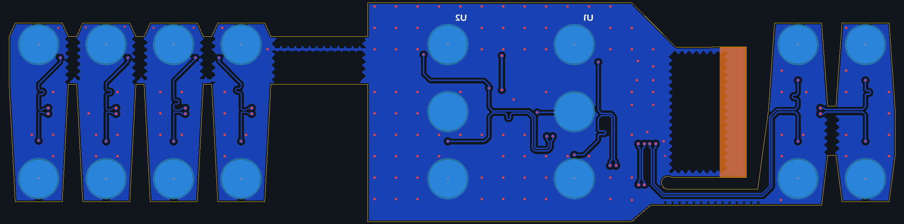
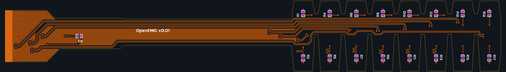
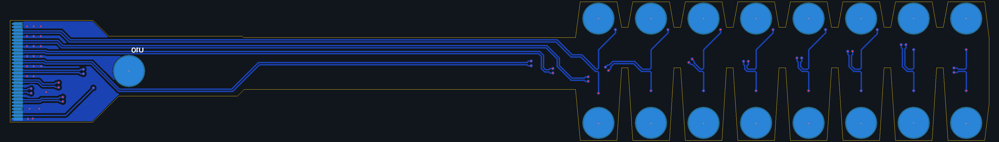

# OpenEMG v0.01 双层表带柔性电极软板（盒底 A5＋B1 方案）

> [!IMPORTANT]
> **状态声明（已投单打样 · 待实物试装验收）**
> 本目录归档适配 [`OpenEMG v0.01` 广濑 `1.0 mm` 双 30 针 16 通道采集板](../README.md) 的最新双层（2 层）FPC 表带电极软板定稿工程与嘉立创直接上传制造包。当前处于**首轮打样与贴片审单阶段，尚未完成到件断电试装（尤其是 B 板尾端 `U10` 折回穿过盒底第 6 孔后的柱头齐平度与弯折余量待实物验证）**；如需复刻，建议待实物试装记录更新后再批量制作。

## 1. 盒底 A5＋B1 六触点布局方案

为避免在南侧长表带另开辅助孔、同时保证盒底贴肤面具备完整的 **6 根导电接触柱（4 路采样 + 2 路辅助偏置/参考）**，本版采用 **A 板 5 根 + B 板折回补第 6 根（A5＋B1）** 的装配定稿：

| 软板 | 尺寸与层数 | 金手指与 PI 补强 | 贴肤接触柱配置 | 顶面贴片限流电阻（SMT） |
|---|---|---|---|---|
| **Strap FPC A**（短带 + 盒底主阵列） | 2 层 FPC，`0.11 mm`，`105.00 × 26.00 mm` | `U9` 30P 金手指背面（Bottom）单处 **`0.20 mm` PI 补强**（金手指总厚 `0.30 mm`），弯折区双面无补强 | 共焊 **17 根柱**：北短带 12 根 + **盒底 `U1` 满装 3 根、`U2` 两端装 2 根**（`U2` 中间焊盘空置，不焊悬空装饰柱） | 顶面单面贴 **17 颗 `0402`**：`16 × 100 kΩ`（`C25741`）+ `R3 1 × 200 kΩ`（`C25764`） |
| **Strap FPC B**（长带 + `U10` 折回补孔） | 2 层 FPC，`0.11 mm`，`149.10 × 21.20 mm` | `U9` 30P 金手指背面（Top）单处 **`0.20 mm` PI 补强**（金手指总厚 `0.30 mm`），弯折区双面无补强 | 共焊 **25 根柱**：南长带 24 根 + **尾端 `U10`（接 `BIAS_2`）装 1 根柱，装配时折回穿过底盖第 6 孔** | 顶面单面贴 **17 颗 `0402`**：`16 × 100 kΩ`（`C25741`）+ `R3 1 × 200 kΩ`（`C25764`） |

- 盒底两排 6 孔中心距为 **`15.90 × 15.00 mm`**（相对盒中心 `X = ±7.95 mm, Y = 0 / ±7.50 mm`），与配套结构目录 [`../enclosure-25mm-r3/cap.step`](../enclosure-25mm-r3/cap.step) 一一对齐。
- 顶层钢网（`GTP`）每板仅保留 **34 个 `0402` 电阻焊盘开窗**，底层钢网（`GBP`）为 **0 开窗**；贴肤面电极圆柱（参考尺寸 `Φ4.0 × 2.0 mm`）由后续工序手焊或导电装配。

## 2. 600 DPI 制造层与补强区检视图

橙色半透明区域标示唯一保留的金手指 `0.20 mm` PI 补强层（`A` 板在 `GBSL`，`B` 板在 `GTSL`），板框外悬空丝印已全部清零：

| 板件 | 顶视图（Top） | 底视图（Bottom） |
|---|---|---|
| **Strap FPC A** |  |  |
| **Strap FPC B** |  |  |

## 3. 工程源码与直接上传制造包

- **嘉立创 EDA 专业版双板源工程**：[`OpenEMG_v0.01_Strap_FPC_A5B1.epro2`](OpenEMG_v0.01_Strap_FPC_A5B1.epro2)（包含 `Strap FPC A` 与 `Strap FPC B` 原理图及 PCB）
- **A 板直接上传包**：[`fab/OpenEMG-FPC-A-A5B1-Gerber.zip`](fab/OpenEMG-FPC-A-A5B1-Gerber.zip) · [`fab/A-SMT-BOM.csv`](fab/A-SMT-BOM.csv) · [`fab/A-SMT-CPL.csv`](fab/A-SMT-CPL.csv)
- **B 板直接上传包**：[`fab/OpenEMG-FPC-B-A5B1-Gerber.zip`](fab/OpenEMG-FPC-B-A5B1-Gerber.zip) · [`fab/B-SMT-BOM.csv`](fab/B-SMT-BOM.csv) · [`fab/B-SMT-CPL.csv`](fab/B-SMT-CPL.csv)

### 嘉立创 FPC + SMT 下单参数要点

1. **基材与表面处理**：FPC 软板、双面板、成品厚度 `0.11 mm`、黄色覆盖膜、沉金 `1 u"`、插拔金手指斜边无（总厚 `0.30 mm`，背贴 `0.20 mm` PI 补强，以 Gerber 内的 `.GBSL` / `.GTSL` 层为准）。
2. **SMT 拼板工艺边**：勾选「需要 SMT」时，选择嘉立创帮拼 **`1 × 1`** 并采纳推荐四边工艺边方案（使短边达到 `7.90 cm` 治具档：A 板拼后 `15.80 × 7.90 cm`，B 板拼后 `20.69 × 7.90 cm`）。
3. **补强与贴片顺序**：选择 **`先贴补强,后SMT`**（热压胶贴合，无需 3M 背胶附加费），订单确认方式勾选 **手动确认订单**，发货方式选 **不同交期订单不一起发货**；待 FPC 审单通过后再进入关联 SMT 上传同目录 `BOM.csv` 与 `CPL.csv`（单面只贴顶层、经济型）。
