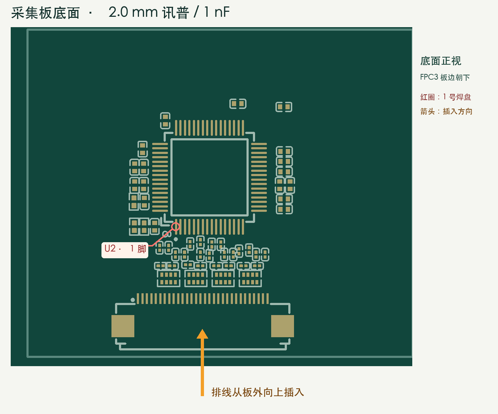

# 16 通道采集板 · 2.0 mm 讯普双 30 针座 · 1 nF

本目录归档与 U9 主控配套的 AFE-30P 四层采集板。两颗 ADS1298 各采 8 路，FPC1、FPC3 接表带，FPC2 接主控。此版本处于工程复核阶段，尚未下单或实物验收。

| 识别项 | 本目录的讯普版 | [广濑版](../16ch-u9-dual30/)（对照提交 a43e445） |
|---|---|---|
| FPC1、FPC3 | 讯普 FPC-05F-30PH20，2.0 mm，C2856808 | 广濑 FH34SRJ-30S-0.5SH(50)，1.0 mm，C324727 |
| 16 颗差分电容 C72–C79、C109–C116 | 1 nF，村田 GRM0335C1H102GE01D，C3857115 | 22 pF，村田 GRM0335C1H220JA01D，C76924 |
| 表带配套 | 已核对的软板设计采用铜线直连，采样线每根由采集板串 15 kΩ；加长软尾最终铜稿待确认 | 配套保护软板在每根采样线上另串 100 kΩ，每路偏置另串 200 kΩ |

### 工程与制造文件

[嘉立创工程 .epro](AFE-30P.epro) · [嘉立创工程 .epro2](AFE-30P.epro2) · [单板 Gerber（含钻孔与飞针表）](Gerber_AFE-30P.zip) · [贴片 BOM](jlc_smt_bom.csv) · [贴片坐标 CPL](jlc_smt_cpl.csv)

整板 BOM 共 23 种料、114 个贴片位号，顶面 64 个、底面 50 个。负电源反馈 R4 为 105 kΩ（C2984407）。上传 `jlc_smt_cpl.csv` 时保持嘉立创平台默认的「AD,99SE,Allegro,PADS(宏)等其他」选项（底层元件已做 `+180°` 对齐补偿）。Gerber、BOM、CPL 和装配图请成套使用。

### 待工程师确认

2026-11-15 核对了工程师原版与修订版的逐位号对照、当前贴片 BOM 和 Gerber 中的飞针网表。三个器件都在贴片清单里。下面的接线来自制造文件，数值是设计值，尚待台架验证。

| 位号 | 工程师原版 → 当前 BOM | 实际接线 |
|---|---|---|
| R34 | 10 kΩ → 392 kΩ | U1 的 63 脚经 R34 接 FPC1 的 2 脚，是第一路偏置输出串阻。 |
| R36 | 10 kΩ → 392 kΩ | U2 的 63 脚经 R36 接 FPC3 的 2 脚，是独立的第二路输出。 |
| C17 | 100 pF → 10 nF | C17 与 R32（392 kΩ）并联，接在 U2 的 63 脚与 61 脚之间，是第二路反馈电容。 |

**待确认的是整条偏置回路。** 两路输出在采集板上分开到两个连接器。需对照最终软板确认两个辅助触点的去向，并确认 U1、U2 在目标固件中的偏置使能设置。请设计者据此明确 R34、R36、C17 各自的装配值或不贴，并在离体台架用预期负载检查偏置输出是否饱和或振荡。当前 BOM 记录的是修订稿，三项改值仍缺同版签核。

### 底面装配方向

从板底正视，FPC3 所在板边朝下。红圈对应 U2 左下角的 1 号焊盘；排线从板外向上插入 FPC3。此图按本目录 Gerber 和飞针坐标绘制，厂方贴装预览及实物方向仍待核对。

