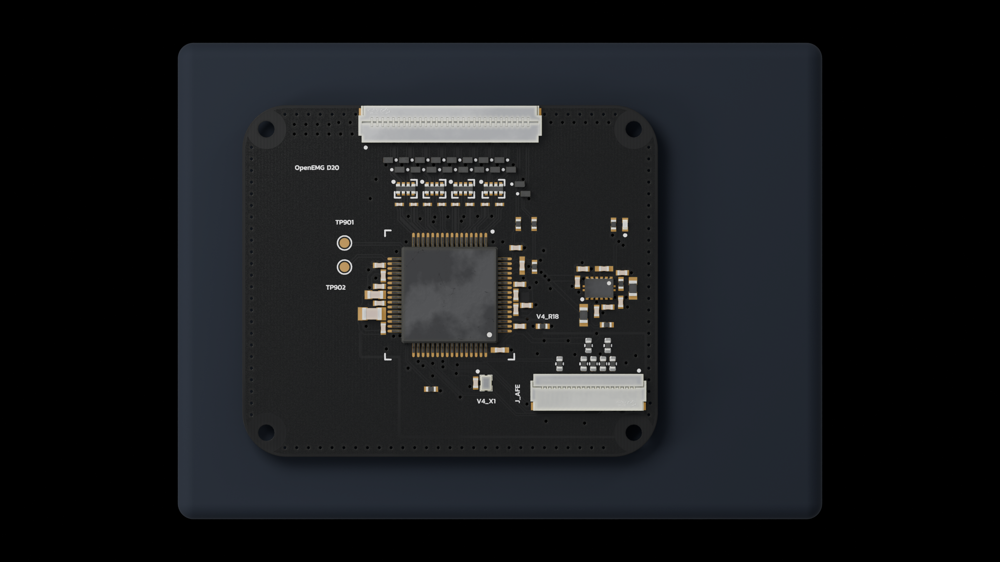
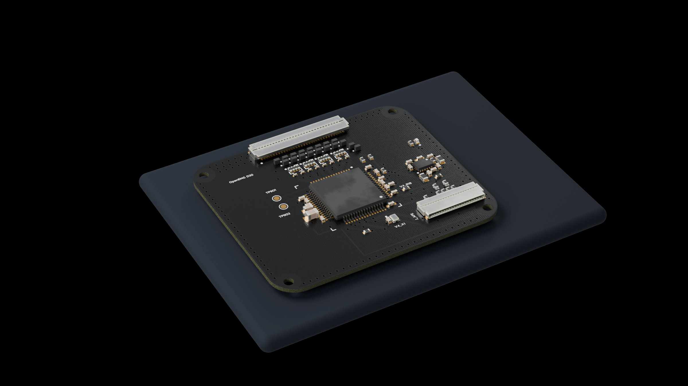

# 16 通道旗舰圆角上下叠板（`16ch-c08b-round`）

上层配共用主控 [`../common-mainboard/mainboard-r4u6/`](../common-mainboard/mainboard-r4u6/)，下层为本目录的双面双 `ADS1298` 16 通道采集板 `afe-d20/`，外接 34P 四层柔性表带软板，装入 [`../enclosure-46x40/c08b-shell-r12/`](../enclosure-46x40/c08b-shell-r12/) 或 [`../enclosure-46x40/c08b-shell-r13-notch/`](../enclosure-46x40/c08b-shell-r13-notch/) 圆角外壳。

| 采集板 `D20` 正交俯视（渲染预览） | 采集板 `D20` 透视斜视（渲染预览） |
|---|---|
|  |  |

## 目录结构

- `afe-d20/`：采集板 KiCad 10 原生工程（自带 `libs/` 封装库与 `assembly/models/FPC2-fh34.step`，DRC 0 违规 / 0 未连）、满载 127 颗器件的整板三维模型 **`c08b-afe-d20-3d.step`**、邮票孔拼板 Gerber、双面 SMT BOM/CPL。
- `schematics-afe/`：采集板 4 页 SVG 原理图及 529 脚逐脚对板校验脚本 `check_all.py`。
- `jlc-eda/`：**嘉立创 EDA 专业版完整工程**（`C08B-全套汇总-主控R4U6-采集D20.epro2` 与 `C08B-AFE采集板-D20-原理图+PCB+3D.epro2`）。
- `strap-fpc-d2/`：配合现成 `25 mm` 表带贴装的 12+2+2 四层 34P 双片表带电极软板（含 `strap-{a,b}-3d.step`）及 `0.8 mm` TPU 开孔定位层（`tpu-layer-d2/`，含 `.step`/`.stl`/`.3mf`）。
- `strap-fpc-r15/`：配合一体成型 TPU 表带入口（`c08b-shell-r12` / `c08b-shell-r13-notch`）的 34P 四层双片软板（含 `strap-{a,b}-3d.step`）。
- `pod-d1/`：穿在现成 `25 mm` 魔术贴表带上的独立 TPU95A 电极豆方案（`pod_d1.step`、7 连条 `pod_strip_d1.{step,stl}` 与 Bambu X2D 切片包 `.3mf`）。
- `firmware-guide.md`：双片 `ADS1298` 同源 `2.048 MHz` 同步采样状态机与寄存器配置手册。
