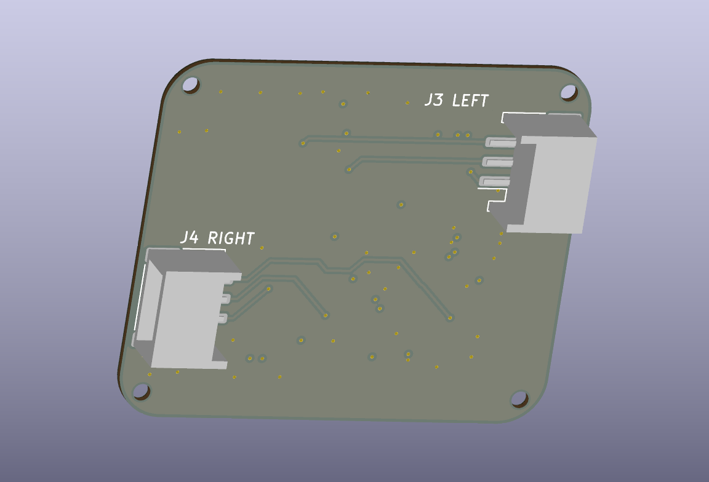

# S1 双肩肌电采集板

S1 是从双通道 R10派生的台架候选。使用 ADS1292 与原有 P44e + XIAO nRF52840 Sense。43.1 × 36.5 × 0.8 mm 四层采集板底面有两只电极线插座。工程入口为 [shoulder-s1.kicad_pro](shoulder-s1.kicad_pro)。静态设计已完成，尚未打样、上电或贴肤。

[下载整板 STEP](shoulder-s1.step) · [KiCad 原理图](shoulder-s1.kicad_sch) · [接口针序与出线图](board-bottom.png) · [模型来源与许可](MODELS.md)

## 两束电极线

| 插座 | 出线方向（从元件面看） | 1 脚 | 2 脚 | 3 脚 |
|---|---|---|---|---|
| J3 LEFT | 西边 | 左肩 CH1+ | 左辅助参考 | 左肩 CH1− |
| J4 RIGHT | 东边 | 右肩 CH2+ | 右辅助参考 | 右肩 CH2− |

每束使用一只 JST PHR-3 线端胶壳配 S3B-PH-SM4-TB 板端侧插座。线端按壳体的 1 脚标记核序，通断档逐芯核对。每束两根测量线在同侧成对走线，第 2 脚单独引出。两根辅助参考分别经过 620 kΩ，在板内汇合后经 300 kΩ 接 RLDOUT；它们由同一偏置驱动，均不可接屏蔽或电源地。四个信号输入各经两颗 300 kΩ 和中间节点的 ESD 保护。两只插座的 MP 是机械焊脚，每只座的两只 MP 在板上相连并与信号、电源地隔开。[JST PH 系列图纸](https://www.jst-mfg.com/product/pdf/eng/ePH.pdf)

J3 与 J4 的插拔轴线分别朝外，PCB 面内出口各自面向就近板边。两座均增加板底高度。肩颈壳需要双侧开口和两处夹持绝缘外皮的线夹，导线拉力应由壳体承受。既有腕带底盖开的是六个干电极孔，不能据此认定新插头能穿壳。首件需核插头、线夹、完整插拔行程及右侧上下两层 JST 线束与 J2 排线的共存。板底插座可手焊用于首件。

## 台架验收设计

下表为建议的原型验收条件，全部未实测。使用模拟负载和隔离差分信号源，记录实际线长、输入幅值、增益与原始帧。上电前核回路和电池供电时序；保留 R32 / Q1 的 USB 关断互锁及固件硬件锁。未确认供电、互锁及限流前，保持锁定。

| 测项 | 方法 | 建议通过条件 |
|---|---|---|
| 线束与保护 | 断电，从每根线远端量到板端针脚。核 4 个测量输入各到第一、第二级电阻末端，参考线到 RLDOUT。 | 线序同上表，输入约 300 / 600 kΩ，参考各约 920 kΩ。检查压接和绝缘。 |
| 通道与频响 | 正常双差分输入模式，先给左路、再给右路，从线束远端注入等幅正弦，另一通道接匹配的无信号模拟负载。每路扫 20、50、100、250、450 Hz。禁用显示端滤波，用原始 SPI 采样比较幅值。 | 4 kHz 为首选档。两路单独核算相对 100 Hz 的增益，各频点在 ±3 dB 内。记录另一通道同频响应和底噪，建议串扰 ≤ −40 dB。 |
| 同步和掉样 | 分别以 2 kHz、4 kHz 连续采 60 秒，同步比对 DRDY 边沿、两通道原始帧和溢出计数。 | 每个 DRDY 对应一个含两路数据的帧。按实测时钟核采样频率，完整记录窗口内无跳帧、无溢出。分别记录 SPI 与主机收包结果。 |
| 外接线与互锁 | 接上预定长度线束，测双路输入短接底噪、工频拾取及 RLD 是否振荡。用模拟负载验证 USB 插入后 TP8 拉低并停止转换；再用断电样件检查壳体夹线和插拔。 | 留存波形、互锁电平、端口及线束照片。人体试用另行做安全复核。 |

芯片的 2 / 4 kSPS 档 −3 dB 带宽分别为 524 / 1048 Hz。板级频响还受输入电路与线束影响。[TI 数据手册](https://www.ti.com/lit/ds/symlink/ads1292.pdf)

## 复核

在本目录用 KiCad 10.0.6 和 Python 3 运行 `python3 verify.py`。它从 S1 原理图重新导出网表，与从 R10 原理图导出的固定对照表 `r10-pins.csv` 比较，核对两组线序、其余 R10 引脚和关键保护件的标称值，注入右肩反接反例，再检查 ERC、重铺铜 DRC、未连接和图板一致性。工程带有 0.45 mm 无限流输入铜到电源和数字网络的间距规则。外壳、实际线缆和寄生参数仍须实测。
