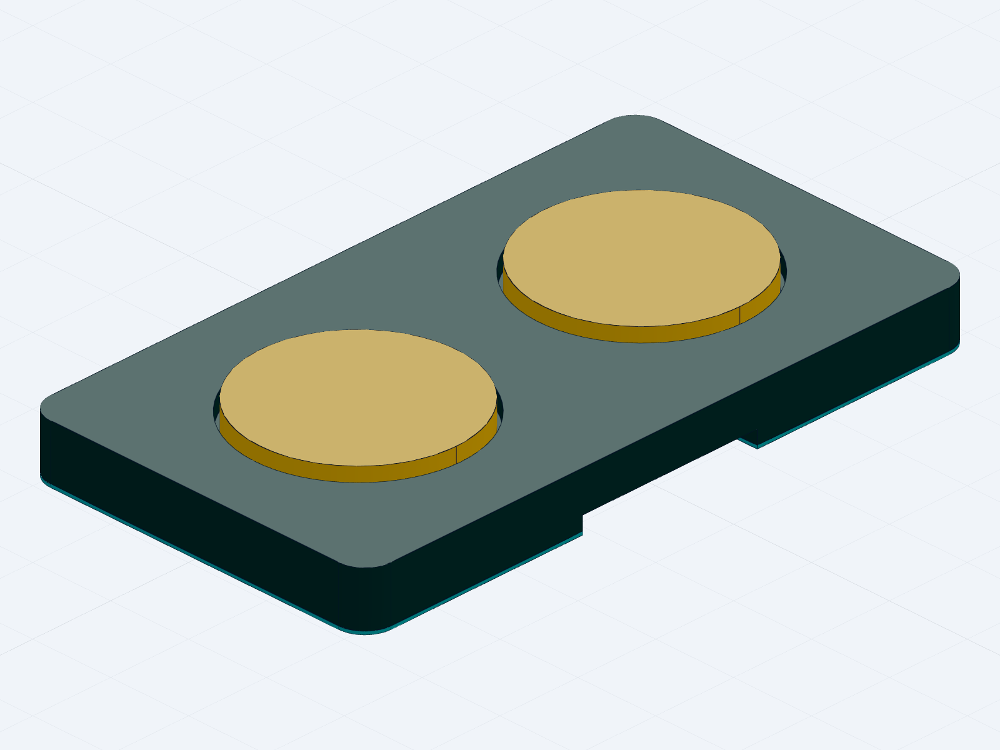

# 平顺贴肤面＋外围胶粘方案

2026-10-14｜当前推荐候选，已建模，未完成打印、粘接或佩戴验收。板子尚未到货。沿用本目录CAD；三扣边版停止作为贴肤方案推进。

## A｜外形和连接



`皮肤 → Φ9×1.2圆片 → 背面中央弹片接触 → F04焊盘／走线 → 17根尾线 → 外置R01`

`织带承力 → TPU外缘及局部固定 → 圆片承台；软板保持弯曲余量，不承受织带拉力`

| 部件 | 当前方案 |
|---|---|
| 贴肤面 | 连续TPU；外框与触点座一体，无高出圆片的扣边 |
| 圆片 | 承台承托＋背面外围薄胶防脱；固定式，无独立浮动行程 |
| 背面中央 | Φ7窗口，保持无胶，给弹片直接接触金属 |
| 弹片 | 底脚焊F04，弹臂接触圆片；实际BW焊位、允许压缩及接触力待核 |
| 软板 | 整条从背面装入，不剪板；局部补强与胶区待弯曲试装确认 |
| 织带 | 最后固定，保护软板背面；不设整块硬底盖 |

名义圆片最终突出0.5mm；含胶、不含织带总厚3.006mm，均为CAD值。表带之外的R01主舱、尾线及扣具仍需完善，不能将此图当作整机完成。

## B｜胶应该在哪里

```text
                 圆片贴肤面：不涂胶
        ┌────────────────────────┐
        │       金属圆片         │
        └───┬────────────────┬───┘
       外围薄胶            外围薄胶
        TPU承台            TPU承台
                 中央留空
                    ↑
              弹片接触圆片背面
                    ↓
                 F04软板
```

这是剖面示意，不按比例。模型环胶外径8.9mm、内径7.1mm、厚0.05mm，仅为叠层假设，不是已验证的点胶量或施工公差。

允许区域：圆片背面外围与承台之间。禁止区域：金属贴肤面、背面中央接触区、弹片活动部分、FPC弯折桥、焊盘和尾端接线区。不要填满整个圆片口袋，不整条灌封。0.2mm名义径向间隙不能当作已验证的容胶槽。

材料还没有定型：需实际TPU95A品牌、金属材质／镀层，与胶厂资料核对粘接相容性、固化条件和可能接触皮肤的限制。柔性胶只是候选方向；“柔性”“无味”均不能证明粘得牢或适合贴肤。无依据不指定型号、点胶量、固化时间或底涂剂。

## C｜干装与正式装配

| 顺序 | 动作 | 检查／停止条件 |
|---|---|---|
| 1 | 打印三排TPU空件，检查承台、孔口、薄面和毛刺 | 无裂纹、翘曲；圆片轻放能就位，不强塞 |
| 2 | 不涂胶，把圆片从正面放在承台上；保持正面朝上 | 检查边缘及突出量。干装没有防脱，翻转前取出或用独立托具保持，不能凭摩擦认为已固定 |
| 3 | 到板后先核BW脚位、焊接和支撑，再用夹具保持圆片做背面接触／整板试装 | 核真实弹片工作高度和导通；不能用胶填高度错误，不能强压弹片 |
| 4 | 将电子件与待粘TPU分离，在单个圆片试件上验证胶材与工艺 | 按胶厂说明处理同批TPU和金属；清洁／底涂须有材料相容性依据 |
| 5 | 在外围允许区域施少量受控胶，圆片正面放入，用定位夹具保持高度 | 不挤胶到中央或贴肤面；记录胶型、批次、用量及夹具定位方法。没有定厚方法不能承诺0.05mm |
| 6 | 按胶厂完整固化条件等待，取下夹具后检查 | 无溢胶、翘起、松动或明显胶层缺陷；重新测突出量，缺陷件返工或报废 |
| 7 | 安装已经单独焊接、冷却并电测的F04及弹片，从背面整体放入 | 无夹板；每片圆片接触稳定；胶不能流动或污染弹片 |
| 8 | 三排逐渐轻弯，确定软板滑移及胶区后再固定织带 | 拉紧、折痕、触点断续立即停；通过后才扩大至整条 |

**干装时的高度与粘完不同：** 无胶且完全落座时，金属背面名义Z=1.606mm，突出约0.45mm；0.05mm假设胶层形成后背面Z=1.656mm，突出0.50mm。因此不能用无胶强压状态验证最终弹片预压。实际突出量需用固化后的样件测量。

胶的作用是防脱；承台负责定位和承托。弹片对胶接的持续顶力、真实接触压力仍未测，不能宣称“粘好后一定稳定”。

## D｜先验证一个，再扩大

| 阶段 | 要留下的记录 | 通过条件 |
|---|---|---|
| 无电子件单片 | 固化前后高度、胶区照片、翻转及轻推后的变化 | 无脱落／边缘翘起；贴肤及中央接触区无胶 |
| 装实际弹片 | 工作高度来源、平直／轻弯接触电阻、表笔电阻及采样能力 | 无未解释断续；符合弹片允许工作范围 |
| 三排装配 | 固定区域、软板滑移、第一次异常姿态 | 软板无被迫拉伸或折痕，焊区不受拉 |
| 粘接耐受 | 按真实使用动作确定载荷及循环；同批样片对比 | 固化后弯折／轻推不松动；具体力和次数在试验前冻结 |
| 佩戴前 | 金属边缘、表面、材料资料与独立电气安全复核 | 通过后才短时佩戴；单次舒适不等于长期耐汗／过敏或寿命认证 |

胶固定的代价是拆修困难。拆修须先断电、分离软板，再处理胶接；不要从背面推弹片顶出圆片，不用未经材料核实的溶剂或加热方式。剥离时破坏承台的TPU件需要更换。

## E｜使用哪些文件

- [整条装配STEP](assembled.step)、[背部安装状态STEP](loading.step)、[双触点STEP](row.step)：当前无凸起扣边基线。
- `f04-three-row-trial`（三排 TPU 打印与试装）：继续使用此候选。胶材确定前仅干装；尚未实打验收。
- [台架验收表](../r01-bench/BENCH-ACCEPTANCE.md)：记录实际尺寸、接触和弯曲。
- [电安全须知](../../../SAFETY.md)：R01外置、电池无线、独立安全复核与佩戴门槛。

本轮没有重建已确认几何，也没有验证任何胶型号。新方案是取消扣边路线，统一到平顺TPU＋可验证的局部胶接工艺。
