# OpenEMG 模块化硬件家族总览（2ch / 8ch / 16ch 共用主控与壳体）

> [!IMPORTANT]
> **人工审核准备下单 vs AI 生成未下单（下单前必读）**
> - **唯一经人工硬件工程师设计并逐脚审核通过、准备下单的版本**：[`16ch-afe-hirose-1mm-1nf/`](16ch-afe-hirose-1mm-1nf/)（`OpenEMG v0.01` 双板：6 层 `C08B-U9` 主控板 + 带 32 路 `ESD401DPYR` 输入保护管的广濑 `1.0 mm` `1 nF` 4 层采集板，146 个贴片位号，已对照 TI `ADS1298` 数据手册与 `SBAU171D` 逐脚审核通过，准备打样做离体台架首测）。
> - **其余 AI 生成设计（尚未人工审核 · 尚未下单）**：除历史 8 路台架开发板 [`8ch-ads1298/r01-bench/`](8ch-ads1298/r01-bench/) 已做过离体实板测试外，本目录其余版本——包括 `16ch-u9-dual30/`（`22 pF` 穿戴派生版）、`16ch-afe-xunpu-2mm-1nf/`、`16ch-c08b-round/`（双 34 针 `D20/R4U6`）、`8ch-ads1298/afe-d20*-8ch/`、`2ch-ads1292/`、全部柔性电极软板（FPC）及全部 3D 打印外壳——均为 AI 生成参考设计，**尚未经人工工程师逐板审核，也尚未下单打样**。

**AI 结构与叠板探索 · 新版 16 通道小型化派生双板（双 30P 四层软板 + `9.60 mm` 超薄圆润手表壳，DRC 0 / 飞线 0，AI 生成未下单）**　[U9 圆角 6 层 `0.80 mm` 双核主控 `OpenEMG-C08B-Mainboard-Rev0.01`、超薄双 30P 4 层 `0.80 mm` 采集板 `AFE-30P`、双 30P 四层保护软板 `strap-fpc-30p` 与圆润无外露螺丝手表壳 `enclosure-u9-watch`](16ch-u9-dual30/) 使用东侧 20 芯反序排线直连，已完成：① 主控 `Rev0.01` 恢复 `26.64 × 20.90 mm` 原矩形电池窗（东梁宽 `2.76 mm`）、同步 6 层 `0.80 mm` 真实叠层、去掉中央 `DEBUG` 线框并整洁重排丝印、32MHz 晶振泪滴与 `BUTTON_N` 飞线清零；② `AFE-30P` 升级 `1.00 mm` 超薄上下双触点 30P 座（`C324727`）、`43.10 × 36.50 mm` 四角 `R1.80` 圆角与 `0.80 mm` 四层板厚、`FPC2.17/18` 交叉修正、`ADS1298` `RESV1=GND` 修正、32 颗共模电容空贴 DNP（钢网 64 孔全剥离）+ 16 颗 `22 pF` 差分电容保 CMRR、`C10=1 µF` 飞跨电容、`Inner2` 北数字 `GND`/南模拟 `AGND` 分岛及晶振下完整参考地；③ 配套 `32×100 kΩ + 2×200 kΩ` 贴肤限流双 30P 四层软板及 `46.80 × 40.00 × 9.60 mm` 超薄圆润手表壳（最小壁厚 `0.85 mm`，23 对三维布尔 `0.000 mm³` 零干涉）。下文 `D20 / R4U6 / 8ch / 2ch` 属于双 34 针及入门参考系列，完整保留供对照复刻。

本目录收录 OpenEMG 全系硬件的 **KiCad 10 原生工程**、**嘉立创 EDA 专业版（`.epro2` / `.epcb2`）工程**、**生产制造包（Gerber / BOM / CPL / IPC-D-356，全系 17 套直接上传包清单与 SHA-256 核对见 [ORDER-MATRIX.md](ORDER-MATRIX.md)）** 与 **3D 打印圆润外壳（`build123d` Python + STEP/STL/GLB）**，统一按 **[CERN-OHL-S-2.0](../LICENSE-HARDWARE)** 强互惠开源硬件协议发布。

### 三维光追渲染预览（[`renders/`](renders/)，基于源工程一键复现，非实物照片）

> **边界说明**：以下 8 组 16 张图片均为 Blender Cycles 光追设计预览（哑光黑阻焊 + `#c8964a` 沉金焊盘 + 工程高透壳示意），不代表制造或人体佩戴验收；套件收纳图为模块化开源复刻防静电 EVA 收纳示意，非商业零售包装。复现脚本见 [`renders/README.md`](renders/README.md)。

| 类别 | 正交俯视（Top） | 透视斜视（Iso） |
|---|---|---|
| **1 · 成品总览** 左：16ch `C08B R13` 整表正反双姿态 右：2ch `ADS1292 R7` 一体盒正反双姿态 | 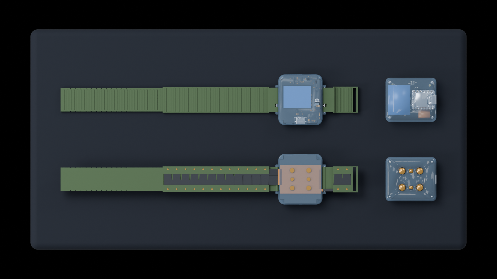 | 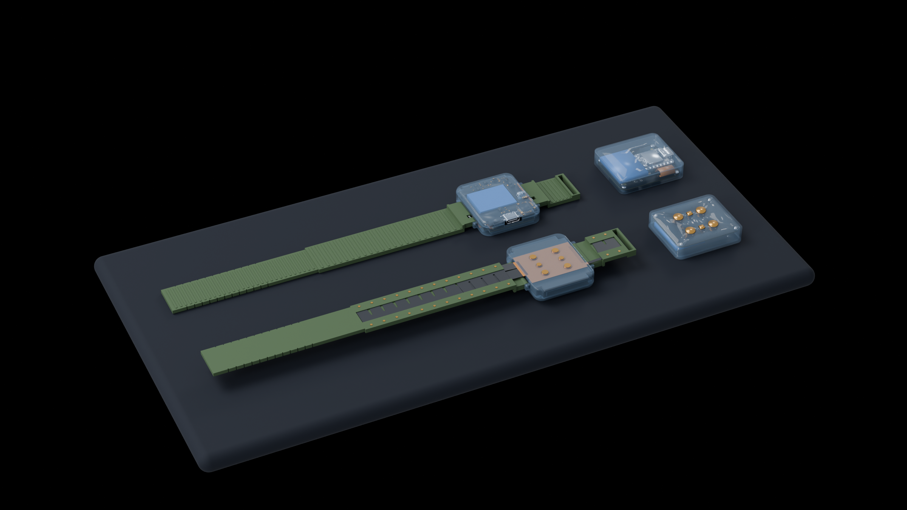 |
| **2 · 开源复刻套件收纳示意** `C08B` 胶囊 + `8ch/2ch` 可换采集板 + `P44e` + `34P` 软板 + `Pod D1` | 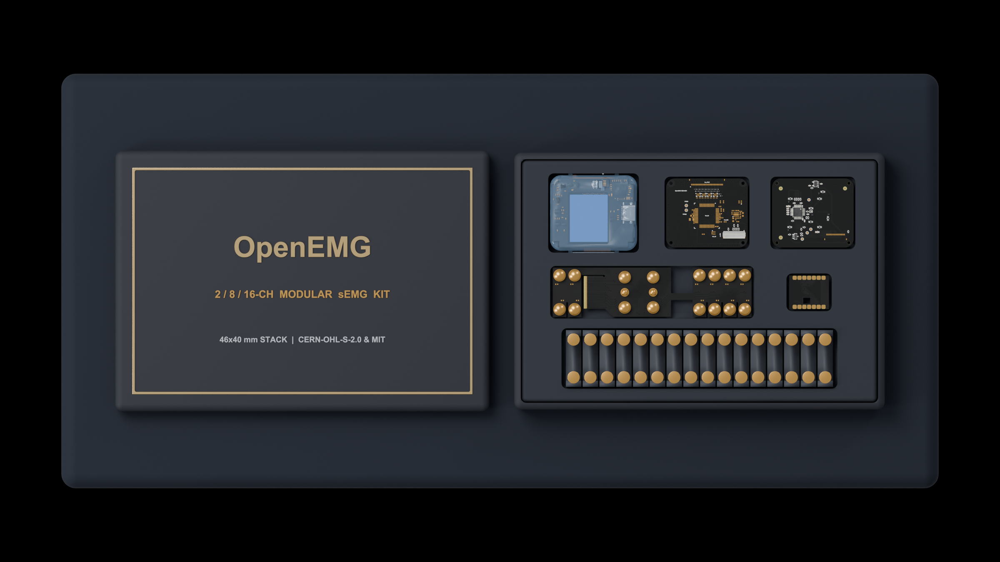 | 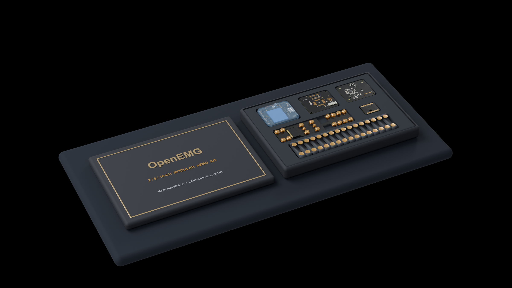 |
| **3 · 三档叠板立体爆炸组装图** 左 `16ch R13` · 中 `8ch D20-8CH` · 右 `2ch R7` | 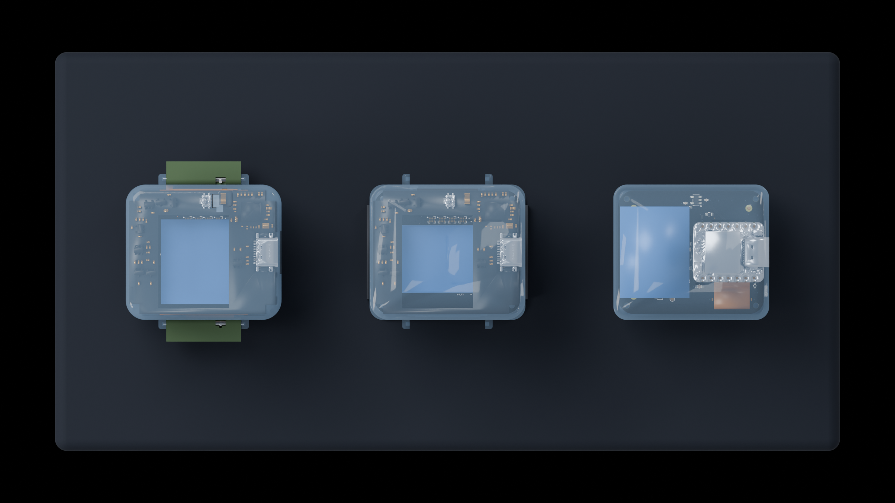 | 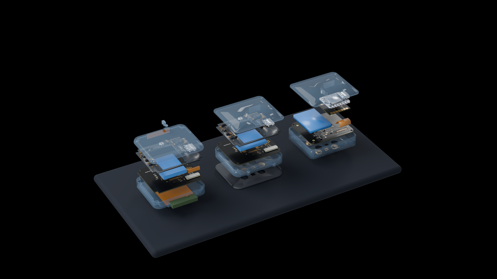 |
| **4 · 柔性电极表带系统** `16ch D2` A/B 软板 + `8ch D2-8CH` 单片软板 + `0.8 mm` TPU 定位层 + `F04` 连续表带 | 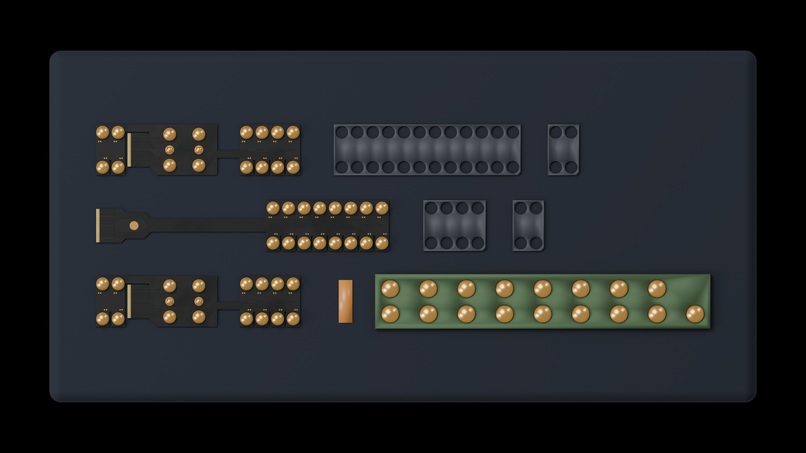 | 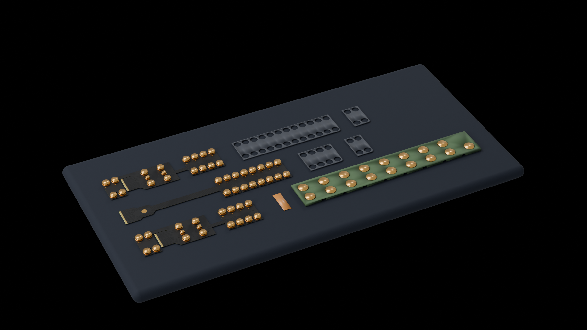 |
| **5 · 贴肤镀金干电极微距** `2ch` 板底六触点 + 外扣六孔底盖 `Cap D2` + `Pod D1` 单豆分解与 16 节织带阵列 | 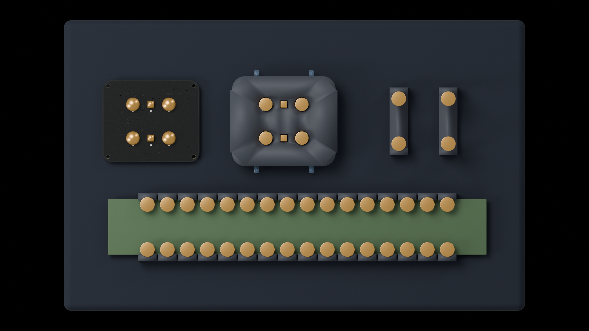 | 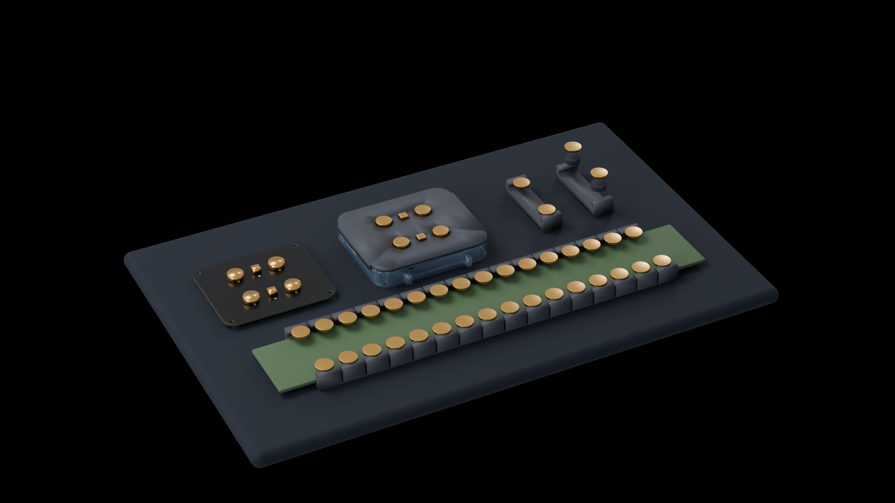 |
| **6 · C08B 双板与胶囊叠装总览** 左：采集板 `D20` · 中：主控 `R4U6` · 右：叠装透视 | 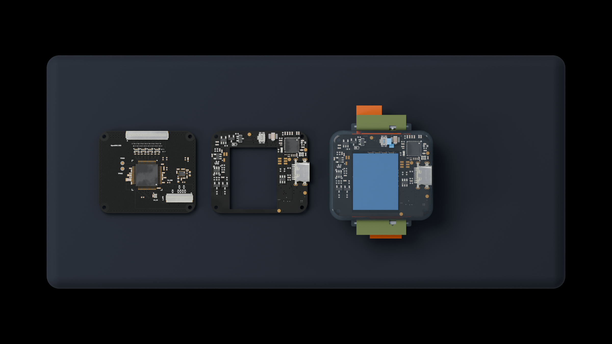 | 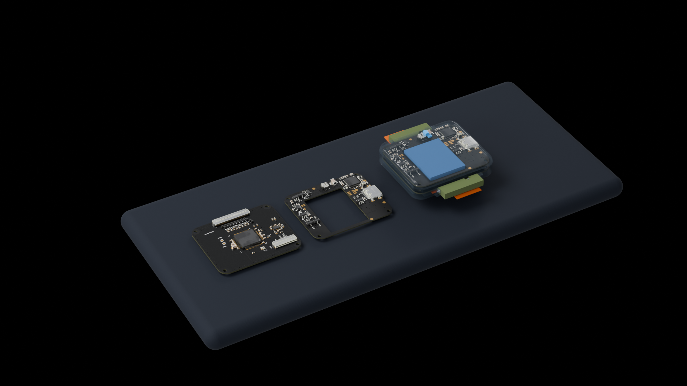 |
| **7 · 下板：采集板 `D20`** | 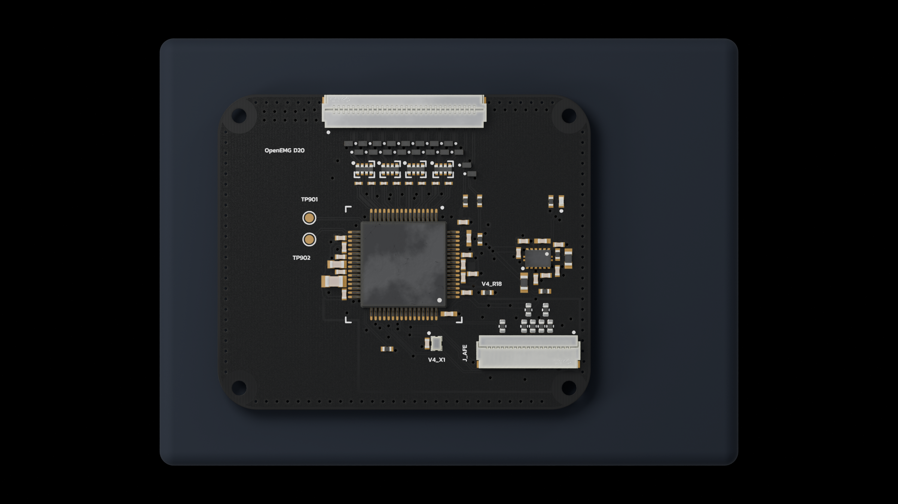 | 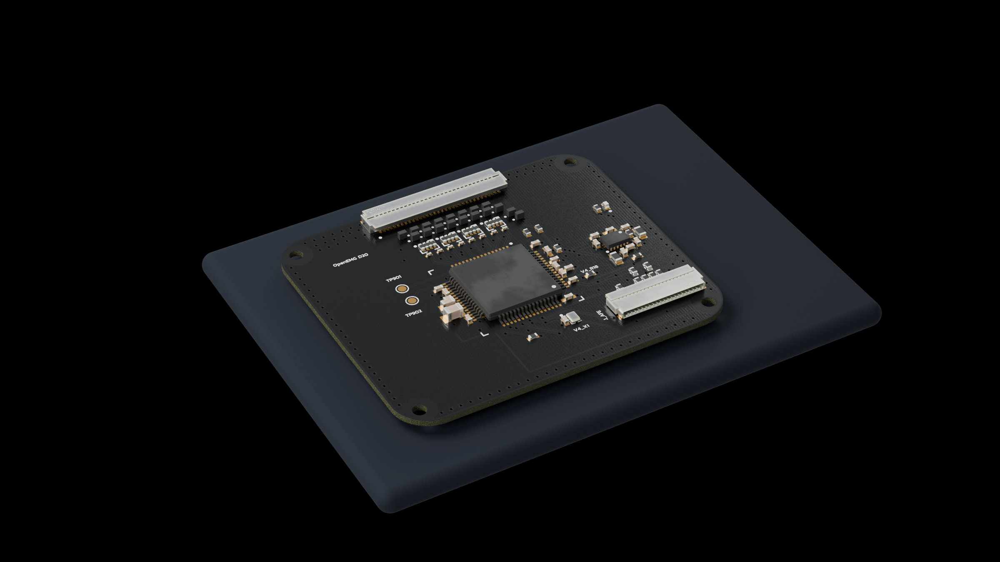 |
| **8 · 上板：共用主控 `R4U6`** | 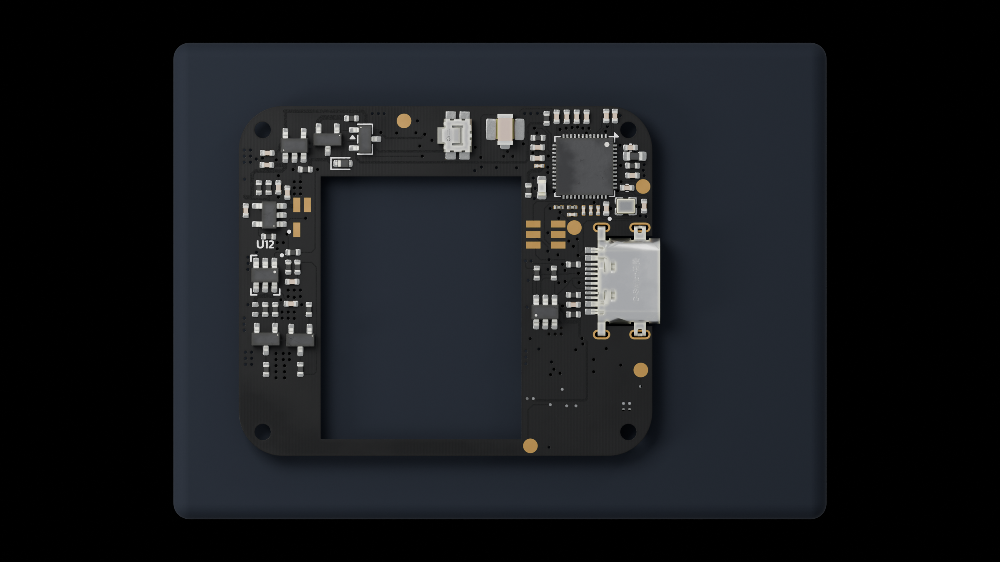 | 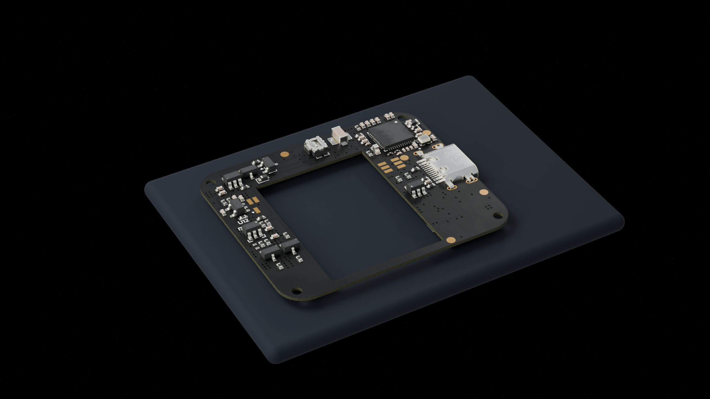 |

---

## A · 为什么 2 / 8 / 16 通道能共用同一个主控板与外壳家族？

三档穿戴采集板均采用完全相同的 **`43.10 × 36.50 mm`** 四层板框包络（同时提供配四角螺丝柱外壳 `R12` 的**圆孔版 `R4U6 / D20 / D20-8CH`**，以及配无螺丝抱柱外壳 `R13` 的**四角缺口版 `R4U6N / D20N / D20N-8CH`**，同档位两版 BOM/CPL 与走线 100% 一致），并统一使用东南角的 **20P `0.5 mm` 下接 FPC 座（`FH34SRJ-20S-0.5SH(50)`，立创 `C2802370`，开口均朝南）** 进行上下叠板互联，由 `firmware/c08b-bringup` 上电免跳线自动识别 `2ch / 8ch / 16ch`：

| 主控 `J_AFE` 脚号 | 共用主控 `R4U6` 网名 | 对应采集端脚号 (`21-k`) | `16ch D20` 网名 | `8ch D20` 单面贴网名 | `2ch ADS1292` 网名 | 兼容性结论 |
|---:|---|---:|---|---|---|---|
| `1, 2` | `3V3_AFE` | `20, 19` | `3V3` | `3V3` | `3V3` | ✓ 3.3V 供电直通 |
| `3` | `NC` | `18` | `ADS_CLKSEL`（板内下拉） | `ADS_CLKSEL`（板内下拉） | `NC` | ✓ 无冲突 |
| `4` | `ADS_DRDY_A` (`PA2`) | `17` | `ADS_DRDY_A` | `ADS_DRDY_A` | `ADS_DRDY_N` | ✓ 主片中断对齐 |
| `5` | `AFE_GPIO3` (`PA0`) | `16` | `AFE_GPIO3` | `AFE_GPIO3` | `NC` | ✓ 无冲突 |
| `6` | `DOUT_B` (`SPI1_MISO`) | `15` | `DOUT_B` | `DOUT_B` | `ADS_DOUT` | ✓ MISO 对齐 |
| `7, 9, 20` | `GND`（`8` 悬空） | `14, 12, 1` | `GND` | `GND` | `GND`（`13` 亦地） | ✓ 多点地回流对齐 |
| `10` | `AFE_SCLK` (`SPI1_SCK`) | `11` | `SCLK_B` | `SCLK_B` | `MCU_SCLK` | ✓ SPI 时钟对齐 |
| `11` | `AFE_CS_A` (`PB0`) | `10` | `ADS_CS_A` | `ADS_CS_A` | `ADS_CS_N` | ✓ 主片选对齐 |
| `12` | `AFE_START` (`PA3`) | `9` | `ADS_START` | `ADS_START` | `ADS_START` | ✓ 硬件同步启动对齐 |
| `13` | `NC` | `8` | `AFE_CLK_IN`（板载晶振） | `AFE_CLK_IN`（板载晶振） | `NC`（内部时钟） | ✓ 无冲突 |
| `14` | `AFE_RESET` (`PA8`) | `7` | `ADS_RESET` | `ADS_RESET` | `NC` | ✓ `ADS1292` 复位并入 `PWDN` |
| `15` | `AFE_PWDN` (`PA1`) | `6` | `ADS_PWDN` | `ADS_PWDN` | `MCU_PWDN` | ✓ 硬件掉电/复位对齐 |
| `16` | `AFE_DIN` (`SPI1_MOSI`) | `5` | `DIN_B` | `DIN_B` | `ADS_DIN` | ✓ MOSI 对齐 |
| `17` | `AFE_CS_B` (`PB1`) | `4` | `ADS_CS_B` | 空贴 `V4_U2` | `NC` | ✓ 2ch/8ch 悬空安全 |
| `18` | `AFE_DRDY_B` (`PA4`) | `3` | `ADS_DRDY_B` | 空贴 `V4_U2` | `AVDD_SENSE`（串 `100kΩ`） | ✓ 16ch 从片中断 / 2ch 读 3.0V 模拟电 |
| `19` | `NC`（`P44e` 上为 `5V`） | `2` | `NC` | `NC` | `XIAO_5V`（`10kΩ` 下拉） | ✓ 接 `R4U6` 时由主控切断 `3V3_AFE` 互锁；接 `P44e` 时驱动 `Q1` 互锁 |

### 机械坐标对位说明（板中心 `(0, 0)` 口径）
- **主控 `R4U6` 底面 `J_AFE`**：焊盘中心群 `(+14.34, -10.50) mm`（排线插口基准 `-11.75 mm`）
- **`8ch / 16ch D20` 顶面 `J_AFE`**：焊盘中心群 `(+14.34, -10.50) mm`（插口基准 `-11.75 mm`，与 `R4U6` **`0.00 mm` 完全正对**，短 U 形排线直连）
- **`2ch ADS1292` 顶面 `J2`**：`(+12.00, -11.40) mm`（与入门上层板 `P44e` `0.00 mm` 正对；若改配 `R4U6` 主控叠装，横向仅偏 **`2.34 mm`**，选用约 `25 mm` 长的 0.5 mm 20P 软排线微斜过渡即可）。

---

## B · 嘉立创 EDA 专业版工程文件（`.epro2` / `.epcb2`）快速索引

直接在**嘉立创 EDA 专业版（客户端 V2.2+ / 网页版）**选择「文件 → 导入 → 嘉立创EDA专业版」即可打开带完整原理图、多层 PCB 与 3D 预览的工程：

| 档位与用途 | 工程文件路径 | 说明 |
|---|---|---|
| **16ch `v0.01` 双板合并工程 + 广濑 `1.0 mm` `1 nF` 台架采集板（人工审核 · 准备下单）** | `16ch-afe-hirose-1mm-1nf/OpenEMG_v0.01_DualBoard.epro2` `16ch-afe-hirose-1mm-1nf/kicad/` `16ch-afe-xunpu-2mm-1nf/AFE-30P.epro2` | **2026-11-15 人工工程师逐脚审核定版、准备下单的双板工程**，采集板 D101–D132 共 32 颗 ESD401、146 个贴片位号（`01 主控板` + `02 采集板` 四角 `R1.80` 圆角、现货 `0603 R4=104kΩ C861070`、广濑 `1.0 mm` 双 30P + `1 nF` 差分网络，含同步单板 Gerber/BOM/CPL 及 1:1 导出的 KiCad 8 原生双板与九页原理图 `kicad/`）；附 AI 派生讯普 `2.0 mm` 对照版（未下单） |
| **16ch 6 层圆角主控 `Rev0.01` + 超薄双 30P `22 pF` 穿戴派生版（AI 生成 · 未下单）** | `16ch-u9-dual30/OpenEMG-C08B-Mainboard-Rev0.01.epro2` `16ch-u9-dual30/AFE-30P.epro2` | AI 结构与叠板派生参考：6 层 `OpenEMG-C08B-Mainboard-Rev0.01` + 4 层 `0.80 mm` 圆角 `R1.80` 超薄双 30P（`C324727`）`AFE-30P`（`22 pF` 差分网络，含 `fab-mcu-u9/`、`fab-afe-30p/` 与 KiCad 四层软板 `strap-fpc-30p/`，尚未人工审核、尚未下单） |
| **16ch 圆孔全套汇总（配 `R12` 壳）** | `16ch-c08b-round/jlc-eda/C08B-全套汇总-主控R4U6-采集D20.epro2` | 同时包含 `R4U6` 主控板、双面 `D20` 采集板与双软板原理图 + 四层 PCB |
| **16ch 缺口全套汇总（配 `R13` 壳）** | `16ch-c08b-round/jlc-eda/C08B-全套汇总-主控R4U6N-采集D20N.epro2` | 同时包含四角缺口主控 `R4U6N`、双面缺口采集板 `D20N` 与双软板原理图 + 四层 PCB |
| **16ch 采集板独立工程（圆孔 / 缺口）** | `16ch-c08b-round/jlc-eda/C08B-AFE采集板-D20-原理图+PCB+3D.epro2` `16ch-c08b-round/jlc-eda/C08B-AFE采集板-D20N-缺口-原理图+PCB+3D.epro2` | 16ch 双面采集板单板工程（圆孔版与四角缺口版） |
| **8ch 纯单面圆孔全套汇总（配 `R12` 壳）** | `8ch-ads1298/afe-d20-8ch/jlc-eda/C08B-8ch全套汇总-主控R4U6-采集D20-8CH单面.epro2` | 同时包含 `R4U6` 主控、纯单面 `D20-8CH` 采集板与单片 4 层软板 `D2-8CH` + 9 页原理图 |
| **8ch 纯单面缺口全套汇总（配 `R13` 壳）** | `8ch-ads1298/afe-d20n-8ch/jlc-eda/C08B-8ch全套汇总-主控R4U6N-采集D20N-8CH单面.epro2` | 同时包含 `R4U6N` 缺口主控、纯单面缺口 `D20N-8CH` 采集板与单片软板 `D2-8CH` + 9 页原理图 |
| **8ch 纯单面采集板独立工程（圆孔 / 缺口）** | `8ch-ads1298/afe-d20-8ch/jlc-eda/C08B-AFE采集板-D20-8CH-单面8路-原理图+PCB+3D.epro2` `8ch-ads1298/afe-d20n-8ch/jlc-eda/C08B-AFE采集板-D20N-8CH-缺口单面8路-原理图+PCB+3D.epro2` | 纯单面 8 路采集板（正面 76 颗贴片，背面 0 器件绿油绝缘） |
| **8ch 单片 4 层表带软板 `D2-8CH`** | `8ch-ads1298/strap-fpc-d2-8ch/jlc-eda/C08B-表带软板-D2-8CH单片.epro2` | 单片 4 层 34P 软板（胶囊底双辅助 `200k` 串阻 + 6 窗 `0.20 mm` PI 垫片复用现成底盖） |
| **共用主控 `R4U6` / `R4U6N` 源板** | `common-mainboard/mainboard-r4u6/C08B-main-R4U6.epcb2` `common-mainboard/mainboard-r4u6n/C08B-main-R4U6N.epcb2` | 主控板定稿四层 `0.6 mm` PCB 源文件（圆孔版与四角缺口版） |
| **入门上层 `P44e` XIAO 转接板** | `common-mainboard/adapter-p44e-xiao/jlc-eda/P44e-XIAO转接板-0.8mm-PCB+3D.epro2` | `17.78 × 21.00 mm` 双层（2 层）`0.8 mm` XIAO 转接主控工程 |
| **入门 2ch `ADS1292` 六触点载板** | `2ch-ads1292/jlc-eda/ADS1292-2ch-R9-原理图+PCB+3D.epro2` | 原理图 R9 + 四层 `0.8 mm` 底面六触点 PCB + 47 颗贴片 3D |
| **8ch 柔性电极软板 `F04`** | `8ch-ads1298/jlc-eda/F04-八通道软板-原理图+PCB.epro2` | 八通道双层（2 层）FPC 柔性电极软板嘉立创工程参考 |

> **关于嘉立创 `.epro2` 与离线整板 3D 模型的说明**：嘉立创 `.epro2` 内部记录器件的云端 3D UUID，在嘉立创 EDA 专业版客户端联网打开会自动拉取立创商城 3D 预览；若使用 **FreeCAD / Fusion 360 / SolidWorks / Bambu Studio** 离线查看或做结构干涉核查，请直接使用下方已嵌齐全部器件的独立 `-3d.step`、`.stl`、`.3mf` 与 `.f3d` 文件。

---

## C · 全系 3D 模型、参数化 CAD 源码与打印切片包索引

### 1. 满载器件整板三维模型（20 块 `-3d.step`，已通过缺件零容忍门禁导出）

| 模块 | 整板 STEP 路径 | 说明 |
|---|---|---|
| **16ch 旗舰 6 层双核主控 `MCU-U9`（`Rev0.01`）** | `16ch-u9-dual30/mcu-u9-3d.step` | `0.80 mm` 6 层基板 + `STM32L432`、`nRF52840`、沉板 `USB-C`、`26.64×20.90 mm` 原矩形电池窗及双面 110 颗器件实体（588 solids） |
| **16ch 旗舰超薄双 30P 采集板 `AFE-30P`** | `16ch-u9-dual30/afe-30p-3d.step` | `43.10×36.50 mm` 四角 `R1.80` `0.80 mm` 板框 + 双 `ADS1298` + 双 `1.00 mm` 30P 座 `C324727` 共 82 颗贴片实体（306 solids，已移除 32 颗 DNP 共模电容） |
| **16ch 旗舰双 30P 四层表带软板（A/B 片）** | `16ch-u9-dual30/strap-fpc-30p/strap-30p-{a,b}-3d.step` | 适配正反 30P 座 `1.524 mm` 错位金手指 + `32×100k + 2×200k` 限流串阻 + 镀金贴肤电极片 |
| **共用双核主控 `R4U6`（圆孔）** | `common-mainboard/mainboard-r4u6/c08b-mainboard-r4u6-3d.step` | 配螺丝壳 `R12`，含 `STM32L432`、`nRF52840`、沉板 `USB-C`、20P 座等全器件 |
| **共用双核主控 `R4U6N`（四角缺口）** | `common-mainboard/mainboard-r4u6n/c08b-mainboard-r4u6n-3d.step` | 配无螺丝抱柱壳 `R13`，精确四角缺口轮廓 + 全器件 3D 实体 |
| **入门 `XIAO` 转接板 `P44e`** | `common-mainboard/adapter-p44e-xiao/p44e-3d.step` | 含官方 `Seeed XIAO nRF52840` 模块、底面 `J1` 20P 座与互锁阻容二极管 |
| **入门 2ch `ADS1292` 一体板** | `2ch-ads1292/board/ads1292-2ch-3d.step` | 含 `ADS1292`、`J2` 20P 座、ESD 阵列及底面两排 6 颗镀金电极铜片 |
| **8ch 纯单面专属叠板 `D20-8CH`（圆孔）** | `8ch-ads1298/afe-d20-8ch/afe-d20-8ch-3d.step` | 配 `R12` 壳，顶面 76 颗贴装件满载，背面 0 器件绿油绝缘 |
| **8ch 纯单面专属叠板 `D20N-8CH`（缺口）** | `8ch-ads1298/afe-d20n-8ch/afe-d20n-8ch-3d.step` | 配无螺丝壳 `R13`，四角缺口板框 + 顶面 76 颗贴装件满载 |
| **8ch 单片 4 层表带软板 `D2-8CH`** | `8ch-ads1298/strap-fpc-d2-8ch/strap-d2-8ch-3d.step` | 单片直插 `V4_FPC1`，含 16+2 镀金电极铜片与 100k/200k 保护串阻 |
| **8ch 共板单面贴兼容版** | `8ch-ads1298/stacked-d20-8ch/c08b-afe-d20-8ch-single-3d.step` | 16ch 裸板顶面 76 颗满贴、底面 51 颗从片支路空贴（`--no-dnp` 构型） |
| **8ch 台架开发板 `V12-R01`** | `8ch-ads1298/r01-bench/v12-r01-3d.step` | 含 `ADS1298`、`J1` 2×8 排针座、`J3` Micro-Fit 3.0 电极座及全部 198 颗实物器件 |
| **8ch 柔性表带软板 `F04`** | `8ch-ads1298/f04-strap-fpc/fpc-f04-3d.step` | 含 17 处 `Harwin S7231` 弹片名义包络 |
| **16ch 旗舰双面采集板 `D20`（圆孔）** | `16ch-c08b-round/afe-d20/c08b-afe-d20-3d.step` | 配 `R12` 壳，正反双面双 `ADS1298` + 双 34P 座 + 20P 座共 127 颗器件满贴 |
| **16ch 旗舰双面采集板 `D20N`（缺口）** | `16ch-c08b-round/afe-d20n/c08b-afe-d20n-3d.step` | 配无螺丝壳 `R13`，四角缺口板框 + 正反双面 127 颗器件满贴 |
| **16ch 表带软板 `D2`（A/B 片）** | `16ch-c08b-round/strap-fpc-d2/strap-{a,b}-3d.step` | 含 100k/200k 保护串阻与皮肤面镀金电极铜片 |
| **16ch 表带软板 `R15`（A/B 片）** | `16ch-c08b-round/strap-fpc-r15/strap-{a,b}-3d.step` | 适配一体成型 TPU 表带入口的 34P 四层双片软板 |

### 2. `46 × 40 mm` 圆润外壳与表带结构件（STEP / STL / 3MF / GLB / Fusion `.f3d`）

| 结构套件 | 目录 | 交付格式与内容 |
|---|---|---|
| **16ch 旗舰圆润无外露螺丝手表壳 `U9-Watch`** | `16ch-u9-dual30/enclosure-u9-watch/` | `build.py` / `fit_3d_check.py`（全量 23 对三维布尔 `0.000 mm³` 零干涉 + 9 处三维壁厚探针 `≥ 0.85 mm` + 6 组正反例）+ 单件 `tray` / `cover` / `side_button` / `cap_bottom` (`.step`/`.stl`) + 满载双板/电池/双软板 `assembly` / `exploded` (`.step`/`.glb`)，主体净高 **`46.80×40.00×9.60 mm`** |
| **8/16ch 四角螺丝柱透明壳 `R12`** | `enclosure-46x40/c08b-shell-r12/` | `build.py` / `check.py` + 单件 `tray` / `cover` / `switch_plunger` / `standoff` (`.step`/`.stl`) + `assembly`/`exploded` (`.step`/`.glb`) + 外扣六孔底盖 `capsule-cap-d2/` (`.step`/`.stl`/`.3mf`) + 一体表带切片 `slice-tpu-x2d-20261109/` (`.3mf`) |
| **8/16ch 无螺丝缺口抱柱壳 `R13`** | `enclosure-46x40/c08b-shell-r13-notch/` | `build.py` / `check.py` + **Fusion 360 原生源档 `.f3d`** + 单件 `tray` / `cover`（带定位销）/ `switch_plunger`（带导向脚）/ `lug_test_22mm` / 军绿表带 (`.step`/`.stl`) + 总装/爆炸 (`.step`/`.glb`) |
| **2ch 六触点叠板壳 `R7`** | `enclosure-46x40/ads1292-shell-r7/` | `model.py`（自包含读取 `sources/XIAO-nRF52840-v15.step`）+ 总装 `host.step` + 单件可打印 `shell.step` / `lid.step` / `ads1292-r7-{shell,lid}.stl` + 1:1 纸样 PDF |
| **16ch 表带 `0.8 mm` TPU 定位层 `D2`** | `16ch-c08b-round/strap-fpc-d2/tpu-layer-d2/` | `build.py` / `check.py` + 南北段 `layer_d2_{north,south}.{step,stl}` + `layer_d2-X2D-TPU95A.3mf` + 1:1 纸样 PDF |
| **8ch 表带 `0.8 mm` 短版 TPU 定位层 `D2-8CH`** | `8ch-ads1298/strap-fpc-d2-8ch/tpu-layer-d2-8ch/` | 南片缩短 `64.0 mm` 消除悬空盲孔：`layer_d2_8ch_{north,south}.{step,stl}` + `layer_d2_8ch-X2D-TPU95A.3mf` + 1:1 装配与 9448A / PI 垫片裁切纸样 PDF |
| **16ch 独立电极豆 `Pod D1`** | `16ch-c08b-round/pod-d1/` | 穿在现成 `25 mm` 魔术贴表带上的独立 TPU95A 电极豆：`pod_d1.step`、16 连条 `pod_strip_d1.{step,stl}` 与 `pod_strip_d1-X2D-TPU95A.3mf` |
| **8ch 背开口连续 TPU 表带 `F04`** | `8ch-ads1298/f04-openback-tpu/` | 自包含 `build.py` + 单排 `shell.step` / `shell-print.stl` + 9 排连续内衬 `liner.step` / `liner-print.stl` + 背装示意 `loading.step` + 总装 `assembled.step` |
