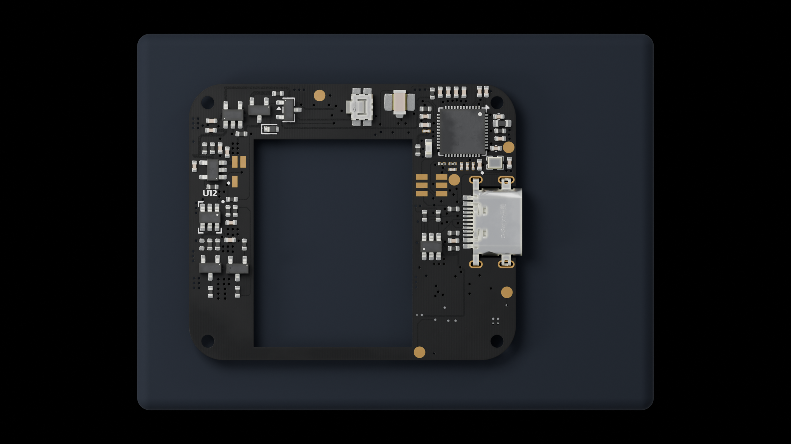
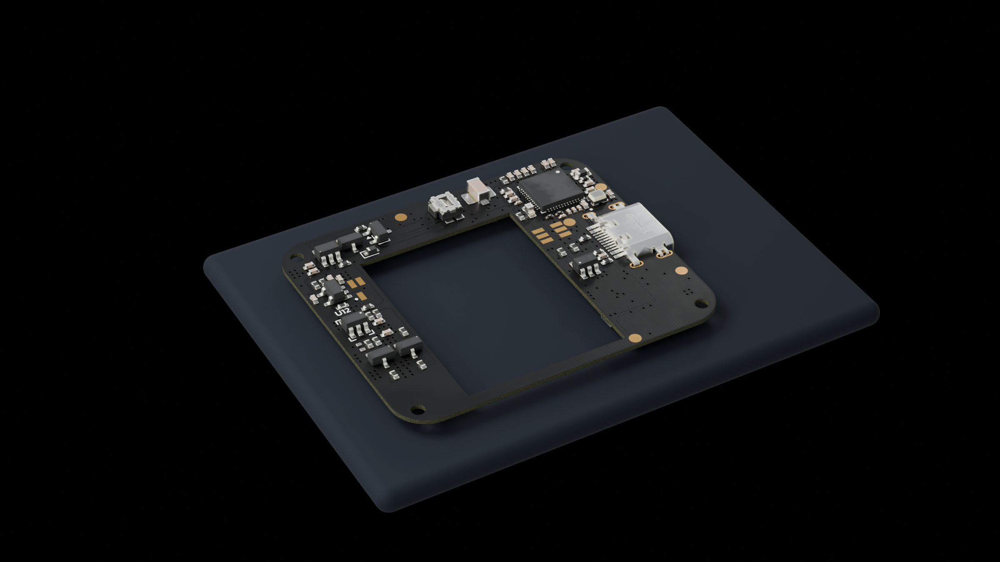

# 共用上层主控模块（`common-mainboard`）

本目录提供两款与下层采集板通过 20P `0.5 mm` 排线座互联的上层主控方案：

| 共用主控 `R4U6` 正交俯视（渲染预览） | 共用主控 `R4U6` 透视斜视（渲染预览） |
|---|---|
|  |  |

1. **`mainboard-r4u6/`（旗舰双核圆孔主控，配螺丝壳 `R12`）**：`43.10 × 36.50 mm` 四层 `0.6 mm` 板（`JLC04061H-3313`），板载 `STM32L432KCU6` + `nRF52840-QFAA` + `LSM6DS3TR-C` + 锂电充电与 USB 硬件互锁（`U18.31 BOOT0 = VBUS_SENSE` 支持插 USB 上电免焊线进 ROM DFU），零跳线自动识别 **2ch / 8ch / 16ch** 全系下层板；含嘉立创源文件 `C08B-main-R4U6.epcb2`、生产制造包、满载器件整板三维模型 **`c08b-mainboard-r4u6-3d.step`**，对应 5 页原理图见 `schematics/`。
2. **`mainboard-r4u6n/`（旗舰双核四角缺口主控，配无螺丝抱柱壳 `R13`）**：电气、4 层走线与 BOM/CPL 与 `mainboard-r4u6` 100% 相同，仅去掉四角安装孔 `H901..H904` 并改为与无螺丝外壳 [`../enclosure-46x40/c08b-shell-r13-notch/`](../enclosure-46x40/c08b-shell-r13-notch/) 抱柱卡合的四角缺口；含 `C08B-main-R4U6N.epcb2`、制造包 `C08B-main-R4U6N-gerber.zip` 与满载整板三维模型 **`c08b-mainboard-r4u6n-3d.step`**。
3. **`adapter-p44e-xiao/`（入门开发板转接主控）**：`17.78 × 21.00 mm` 双层（2 层）`0.8 mm` 转接板，直接焊接市售 `Seeed Studio XIAO nRF52840` 模块，含原生 KiCad 工程、制造包、嘉立创 `jlc-eda/P44e-XIAO转接板-0.8mm-PCB+3D.epro2` 与带 XIAO 模块的整板三维模型 **`p44e-3d.step`**。（注意：`P44e` 的 `J1-19` 脚输出 `5V` 驱动 `2ch-ads1292` 的 USB 互锁，严禁插到未隔离该脚的旧版采集板）。
