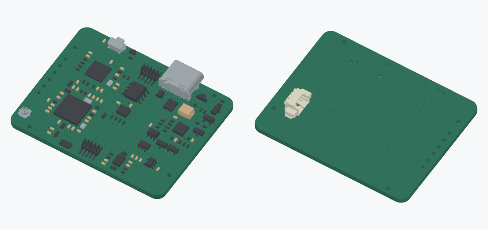

# MAIN V1.0B 主板 STEP

设计外壳或核对插座位置，请下载[带器件的主板模型](OpenEMG-MAIN-V1.0B-PCBA.zip)，解压后用支持 STEP 的 CAD 打开。只需板框和钻孔时，使用[裸板模型](OpenEMG-MAIN-V1.0B-PCB.step)。两个文件共用毫米坐标，俯视正面时原点在板框外接矩形的左下角，板底为 Z = 0。

| 可直接量取的位置 | 模型尺寸或位置（mm） |
| --- | --- |
| 裸板 | 46.00 × 36.50，四角 R2.50。模型厚 1.58615，取自 PCB 设计层叠 |
| 四个 Ø1.20 孔中心 | (2.00, 29.00)、(44.00, 7.50)、(40.25, 35.00)、(5.75, 1.50) |
| 烧录位 H1 | 保留 6 个 Ø1.00 孔，间距 2.54，首件不焊排针 |
| 板对板插座 CN1、CN2 | 贴片中心 (23.00, 3.50)、(23.00, 31.50)，同在正面，中心距 28.00 |
| USB2 | 贴片中心 (31.00, 32.50)，开口朝 +Y。模型口沿伸出板边约 0.99 |
| 电池插座 CN3 | 在反面，贴片中心 (40.70, 11.40)，模型向板底下方伸出约 3.40 |

裸板按本版 [Gerber 与钻孔文件](../fabrication/) 重建。已逐一核对 281 个圆孔和 4 个长槽，包括 USB 固定槽、H1 的孔和 267 个过孔。带器件模型按[首件用料](../assembly/BOM.csv)和[坐标表](../fabrication/CPL.csv)筛选了 127 个位号，正面 126 个、反面 1 个。可在 CAD 装配树中按位号选择。H1 和 R31 均不装。

## 模型精度

- U4 和实际替换的晶振 X1 用最大封装尺寸表示，以便预留空间。U4 为 7.10 × 7.10 × 0.85，X1 为 1.70 × 1.10 × 0.50。两处均省略端子细节。[Nordic 芯片尺寸](https://docs.nordicsemi.com/r/bundle/ps_nrf52840/page/mec_spec.html) · [Abracon 晶振尺寸图](https://abracon.com/Resonators/ABS05.pdf)
- 其余器件取自主板工程关联的嘉立创 EDA 封装模型。USB2 实装为 16 针，工程中的三维外形取自同系列 6 针模型。外壳开口可据此初排，内部触点和插接尺寸请按实贴型号图纸核对。[首韩 USB2 器件图纸](https://datasheet.lcsc.com/datasheet/pdf/2d53d8d8199c9dd6666d9bc9ac7c3a1e.pdf?productCode=C2765186)
- STEP 用于结构设计。制板请使用原 Gerber，贴片请使用首件 BOM 和 CPL。焊后高度、插头进出空间和扣壳间隙仍待首件实测。

主板机械设计随项目使用 [CERN-OHL-S-2.0](../LICENSE-HARDWARE)。器件品牌及其规格图归各自权利人。
