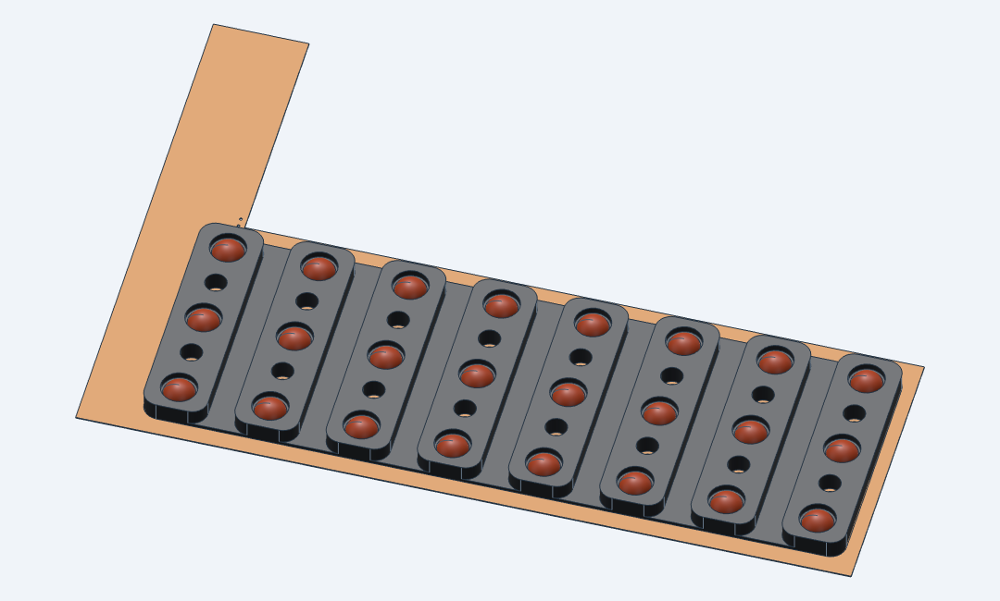
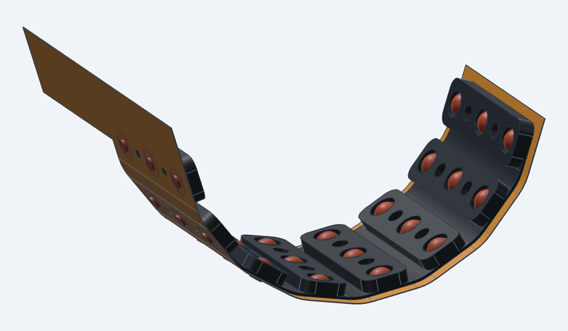

# OpenEMG WB v0.1 八节电极表带

本版为配 OpenEMG AFE V1.0B 采集板及其 20P 腕带软板的机械定版。每条表带有 8 个电极块、24 个铜钉。CAD 已核对孔位和弯曲间隙，X2D 已完成切片。实物焊接、佩戴接触和反复弯折寿命待首件验证。



### 打印和装配

用 TPU 95A 将薄片一侧平放在打印板上，铜钉沉孔朝上。X2D 的 0.4 mm 喷嘴切片每盘一条、无支撑，预计 39 分钟、3.57 g。其他打印机可下载 STL 自行切片。

| 用途 | 文件 |
|---|---|
| 打印表带 | [X2D 切片](print/strap-x2d-tpu95a.3mf) · [通用 STL](print/strap.stl) |
| 修改结构 | [表带 STEP](model/strap.step) · [参数化建模脚本](model/strap.py) |
| 查看装配 | [平放 STEP](model/assembly-flat.step) · [弯曲半径 25 mm 的 STEP](model/assembly-r25.step) |

表带本体 77 × 26 mm，电极块厚 2.30 mm。相邻黑块间距 3.00 mm，缝底由 0.40 mm 厚的 TPU 薄片连成一体。铜钉按杆径 2.00 mm、帽下杆长 2.00 mm 建模。帽径 3.50 mm、帽高 1.20 mm 为试装假设，采购件需核实。按软板厚 0.11 mm 计算，钉头高出黑块 0.40 mm，杆尾露出板背 0.39 mm。装配 STEP 中的软板仅作孔位和装配外形参考。

### 弯曲间隙

以铜钉顶端接触的圆弧为基准，将黑块视为刚体，七道薄片均匀弯曲。贴肤半径为 15、20、25、30、35 mm 时，黑块上角的最小净距依次为 1.80、2.06、2.23、2.35、2.44 mm。[逐缝测量数据](model/gap-clearance.csv)



可在本目录运行以下命令重建打印件及弯曲检查。硬件设计使用 [CERN-OHL-S-2.0](../../LICENSE-HARDWARE)。

```sh
uv run model/strap.py out/flat
uv run model/bent.py model/assembly-flat.step out/bent
```
